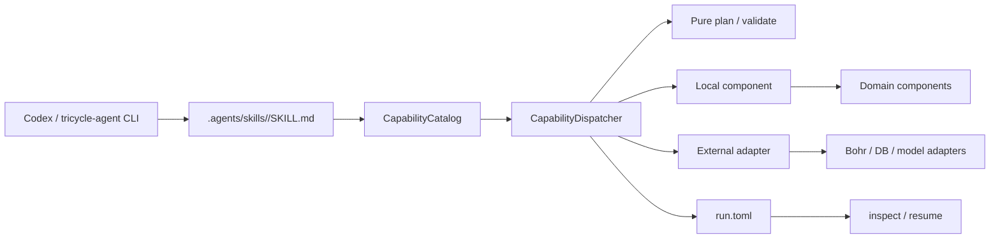
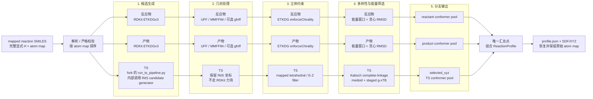

# TriCycle Agent

TriCycle Agent 是面向自动环加成反应探索的智能体项目。它采用 `uv` workspace 管理多个 Python package，通过可独立发现的能力组件把 ReactionOpt、候选采样、Bohr 计算、反应数据库以及 RxnResid/RitS 模型工作流连接起来。

当前项目的重点是建立稳定、可测试、可替换的编排边界。真实的数据库 schema、模型训练命令和平台账号不会被硬编码进组件；它们通过 adapter 注入。Bohr 批量/Gaussian/DPA-Berny 工作流已经具备本地 staging 和生命周期实现，ORCA 则通过通用批量脚本接入同一个计算镜像。

## 1. 架构总览



各层职责如下：

- `apps/tricycle-agent` 是组合应用，创建能力目录、分发能力并提供 CLI；它不是一个自带大模型服务的闭环运行器。
- `packages/tricycle-core` 保存跨组件共享的 `CapabilityManifest`、`CapabilityCatalog`、`TaskPlan`、`TaskResult`、`Artifact`、`ExecutionContext`、`RunStore` 以及外部服务 protocol。core 不依赖具体组件。
- `packages/*` 下的组件将明确的请求模型转换为计划或结果。能力通过稳定的 capability ID 暴露，组件之间不互相读取内部实现。
- adapter 是唯一接触外部系统的边界。默认 `ExecutionContext.dry_run=True`，规划和测试不会读取凭据、访问网络或提交真实任务。
- `tricycle-bohrsubmit` 负责本地任务目录、输入文件、worker 分片和 Bohr 生命周期；`BohrCliGateway` 是生产环境中调用 `bohr` 命令的唯一 subprocess 边界。

### ReactionOpt profile 三分支架构

`reactionopt.profile` 接受一个显式氢完整、原子映射完整的 mapped reaction SMILES。解析和校验通过后，反应物构象、产物构象和 reaction-level RitS TS 分成三条独立数据流；只有在最后一步才组合成 `ReactionProfile`。RitS 分支不依赖另外两条分支的 3D 坐标。



构象分支由 ReactionOpt 侧基于 RDKit 生成并筛选各自的构象池；TS 分支由注入的
`RitsTransitionStateSampler` 执行 fork 中的完整 `run_ts_pipeline.py`，包括 RitS candidate 生成、立体约束
过滤、重原子 Kabsch RMSD 聚类、medoid 预筛选和 staged g-xTB 能量排序。该 fork pipeline 要求
worker 输入使用连续 `1..N` atom map 时，adapter 只在临时输入中重编号，读取 selected TS 后再
恢复用户输入的原始映射，因此最终 profile 的三个结构池共享同一套全局 atom-map 顺序。

这里的 RDKit 构象筛选与 RitS 后处理只有抽象层面的“生成候选、按能量排序、保持结构多样性”相似，
不是同一套算法：RDKit 的 `UFF/MMFF94/GFN-FF` 能量和贪心 RMSD 去重不能替代 RitS 的 stereo
filter、complete-linkage 聚类或配置指定的 g-xTB staged ranking。两条流程的逐项边界见包 README。

更详细的输入合约、调用链、pipeline 参数和输出文件说明见
[`packages/tricycle-reactionopt/README.md`](packages/tricycle-reactionopt/README.md)。

一次自动探索可以按下面的方向串联：

```text
ReactionOpt 生成反应配置
        ↓
Sampling 从候选空间选择下一批
        ↓
Bohr compute / Bohr submit 执行计算
        ↓
Reaction DB 记录结果和 provenance
        ↓
RxnResid / RitS 训练、微调或推理
        ↓
模型结果回到 Sampling，进入下一轮
```

这里的生命周期是推荐的组合方式，不代表所有真实平台 adapter 都已经在本仓库中实现。

## 2. 仓库结构

```text
packages/
  tricycle-core/          公共模型、protocol、能力目录、运行状态和兼容 API
  tricycle-bohr/          通用 Bohr 计算、单任务模型 job 和 gateway 边界
  tricycle-bohrsubmit/    批量 staging、Gaussian/DPA-Berny 和生命周期工作流
  tricycle-reaction-db/   反应记录校验、录入和 repository 边界
  tricycle-sar/           RxnResid 训练/微调/推理任务及 Bohr 提交规划（保留 sar.* 命名）
  tricycle-rits/          RitS 训练/微调/推理任务、命令构造及 Bohr 提交规划
  tricycle-sampling/      候选空间和可替换采样策略
  tricycle-reactionopt/   ReactionOpt 配置、mapped profile 和三分支 RitS pipeline 边界
apps/
  tricycle-agent/         组合能力目录并提供 tricycle-agent CLI
configs/                  TOML 请求和 adapter 策略示例
.agents/skills/           Codex 发现入口，每个能力一个 SKILL.md
skills/                   旧版 Skill 兼容索引
docs/                     架构、插件契约和开发说明
tests/                    不依赖外部服务的 smoke tests
```

组合应用的 CLI、能力分发和运行状态说明见 [`apps/tricycle-agent/README.md`](apps/tricycle-agent/README.md)。

依赖方向保持为：

```text
Codex Skill ──> CapabilityCatalog ──> 组件 ──> tricycle-core
tricycle-sar ────> tricycle-bohr ──> tricycle-core
tricycle-reactionopt ─> tricycle-rits ─> tricycle-bohr ─> tricycle-core
```

组件仍在 [`apps/tricycle-agent/src/tricycle_agent/bootstrap.py`](apps/tricycle-agent/src/tricycle_agent/bootstrap.py) 中显式组合；能力映射在 [`capabilities.py`](apps/tricycle-agent/src/tricycle_agent/capabilities.py) 中声明。这样可以审核每个能力的副作用和 adapter，而不会仅凭目录存在就自动执行代码。

## 3. 当前组件与能力

| Component / legacy Plugin ID | 作用 | Codex 能力 | 包 README |
| --- | --- | --- | --- |
| `tricycle.bohr.compute` | 通用 Bohr 计算任务 | `bohr.compute.plan`、`bohr.compute.submit`、`bohr.job.status`、`bohr.job.download` | [`tricycle-bohr`](packages/tricycle-bohr/README.md) |
| `tricycle.bohr.submit` | Bohr 批量及化学计算工作流 | `bohr.batch.*`、`dpa-berny.prepare`、`dpa-berny.rescue` | [`tricycle-bohrsubmit`](packages/tricycle-bohrsubmit/README.md) |
| `tricycle.reaction-database` | 按批次导入计算日志、数据库筛选和训练数据导出 | `reaction-db.ingest`、`reaction-db.batch-import`、`reaction-db.filter`、`reaction-db.export-rits`、`reaction-db.export-rxnresid` | [`tricycle-reaction-db`](packages/tricycle-reaction-db/README.md) |
| `tricycle.sar` | RxnResid 训练/微调/推理任务（兼容 sar.* 命名） | `sar.train`、`sar.finetune`、`sar.infer` | [`tricycle-sar`](packages/tricycle-sar/README.md) |
| `tricycle.rits` | RitS 训练/微调/推理任务 | `rits.train`、`rits.finetune`、`rits.infer` | [`tricycle-rits`](packages/tricycle-rits/README.md) |
| `tricycle.sampling` | 候选选择 | `candidate.select`；内置随机、first-n 和三种 uncertainty 策略 | [`tricycle-sampling`](packages/tricycle-sampling/README.md) |
| `tricycle.exploration` | 可复现探索轮次与快照迁移记录 | `exploration.round`；记录候选空间、采样轨迹、下一范围、RitS train/skip 和下一快照 replay key | [`tricycle-exploration`](packages/tricycle-exploration/README.md) |
| `tricycle.reactionopt` | 生成版本化配置，以及独立构象/TS 分支的 mapped reaction profile | `reactionopt.generate`、`reactionopt.export`、`reactionopt.profile` | [`tricycle-reactionopt`](packages/tricycle-reactionopt/README.md) |

公共契约和运行时基础设施见 [`tricycle-core`](packages/tricycle-core/README.md)。

每次通过 CLI 执行的 run 会保存原始 `request.toml`、不可变 `plan.toml`/`plans/` 和
`trace/events.jsonl`。探索轮次额外保存完整候选池、分数、排除/选择理由、下一空间策略、RitS
train/skip 证据及输入到下一模型快照的 replay key；具体文件布局见
[`tricycle-exploration`](packages/tricycle-exploration/README.md)。

新的 Codex 发现入口位于 [`.agents/skills/`](.agents/skills/)，每个能力一个 `SKILL.md`。旧版 [`skills/`](skills/) 只作为兼容索引；开发契约见 [`docs/plugin-contract.md`](docs/plugin-contract.md)。

反应数据库的 project/batch 约束、数据库权威筛选、RitS/RxnResid 导出字段以及基本查询层说明见
[`docs/reaction-db.md`](docs/reaction-db.md)。

## 4. 安装

要求：

- Python `>=3.11`
- [`uv`](https://docs.astral.sh/uv/)
- 只有需要真实 Bohr 远程操作时才需要安装 `bohr` CLI
- 需要 Gaussian/DPA/ORCA 计算时使用项目约定的计算镜像：
  `registry.dp.tech/dptech/dp/native/prod-23278/gaussian-orca-dp-client:260824`
- RxnResid/RitS 训练、微调和推理使用已构建的深度学习 worker 镜像：
  `registry.dp.tech/dptech/dp/native/prod-23278/dl:260828`

同步 workspace：

```bash
uv sync
```

需要远程 Bohr 操作时，按官方文档安装当前 CLI：

```bash
npm install -g @dptech-corp/bohr-cli@latest
bohr version
bohr doctor --offline
```

参考：[Bohr CLI 安装文档](https://bohrium-doc.dp.tech/en/docs/bohrctl/install/)。

### Bohr 深度学习 worker 镜像

当前使用的镜像是：

```text
registry.dp.tech/dptech/dp/native/prod-23278/dl:260828
```

镜像预装公共的 PyTorch、PyG 加速库、RDKit、Open Babel 以及 RitS/RxnResid
所需的公共运行时，但不包含具体任务源码。每次 Bohr 任务将最新代码、`pyproject.toml`、
任务原生输入文件和数据作为 artifact 上传，由 Bohr 直接执行输入目录中的 bash entrypoint，
例如 `bash run.sh`。entrypoint 负责使用系统 Python 执行
`python3.12 -m pip install --no-cache-dir --editable .`，然后运行任务；不创建虚拟环境。

RxnResid/RitS 请求未显式填写 `image` 时，通过环境变量指定该镜像：

```bash
export BOHR_ML_IMAGE=registry.dp.tech/dptech/dp/native/prod-23278/dl:260828
```

镜像运行时验证和任务代码安装测试见 [`docs/bohr-dl.md`](docs/bohr-dl.md)。RitS 请求示例见
[`configs/example-rits-train-request.toml`](configs/example-rits-train-request.toml) 和
[`configs/example-rits-infer-request.toml`](configs/example-rits-infer-request.toml)。

### RitS 代码版本与预训练权重

RitS 组件固定使用官方仓库的 Git commit，而不是随意跟随 `main`：

```text
repository: https://github.com/gentle1999/RitS
revision: 6d8aa0704c21d2798326a7e070491abf438ca292
model: rits-rgd1-chembl-extended
checkpoint: rits.ckpt
sha256: 2c6fdacc13a304cb8bb4030881ff4198de647d8f8f7fdaa878414e2514be0668
```

该提交是当前官方 `main` 的可复现快照；官方 README 将 `rits.ckpt` 对应到
RGD1-ChEMBL-extended 训练集。组件清单位于
[`packages/tricycle-rits/src/tricycle_rits/assets/rits-model.toml`](packages/tricycle-rits/src/tricycle_rits/assets/rits-model.toml)。

上面的官方 revision 只用于锁定默认模型和 checkpoint 来源；ReactionOpt profile 使用的
`scripts/run_ts_pipeline.py` 是用户维护的 RitS fork 新增脚本，不属于该官方 revision。执行
profile 时，`code_artifact`/`input_directory` 必须指向包含该脚本的 fork checkout。

请将权重文件放在 TriCycle 根目录的：

```text
artifacts/rits/rits.ckpt
```

`artifacts/` 已被 `.gitignore` 忽略，不会把大文件提交到源码仓库。提交 Bohr 任务前，需将
同一个文件放入上传的 RitS 任务目录：

```bash
mkdir -p /path/to/RitS/data
cp artifacts/rits/rits.ckpt /path/to/RitS/data/rits.ckpt
```

因此 `rits.infer` 请求的 checkpoint artifact 应指向
`/path/to/RitS/data/rits.ckpt`，而不是 TriCycle 的缓存路径。权重来自官方发布目录中的
`rits.ckpt`；`ts1x_rits.ckpt` 是另一套 Transition1x 模型，当前不作为默认 RitS 权重。

### RxnResid 代码版本与入口

RxnResid（兼容保留的 `sar.*` 能力）固定使用以下上游仓库和 commit：

```text
repository: https://github.com/gentle1999/RxnResid
revision: ac2a0c59b80d430564309c77d26f0a0d69139009
training_entrypoint: train.py
inference_entrypoint: predict.py
config: configs/rxnresid.yaml
```

任务目录应包含完整的 RxnResid 仓库、配置、数据和 checkpoint；TriCycle 只在计划中记录
仓库 provenance，不在 dry-run 中联网拉取代码。命令构造器使用仓库的官方入口。普通训练要求
`--fold-index`；从 selection checkpoint 微调/重拟合使用 `train.py --refit --checkpoint`，且不再传
`--config` 或 `--fold-index`。示例配置见
[`configs/example-rxnresid-train-request.toml`](configs/example-rxnresid-train-request.toml) 和
[`configs/example-rxnresid-infer-request.toml`](configs/example-rxnresid-infer-request.toml)、
[`configs/example-rxnresid-finetune-request.toml`](configs/example-rxnresid-finetune-request.toml)。

## 5. TriCycle 元数据、任务输入与环境变量

这里需要区分 TriCycle 元项目的配置边界和具体任务的输入边界。TOML 约束只针对
TriCycle 自己解析、校验、持久化或用于恢复的声明式元数据；不要求每个被调度任务的
原生配置文件都改成 TOML。

| 内容 | 载体 | 说明 |
| --- | --- | --- |
| 能力请求、反应参数、采样参数 | TOML | 放在 `configs/*.toml`，由 CLI 读取 |
| Bohr adapter 的重试和命令策略 | TOML | 例如 [`configs/example-bohr.toml`](configs/example-bohr.toml) |
| 运行目录状态和领域元数据 | TOML | `request.toml`、`run.toml`、`batch.toml` |
| 任务项目元数据 | TOML | `pyproject.toml`、`uv.lock` 是项目/依赖管理文件 |
| 具体任务的原生配置和输入 | artifact | 由任务自身决定格式；例如 RitS 的 Hydra YAML 配置是任务输入，不是 TriCycle 配置 |
| 凭据、CLI 路径、部署默认值 | 环境变量 | 由运行进程注入，不写入 TOML |
| CLI 返回和 `TaskPlan`/`TaskResult` 输出 | JSON 文本 | 仅用于机器可读输出，不是配置文件 |

TriCycle 的配置入口统一使用 TOML；CLI 会拒绝以 `.json` 作为请求配置文件。任务输入文件
不由 TriCycle 重新解释或改写，组件只需在请求中声明其 artifact、路径、版本或 hash。
JSON 不作为 TriCycle 配置文件格式，但任务引擎要求的 JSON 输入/输出仍可作为 artifact。
环境变量不是配置文件，而是运行时注入。Bohr 工具会自动从当前工作目录及其父目录查找
`.env`；同名的 shell 环境变量优先，不会被文件覆盖：

```bash
cp .env.example .env
# 编辑 .env，至少设置 BOHR_ACCESS_KEY；不要把真实密钥提交到仓库
```

也可以继续由 CI 或部署系统直接注入环境变量。默认 dry-run 不构造真实 Bohr adapter；
仅 `--live` 执行会把 `.env` 中的认证信息传给 Bohr CLI，凭据不会写入请求、运行状态或日志。

Bohr 常用环境变量：

| 变量 | 用途 |
| --- | --- |
| `BOHR_ACCESS_KEY` | 当前 Bohr CLI 的认证密钥 |
| `ACCESS_KEY` | 旧 CLI 兼容变量；adapter 会在子进程环境中映射为 `BOHR_ACCESS_KEY` |
| `BOHR_BIN` | Bohr 可执行文件路径，默认 `bohr` |
| `BOHR_PROJECT_ID` | 请求 TOML 未填写 `project_id` 时的默认项目 |
| `BOHR_MACHINE_TYPE` | 请求 TOML 未填写 `machine_type` 时的默认机器类型 |
| `BOHR_IMAGE` | 计算/批量请求 TOML 未填写 `image` 时的默认镜像 |
| `BOHR_ML_IMAGE` | RxnResid/RitS 请求 TOML 未填写 `image` 时的深度学习 worker 镜像 |
| `BOHR_RETRY_MAX`、`BOHR_RETRY_DELAY` 等 | `BohrCliConfig.from_env()` 使用的运行时重试策略 |
| `TRICYCLE_RUN_ROOT` | 未指定 `--run-dir`/`out_dir` 时的本地运行根目录，默认 `runs` |

认证可以使用 CLI 的登录流程：

```bash
bohr auth login
bohr auth status
```

在 CI 或无浏览器环境中，优先通过 `BOHR_ACCESS_KEY` 注入认证。认证信息不会被写入请求 TOML、运行目录的 `batch.toml` 或日志。

`BatchRequest`、`DpaBernyRequest`、RxnResid 和 RitS 请求支持从环境变量填充缺失的镜像、project 和 machine 字段；其中 RxnResid/RitS 优先使用 `BOHR_ML_IMAGE`。如果 TOML 中显式填写，则以 TOML 为准。真实提交仍必须提供有效的 project、machine 和 Bohr 凭据。

### 配置示例

ReactionOpt：

```toml
reaction_id = "rxn-demo-001"
reaction_smiles = "[C:1]=[C:2].[C:3]=[C:4]>>[C:1]1[C:2][C:3][C:4]1"
method = "4+2"

[parameters]
target_conformers = 10
force_field = "gfnff"
```

Mapped reaction profile（独立采样 reactant/product 构象，并用 RitS 生成 TS 构象；输入必须是
显式氢完整、每个原子均带唯一映射的 reaction SMILES，氢以独立 `[H:...]` 原子表示）：

```bash
uv run --package tricycle-agent tricycle-agent plan \
  reactionopt.profile configs/example-reactionopt-profile-request.toml \
  --run-id reactionopt-profile-demo
```

该能力的 profile 构建入口是 `Reaction.build_profile(sampler, ...)`。实际 TS 推理必须通过
显式注入的 `RitsTransitionStateSampler` adapter 完成；默认流程不会调用上游 ReactionOpt
的 4+2 product-stretch 初猜策略。

Gaussian：

```toml
xyz = ["data/xyz/*.xyz"]
workers = 4
engine = "gaussian"
functional = "B3LYP"
basis = "6-31G(d)"
task_type = "opt"
```

DPA-Berny：

```toml
xyz = ["data/xyz/*.xyz"]
workers = 4
engine = "dpa"
model = "models/model.ckpt.pt"
task_type = "ts"
```

上面的 DPA 请求要求模型文件存在。三个请求都可以省略 `image`、`project_id` 和 `machine_type`，让环境变量提供默认值。

ORCA 当前没有单独的输入 schema。使用通用 `BatchRequest`，把一个自包含的 Bash worker 入口通过 `worker_script` 传入：

```toml
task_patterns = ["data/tasks/*"]
workers = 4
worker_script = "scripts/run-orca.sh"
```

`run-orca.sh` 会被复制到每个 worker 目录，并在计算镜像中执行。它应自行读取 `manifest.txt` 或 `tasks/`，调用镜像内的 ORCA，并把结果写入 `results/`。

## 6. CLI 使用方式

### 查看兼容组件

```bash
make list-plugins
uv run --package tricycle-agent tricycle-agent plugins
```

`plugins` 的每一行是一个 JSON manifest，这是 CLI 输出格式，不是项目配置格式。

### 查看能力目录

`capabilities` 是 Codex 面向的公共发现入口。每一行包含稳定能力 ID、所属组件、输入类型、副作用等级、
是否需要认证以及是否可恢复：

```bash
make list-capabilities
uv run --package tricycle-agent tricycle-agent capabilities
```

### 只规划任务

`plan` 读取 TOML 并生成可审计的 `TaskPlan`，始终使用 dry-run 上下文。新接口使用 capability ID：

```bash
uv run --package tricycle-agent tricycle-agent plan \
  reactionopt.generate \
  configs/example-reactionopt-request.toml \
  --run-id reactionopt-demo

uv run --package tricycle-agent tricycle-agent plan \
  candidate.select \
  configs/example-sampling-request.toml \
  --run-id sampling-demo

uv run --package tricycle-agent tricycle-agent plan \
  reactionopt.profile \
  configs/example-reactionopt-profile-request.toml \
  --run-id reactionopt-profile-demo
```

规划阶段不会访问 Bohr、数据库或模型服务。

RitS 训练、微调和推理可以直接使用示例请求进行规划；示例中的 `/path/to/RitS` 需要替换为包含
最新代码、数据和 checkpoint 的本地任务目录：

```bash
export BOHR_ML_IMAGE=registry.dp.tech/dptech/dp/native/prod-23278/dl:260828

uv run --package tricycle-agent tricycle-agent plan \
  rits.train configs/example-rits-train-request.toml --run-id rits-train-smoke

uv run --package tricycle-agent tricycle-agent plan \
  rits.infer configs/example-rits-infer-request.toml --run-id rits-infer-smoke

uv run --package tricycle-agent tricycle-agent plan \
  rits.finetune configs/example-rits-finetune-request.toml --run-id rits-finetune-smoke

uv run --package tricycle-agent tricycle-agent plan \
  sar.finetune configs/example-rxnresid-finetune-request.toml --run-id rxnresid-finetune-smoke
```

确认 dry-run 输出的 `input_directory`、`command` 和 artifact 后，才对对应的 `run` 命令
增加 `--live` 提交 Bohr 任务。训练/微调/推理完成后的状态查询和结果下载由通用
`bohr.job.status`、`bohr.job.download` 能力继续处理。

原来的三参数形式 `plan <plugin-id> <operation> <request.toml>` 仍然保留，便于迁移旧脚本。

### 准备本地 Bohr 运行目录

推荐使用能力入口。它会展开输入路径、分配 worker、生成任务文件、`batch.toml` 和通用
`run.toml`，但不会提交远程任务：

```bash
uv run --package tricycle-agent tricycle-agent run \
  dpa-berny.prepare configs/example-dpa-berny-request.toml \
  --run-id dpa-demo --run-dir runs/dpa-demo
```

通用批量任务使用同一个入口：

```bash
uv run --package tricycle-agent tricycle-agent run \
  bohr.batch.prepare configs/my-batch-request.toml \
  --run-id batch-demo --run-dir runs/batch-demo
```

旧的三参数入口仍保留用于迁移脚本：

```bash
uv run --package tricycle-agent tricycle-agent prepare \
  tricycle.bohr.submit dpa-berny.prepare \
  configs/example-dpa-berny-request.toml \
  --run-id dpa-demo
```

运行前要确认请求中的 XYZ glob 和 DPA 模型路径真实存在。通用批量任务使用同一个入口：

### 能力运行、查看和恢复

新入口以一个能力为一次可持久化运行：

```bash
uv run --package tricycle-agent tricycle-agent run \
  reactionopt.generate configs/example-reactionopt-request.toml \
  --run-id reactionopt-demo --run-dir runs/reactionopt-demo

uv run --package tricycle-agent tricycle-agent inspect \
  --run-dir runs/reactionopt-demo

uv run --package tricycle-agent tricycle-agent resume \
  --run-dir runs/<id>
```

`run` 会在运行目录保存不可变的 `request.toml` 和原子更新的 `run.toml`。`resume` 只依据
`run.toml` 的 `resume.next_action` 选择下一项能力，不依赖当前聊天记录。默认仍是 dry-run；
Bohr 提交、状态查询和下载只有在明确加 `--live` 后才会读取认证环境并调用 adapter：

```bash
uv run --package tricycle-agent tricycle-agent resume \
  --run-dir runs/<id> --live \
  --bohr-config configs/example-bohr.toml
```

`inspect` 是只读操作。`run.toml` 不保存访问密钥，CLI 输出可以是 JSON，但 TriCycle 自有的请求、策略和运行状态仍是 TOML；任务原生输入文件不受此限制。

## 7. Bohr 批量工作流

推荐的执行顺序是：

```text
batch.prepare / dpa-berny.prepare
        ↓
检查本地 run 目录和 submit-plan.tsv
        ↓
submit_prepared(..., dry_run=False)
        ↓
status(...) 或 watch(...)
        ↓
download(...)
        ↓
必要时 dpa-berny.rescue
```

准备后的目录通常包含：

```text
runs/<run-id>/
  run.toml              # 通用生命周期状态，权威恢复入口
  request.toml          # 不可变的本轮请求副本
  batch.toml            # Bohr batch 领域配置
  tasks.tsv             # 输入任务与 worker 的映射
  submit-plan.tsv       # 提交前的 worker 计划
  submit-results.tsv    # 提交结果和远程 job id
  worker-000/
    tasks/
    manifest.txt
    manifest.tsv
    run_worker.sh 或 work.sh
    results/
  status.tsv            # 查询后生成
  downloads/            # 下载后生成
    download-results.tsv
```

Gaussian/DPA 的 Python staging 负责生成 `.gjf`、任务元数据和 worker 目录；容器内实际调用 Gaussian、DPA server 的仍是 Bash worker shim。这是计算执行脚本，不是项目的配置入口。`dpa-berny.env` 与兼容旧流程生成的 `batch.env` 也是内部运行时环境桥接文件；用户应修改请求 TOML 后重新 prepare，不要手工维护这些文件。

DPA/Gaussian worker 目录中的 `.json` 是计算引擎要求的领域输入或结果 artifact，不是用户配置文件；项目的声明式配置边界仍然是 TOML。

当前 Bohr CLI adapter 面向新版 `bohr` 命令和公开 `BOHR_ID`（JSON 中的
`bohrId`）。新版 CLI 的 `id` 是平台内部 ID，不能直接用于查看、下载或终止；对带有
`job_group_id` 的旧批次，adapter 会通过 `job describe --job_group_id` 做一次映射后再调用
生命周期命令；解析得到的 `internal_job_id → bohr_id` 映射会持久化到运行目录的
`bohr-id-map.tsv`，后续进程优先复用。提交结果始终保存公开 job ID。命令参数使用新版的 `--id`、`--out` 和
`--output json` 形式；旧版的 `--dataset_path` 等参数不会被盲目拼接到新命令中。当前 CLI
没有 `--backward_files` flag，但其 `--config_file` 支持 `backward_files` 字符串数组，gateway
会把 `output_artifacts` 或显式 `parameters.backward_files` 转成该结果白名单，并在提交时使用
临时 JSON 配置；未声明结果路径时才使用 Bohr 的全量回传默认值。`result_path` 只是
`/personal` 或 `/share` 云盘的自动落盘目录，不是结果选择器。使用非默认 `dataset_paths`
时，adapter 仍会明确拒绝并要求调整输入目录或注入专用 gateway。

下载阶段不会把“目录非空”直接视为成功。对包含 `out.zip` 的结果会校验压缩包 CRC、成员文件
和解压状态；解压标记记录压缩包指纹，压缩包被替换后会重新解压。`resume=True` 可修复损坏或
半下载目录：新结果先写入同盘临时目录，成功后再原子替换，旧目录保留为 `.replaced-*` 备份。
旧批次的空解压标记会在校验通过后自动迁移。

### 从 Python 执行真实生命周期

下面的代码展示真实提交的边界。请求仍从 TOML 读取，Bohr 策略从 TOML 读取，凭据则由
shell 环境或自动发现的项目 `.env` 提供：

```python
import tomllib
from pathlib import Path

from tricycle_agent import create_capability_catalog
from tricycle_agent.execution import CapabilityDispatcher
from tricycle_bohrsubmit import BohrCliConfig, BohrCliGateway
from tricycle_core import ExecutionContext

request_path = Path("configs/my-batch-request.toml")
with request_path.open("rb") as handle:
    request = tomllib.load(handle)

catalog = create_capability_catalog()
prepared = CapabilityDispatcher(catalog).execute(
    "bohr.batch.prepare",
    request,
    ExecutionContext(run_id="batch-demo", workdir=Path("."), dry_run=True),
)
run_dir = Path(prepared.outputs[0].location)

gateway = BohrCliGateway(BohrCliConfig.from_toml(Path("configs/example-bohr.toml")))
dispatcher = CapabilityDispatcher(catalog, bohr_gateway=gateway)
live = ExecutionContext(run_id="batch-demo", workdir=run_dir.parent, dry_run=False)

submitted = dispatcher.execute("bohr.batch.submit", {"run_dir": str(run_dir)}, live)
status = dispatcher.execute("bohr.batch.status", {"run_dir": str(run_dir)}, live)
downloaded = dispatcher.execute(
    "bohr.batch.download",
    {"run_dir": str(run_dir), "only_succeeded": True, "resume": True},
    live,
)
```

生产环境建议先检查 `submit-plan.tsv` 和 `batch.toml`，再把 `dry_run` 切换为 `False`。`terminate` 是有副作用的操作，必须在本次调用显式传入 `confirm=True`；`watch` 应设置合理的轮询间隔和最大迭代次数。确认不应写入请求 TOML。

本地测试或集成测试可以把 `BohrCliGateway` 换成 `InMemoryBohrGateway`，从而不依赖网络和真实 Bohr 账号。

## 8. 开发与扩展

新增组件/能力的最小步骤：

1. 在 `packages/` 创建独立 package，并使用 `src/<package_name>/` 布局。
2. 定义明确的 dataclass 请求模型，实现组件内部逻辑和纯 `plan`。
3. 为数据库、平台或模型服务定义 protocol，并提供 dry-run 或内存 adapter。
4. 在 `apps/tricycle-agent/src/tricycle_agent/bootstrap.py` 组合组件，并在 `capabilities.py` 声明能力映射。
5. 添加 `.agents/skills/<skill-name>/SKILL.md`、TOML 示例和能力级 smoke test。

当前 workspace 的组件目录由 Python 显式组合，`packages/` 不是跨语言自动加载目录。Bohr CLI 本身使用何种语言并不影响 `BohrCliGateway`，因为它位于进程边界；但如果以后增加 TypeScript 组件，需要把它包装成明确的进程/服务 adapter，再由能力分发器调用。跨语言的是协议边界，不是当前 Python import 机制。

## 9. 校验命令

```bash
make check
make test
uv run pytest
uv run ruff check .
uv lock --check
```

更完整的架构说明见 [`docs/architecture-design.md`](docs/architecture-design.md)（目标架构）和 [`docs/architecture.md`](docs/architecture.md)（当前实现），兼容契约见 [`docs/plugin-contract.md`](docs/plugin-contract.md)，Skill 索引见 [`.agents/skills/README.md`](.agents/skills/README.md)。
