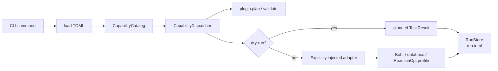

# tricycle-agent

`tricycle-agent` is TriCycle's composition application and CLI. At startup it explicitly registers package plugins, builds the Codex-facing `CapabilityCatalog`, dispatches TOML requests to their components, and persists run state through core's `RunStore`.

Domain logic resides in `packages/`; external services are supplied by adapters injected at execution time. The application does not bundle model, database, or cloud-platform implementations into a closed-loop service.

## Components composed at startup

`bootstrap.py` registers:

- `tricycle.bohr.compute`.
- `tricycle.bohr.submit`.
- `tricycle.reaction-database`.
- `tricycle.sar` (RxnResid).
- `tricycle.rits` and `tricycle.rits.ssh`.
- `tricycle.sampling`.
- `tricycle.reactionopt`.
- `tricycle.exploration`.

`capabilities.py` centralizes public capability-to-plugin-operation mappings. Callers do not need to import component internals directly.

`reactionopt.enumerate-da` accepts ene/diene substrate pairs, generates fully atom-mapped reaction SMILES candidates, and writes them to a local CSV without calling Bohr or other external services.

## CLI

```bash
uv run --package tricycle-agent tricycle-agent plugins
uv run --package tricycle-agent tricycle-agent capabilities
```

### Planning

`plan` reads TOML and emits a JSON-safe `TaskPlan` without external side effects:

```bash
uv run --package tricycle-agent tricycle-agent plan \
  rits.infer configs/example-rits-infer-request.toml --run-id rits-plan-demo
```

### Execution

`run` defaults to dry-run. Only explicit `--live` permits a capability's declared external side effects. The application assembles live adapters for nonlocal capabilities according to capability type:

```bash
uv run --package tricycle-agent tricycle-agent run \
  candidate.select configs/example-sampling-request.toml --run-id sampling-demo
```

Common arguments:

- `--run-id`: run ID.
- `--workdir`: working directory for relative paths and temporary inputs.
- `--run-dir`: output directory for preparation capabilities, or the target directory of an existing run.
- `--live`: permit remote reads/writes.
- `--confirm`: explicit confirmation required by destructive capabilities such as batch termination.
- `--bohr-config`: Bohr CLI adapter configuration file.

Reaction DB live capabilities inject `McpReactionDatabaseAdapter` during execution. Configure the database's Streamable HTTP MCP URL, token, and organization through `TRICYCLE_REACTION_DB_MCP_URL`, `TRICYCLE_REACTION_DB_MCP_TOKEN`, and `TRICYCLE_REACTION_DB_ORGANIZATION_ID`. Credentials are never written to TOML requests or `run.toml`. MCP import first calls `create_project`, then sends log bytes through the database's batch multipart endpoints `/api/upload-batches` and `/api/upload-batches/{batch_id}/files`. This path shares the single-file upload's durable worker and does not use shared directories. Live import returns `submitted` after all files enter the durable queue; it does not wait for asynchronous MolOP parsing. TLS verification is enabled by default; configure an internal CA with `TRICYCLE_REACTION_DB_MCP_CA_BUNDLE`.

### Inspection and recovery

Resumable capabilities save `run.toml` and `request.toml` in the run directory:

```bash
uv run --package tricycle-agent tricycle-agent inspect \
  --run-dir 'runs/<date>/<timestamp>/example'

uv run --package tricycle-agent tricycle-agent resume \
  --run-dir 'runs/<date>/<timestamp>/example' --live
```

Without `--run-dir`, the CLI creates records at `runs/YYYY-MM-DD/HH-MM-SS.ffffff±ZZZZ/<run-id>` using the local timezone. Execution prints the actual directory; use it for recovery. An explicit `--run-dir` or request `out_dir` is honored.

The recovery action comes from `run.toml.resume.next_action`. If a run directory already contains state, `run` refuses to overwrite it. Use `resume` to continue without duplicate remote submissions.

## Dispatch boundary



Before invocation, the application checks capability side effects and authentication requirements. Destructive capabilities also require `--confirm`. The default path constructs no Bohr CLI gateway, loads no credentials, and performs no network access. Missing live adapters produce an explicit integration-not-configured error rather than an implicit network call.

## Layout

| Path | Purpose |
| --- | --- |
| `src/tricycle_agent/bootstrap.py` | Plugin registration and capability catalog creation |
| `src/tricycle_agent/capabilities.py` | Public capability definitions and component-operation mappings |
| `src/tricycle_agent/execution.py` | Adapter assembly and capability dispatch |
| `src/tricycle_agent/cli.py` | CLI arguments and plan/run/inspect/resume lifecycle |
| `src/tricycle_agent/run_state.py` | Application assembly of requests, plans, and recovery actions; core provides `RunStore` |
| `src/tricycle_agent/campaign.py` / `campaign_cli.py` | Persistent exploration supervision and campaign CLI |
| `src/tricycle_agent/toml_requests.py` | User request loading and input restrictions |

See [`packages/`](../../packages/) for domain components and [`docs/plugin-contract.md`](../../docs/plugin-contract.md) for the development contract.

## Validation

```bash
uv run --frozen --all-packages pytest apps/tricycle-agent/tests
```
