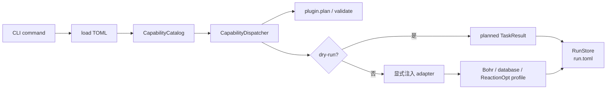

# tricycle-agent

`tricycle-agent` 是 TriCycle 的组合应用和 CLI。它在启动时显式注册各个 package 的 plugin，
构建 Codex-facing `CapabilityCatalog`，把 TOML 请求分发到对应组件，并用 core 的 `RunStore`
保存运行状态。

它不是一个自带模型、数据库或云平台实现的闭环服务。领域逻辑位于 `packages/`，外部服务由
执行时注入的 adapter 负责。

## 启动时组合的组件

`bootstrap.py` 当前注册：

- `tricycle.bohr.compute`；
- `tricycle.bohr.submit`；
- `tricycle.reaction-database`；
- `tricycle.sar`（RxnResid）；
- `tricycle.rits`；
- `tricycle.sampling`；
- `tricycle.reactionopt`。

公开 capability 到 plugin operation 的映射集中在 `capabilities.py`，调用方不需要直接导入
具体组件的内部类。

## CLI

```bash
uv run --package tricycle-agent tricycle-agent plugins
uv run --package tricycle-agent tricycle-agent capabilities
```

### 规划

`plan` 读取 TOML 并输出 JSON-safe `TaskPlan`，不会发起外部副作用：

```bash
uv run --package tricycle-agent tricycle-agent plan \
  rits.infer configs/example-rits-infer-request.toml --run-id rits-plan-demo
```

### 执行

`run` 默认是 dry-run；只有显式传入 `--live` 才允许 capability 声明的外部副作用。非本地
能力的 live adapter 由应用按能力类型装配：

```bash
uv run --package tricycle-agent tricycle-agent run \
  candidate.select configs/example-sampling-request.toml --run-id sampling-demo
```

通用参数包括：

- `--run-id`：运行 ID；
- `--workdir`：相对路径和临时输入的工作目录；
- `--run-dir`：准备类能力的输出目录，或已有运行的目标目录；
- `--live`：允许远程读/写；
- `--confirm`：破坏性能力（例如 batch terminate）所需的显式确认；
- `--bohr-config`：Bohr CLI adapter 的配置文件。

### 查看和恢复

可恢复能力会在 run 目录下保存 `run.toml` 和 `request.toml`：

```bash
uv run --package tricycle-agent tricycle-agent inspect \
  --run-dir runs/example

uv run --package tricycle-agent tricycle-agent resume \
  --run-dir runs/example --live
```

恢复动作来自 `run.toml.resume.next_action`。如果运行目录已有状态，`run` 不会覆盖它，应该
使用 `resume` 继续，避免重复提交远程任务。

## 分发边界



应用层会在调用前检查 capability 的副作用和认证要求；破坏性能力还要求 `--confirm`。默认
路径不构造 Bohr CLI gateway、不加载凭据、不访问网络。没有注入 live adapter 时，执行会明确
抛出集成未配置错误，而不会退化成隐式网络调用。

## 目录

| 路径 | 作用 |
| --- | --- |
| `src/tricycle_agent/bootstrap.py` | 注册 plugin 和创建 capability catalog |
| `src/tricycle_agent/capabilities.py` | 公开 capability 定义及 component-operation 映射 |
| `src/tricycle_agent/execution.py` | adapter 装配和 capability 分发 |
| `src/tricycle_agent/cli.py` | CLI 参数、plan/run/inspect/resume 生命周期 |
| `src/tricycle_agent/run_state.py` | `request.toml`、`run.toml` 和恢复状态管理 |
| `src/tricycle_agent/toml_requests.py` | 用户请求读取和输入限制 |

各领域组件的详细说明：[`packages/`](../../packages/)。开发契约见
[`docs/plugin-contract.md`](../../docs/plugin-contract.md)。

## 验证

```bash
uv run --frozen --all-packages pytest apps/tricycle-agent/tests
```
