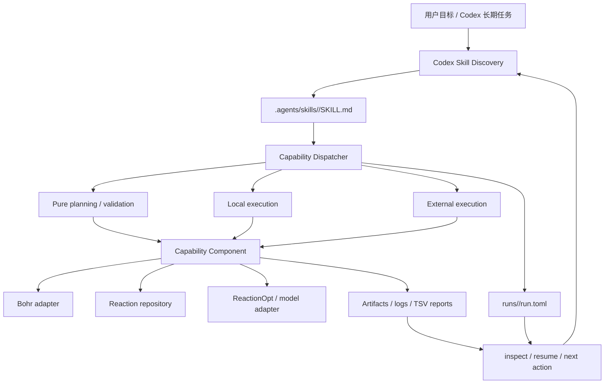

# TriCycle 能力组件架构设计

本文档定义 TriCycle 面向 Codex 长期运行场景的目标架构。它解决两个问题：

1. 每个功能如何独立实现、测试和替换；
2. Codex 如何在合适的上下文中发现能力、调用能力，并在跨会话或长时间运行后继续工作。

本文档中的“组件”是业务实现单元，“能力”是 Codex 可以选择的一项最小功能，“Skill”是 Codex 的发现和调用说明。`Plugin` 只作为现有代码的兼容术语，不再作为新的对外抽象。

## 1. 设计结论

目标架构不是把所有代码改写成 TypeScript，而是把下面四个概念解耦：

```text
Codex Skill       负责发现、触发条件、操作说明和安全边界
Capability        负责一项可独立调用的具体功能
Component         负责一个领域的一组实现和内部复用
Adapter           负责连接 Bohr、数据库、模型或其他外部系统
```

推荐保留当前 Python workspace 和大部分领域实现，逐步完成以下变化：

- 将 Codex 可发现目录从 `skills/` 调整为 `.agents/skills/`；
- 将 `BohrSubmitPlugin` 这类“大插件”拆成多个能力入口；
- 将 `PluginRegistry` 转化为内部的能力目录和分发器；
- 为长期运行增加统一的 `run.toml` 状态文件和恢复协议；
- 让能力通过稳定的命令/API 边界调用，底层语言可以是 Python、TypeScript 或 Bash；
- 所有 TriCycle 自有的请求、运行状态和 adapter 策略仍使用 TOML；具体任务的原生配置
  作为 artifact 输入，格式由任务决定；环境变量只负责凭据和运行时注入。

不建议为了 Codex 的发现机制重写成 TypeScript。Codex 发现的是 Skill 的名称、描述和说明，不是 Python class。只有当某个组件本身依赖 Node/TypeScript 生态时，才需要单独使用 TypeScript 实现。

## 2. 术语和边界

| 术语 | 定义 | 是否面向 Codex |
| --- | --- | --- |
| Skill | 位于 `.agents/skills/<name>/SKILL.md` 的发现与操作说明 | 是 |
| Capability | 一个最小、可命名、可测试、可恢复的功能，例如 `bohr.batch.prepare` | 是 |
| Component | 提供一个或多个能力的领域实现，例如 Bohr submit component | 间接 |
| Adapter | 外部服务连接器，例如 `BohrCliGateway`、`ReactionRepository` | 否，作为能力依赖 |
| Run | 一次可持久化、可恢复的执行实例 | 是 |
| Artifact | 输入、输出或中间文件，例如 XYZ、checkpoint、日志、下载目录 | 是 |
| Plugin | 当前代码中的过渡名称；不再表示 Codex 的发现单位 | 否 |

Codex 的 Skill 机制要求 Skill 目录包含 `SKILL.md`，并从 `name` 和 `description` 开始进行渐进式发现，再在匹配任务时读取完整说明。仓库级 Skill 应放在 `.agents/skills`；因此当前的 [`skills/`](../skills/) 更适合作为项目文档索引或迁移兼容目录，而不是唯一的 Codex 发现入口。参考 [Codex 官方 Skill 文档](https://learn.chatgpt.com/docs/build-skills)。

Skill 的 frontmatter 是 Codex 文件格式的一部分，不是 TriCycle 的业务配置。除这段必要的 `name`/`description` 元数据外，所有请求、策略和运行状态仍使用 TOML。

### 配置边界

TOML 是 TriCycle 元项目的声明式元数据格式，不是所有下游任务的强制配置格式：

| 边界 | 内容 | 格式约束 |
| --- | --- | --- |
| TriCycle 元项目 | 能力请求、adapter 策略、`run.toml`、`batch.toml` 和恢复状态 | 必须使用 TOML |
| 任务项目 | `pyproject.toml`、`uv.lock` 和项目依赖元数据 | 按项目工具要求使用 TOML |
| 任务输入 | 模型超参数、数据清单、checkpoint 参数和任务专属配置 | 作为 artifact，使用任务原生格式 |
| 运行环境 | Bohr 凭据、CLI 路径和部署默认值 | 使用环境变量，不写入配置文件 |

例如，RitS 的 `rits.yaml`/Hydra 参数是 RitS 任务的输入 artifact；TriCycle 只负责在
TOML 请求中声明其路径、版本或 hash，不负责解析或将其转换为 TOML。任务输入可以是
YAML、TOML、INI 或引擎要求的其他格式，但 JSON 不作为 TriCycle 自有配置格式。

## 3. 目标架构



各层职责如下：

### 3.1 Codex 发现层

发现层只解决“什么时候应该考虑某项能力”。它不应包含大量 Python 业务代码，也不应要求 Codex 记住内部类名。

每个 Skill 必须说明：

- 适用场景和明确的触发词；
- 不适用的场景；
- TriCycle 请求 TOML 的字段和前置条件，以及任务输入 artifact 的位置和格式约定；
- 输出 artifact 和运行目录；
- 是否访问网络、读取凭据或产生远程副作用；
- 失败、重试和恢复方式；
- 需要用户确认的动作。

一个 Skill 原则上只覆盖一个用户可理解的功能。比如 `bohr-submit` 当前包含准备、提交、查询、下载和救援，目标架构应至少拆成准备、提交、观察/查询、下载和救援几个 Skill。

### 3.2 能力层

能力是系统的最小调用单位。能力不等于一个 package，也不等于一个外部平台。

建议使用稳定的 capability ID：

```text
reactionopt.generate
reactionopt.export
candidate.select
bohr.compute.plan
bohr.compute.submit
bohr.batch.prepare
bohr.batch.submit
bohr.batch.status
bohr.batch.download
bohr.batch.watch
bohr.batch.terminate
bohr.job.status
bohr.job.download
dpa-berny.prepare
dpa-berny.rescue
reaction-db.ingest
sar.train / sar.finetune
sar.infer
rits.train / rits.finetune
rits.infer
```

一个 component 可以实现多个能力；一个能力只应有一个清晰的输入/输出契约。能力之间通过 artifact、实体 ID 和 `run.toml` 协作，不直接依赖对方的内部 Python class。

### 3.3 组件层

组件负责领域逻辑、请求模型和本地文件处理。例如：

| Component | 提供的能力 | 当前实现 |
| --- | --- | --- |
| ReactionOpt component | `reactionopt.generate`、`reactionopt.export` | `tricycle-reactionopt` |
| Sampling component | `candidate.select` | `tricycle-sampling` |
| Bohr compute component | 通用 Bohr job 规划、提交、状态和下载；单任务模型 job 基础层 | `tricycle-bohr` |
| Bohr workflow component | `bohr.batch.*`、`dpa-berny.*` | `tricycle-bohrsubmit` |
| Reaction DB component | `reaction-db.ingest` | `tricycle-reaction-db` |
| RxnResid component | `sar.train`、`sar.finetune`、`sar.infer`；复用模型 job 基础层 | `tricycle-sar` |
| RitS component | `rits.train`、`rits.finetune`、`rits.infer`；复用模型 job 基础层和 RitS 命令构造器 | `tricycle-rits` |

当前 `PluginBase`、`PluginManifest` 和 `PluginRegistry` 可以继续作为兼容实现，但新接口应逐步以 `Capability`、`CapabilityManifest` 和 `CapabilityCatalog` 为语义中心。

### 3.4 Adapter 层

Adapter 是外部副作用的唯一边界：

- `BohrGateway`：通用 job 的 submit/status/download；
- `BohrWorkflowGateway`：job group、terminate 等批量生命周期操作；
- `ReactionRepository`：反应记录 upsert；
- `ReactionOptAdapter`：调用实际 ReactionOpt 项目并导出文件。

`BohrCliGateway` 负责当前 `bohr` CLI 的命令拼接、输出解析、重试和认证环境继承。它
只把 `bohrId`/`BOHR_ID` 作为公开 job ID；旧批次若保存平台内部 `id`，会在已知任务组
上下文中通过 `job describe --job_group_id` 解析后再执行生命周期操作。组件和 Skill 不应
直接调用 `subprocess` 或拼接 Bohr 命令。解析得到的 `internal_job_id → bohr_id` 映射会
持久化到运行目录的 `bohr-id-map.tsv`，重启后优先复用。

批量下载对 `out.zip` 执行 CRC、成员和解压状态校验；解压标记保存压缩包指纹。`resume=True`
遇到损坏或半下载结果时，会在同盘临时目录中重新下载并在成功后原子替换，原目录保留为
`.replaced-*` 备份，避免把部分结果误报为完整下载。

## 4. 能力契约

目标能力不需要强制继承某个基类，但应提供等价的明确契约：

```text
manifest() -> CapabilityManifest
validate(request.toml) -> ValidationResult
plan(request.toml, context) -> TaskPlan
run(request.toml, context, adapters) -> TaskResult
inspect(run.toml) -> InspectionResult
resume(run.toml, context, adapters) -> TaskResult
```

不是每项能力都必须实现所有方法：

- 纯函数能力可以只有 `validate`、`plan` 和 `run`；
- 远程任务能力应实现 `plan`、`run`、`inspect` 和 `resume`；
- 破坏性操作必须显式接收确认参数；
- 所有默认调用都应保持 dry-run 或只读。

### 4.1 CapabilityManifest

每个能力至少应声明：

| 字段 | 含义 |
| --- | --- |
| `id` | 稳定的能力 ID |
| `description` | 面向 Codex 的一句话用途和触发条件 |
| `component` | 所属组件 |
| `input_kind` | 请求 TOML 的类型或任务输入 artifact 的契约名称 |
| `outputs` | 产物类型和位置约定 |
| `side_effect` | `none`、`local-write`、`remote-read`、`remote-mutate` 或 `destructive` |
| `requires_auth` | 是否需要 Bohr/数据库等凭据 |
| `supports_dry_run` | 是否支持只规划或模拟执行 |
| `resumable` | 是否可从已有 run 目录恢复 |
| `dependencies` | 依赖的能力或 adapter |

能力元数据可以由 Python 代码提供，也可以增加 `capability.toml` 作为机器可读目录。若同时存在 Skill 和 TOML 元数据，应通过测试检查 ID、输入和副作用等级一致，避免描述漂移。

## 5. 执行模型和副作用分级

Codex 是否适合直接调用一项能力，应由副作用等级决定：

| 等级 | 示例 | 默认策略 |
| --- | --- | --- |
| `none` | `reactionopt.generate`、`candidate.select`、校验 | 可以直接执行 |
| `local-write` | `bohr.batch.prepare`、生成本地输入 | 执行前检查输出目录，禁止覆盖非空目录 |
| `remote-read` | `bohr.job.status`、下载 | 需要凭据；不得改变远程任务状态 |
| `remote-mutate` | `bohr.batch.submit`、数据库写入 | 需要显式授权、幂等键和审计记录 |
| `destructive` | `bohr.job.terminate` | 必须 `confirm=true`，默认不自动执行 |

推荐的操作阶段为：

```text
discover → validate → plan → prepare → approve → submit
                                      ↓
                               inspect / watch
                                      ↓
                           download / rescue / resume
```

`plan` 必须是纯操作。`prepare` 只允许本地文件副作用。`submit`、`terminate` 和数据库写入必须通过 adapter，并且不能因为 Codex 会话继续运行就自动升级权限。

## 6. 长期运行和状态模型

Codex 的长期任务不能把状态只放在当前对话、进程内存或临时日志中。每次运行都必须有稳定的 `run_id` 和可重新读取的状态。

### 6.1 目标目录结构

```text
runs/<run-id>/
  request.toml              # 不可变的本轮请求副本
  run.toml                  # 通用生命周期状态，权威状态源
  batch.toml                # Bohr batch 领域配置，迁移期间保留
  tasks.tsv                 # 任务与 worker 映射
  submit-plan.tsv           # 提交前计划
  submit-results.tsv        # worker 与远程 job ID
  status.tsv                # 批量状态明细
  downloads/
    download-results.tsv
  artifacts/                # 结果、checkpoint、输入和报告
  logs/                     # 本地编排日志
```

`batch.toml` 是当前 `tricycle-bohrsubmit` 的领域配置；目标架构增加 `run.toml` 作为所有能力共享的生命周期外壳。TSV 是批量结果表，不是配置文件。

### 6.2 `run.toml` 最小结构

```toml
schema = "tricycle.run/v1"

[run]
id = "dpa-demo"
capability = "bohr.batch.submit"
status = "submitted"
phase = "remote"
created_at = "2026-08-26T10:00:00Z"
updated_at = "2026-08-26T10:05:00Z"

[execution]
dry_run = false
attempt = 1
last_action = "bohr.batch.submit"
last_action_at = "2026-08-26T10:05:00Z"

[remote]
provider = "bohr"
job_group_id = "..."

[resume]
next_action = "bohr.job.status"
last_successful_action = "bohr.batch.submit"

[artifacts]
run_directory = "runs/dpa-demo"
status_file = "runs/dpa-demo/status.tsv"
```

要求：

- `run.toml` 不保存访问密钥、token 或其他秘密；
- destructive 能力的确认属于本次调用参数，不写入可恢复请求或运行状态；
- 状态更新必须尽量原子化，避免中断后产生半写入文件；
- 提交前计算幂等键，重复恢复不能重复提交同一个 worker；
- 每次外部调用记录时间、能力 ID、attempt、公开 job ID 和结果；
- `next_action` 必须是 Codex 可以继续调用的能力 ID；
- 运行目录应足以支持“重新打开目录后继续”，不依赖原始聊天上下文。

### 6.3 目标状态机

```text
planned
  └─> prepared
        └─> approved
              └─> submitted
                    └─> running
                          ├─> succeeded ──> downloaded
                          ├─> failed ─────> rescue / retry / stopped
                          └─> paused ─────> resume
```

当前 core 的 `TaskStatus` 只有 `planned`、`submitted`、`running`、`succeeded`、`failed`。迁移时可以保留这些值，并把 `prepared`、`paused`、`downloaded` 放到 `run.toml` 的 `phase` 或扩展状态中，避免一次性破坏现有 API。

## 7. Codex Skill 目录设计

目标目录：

```text
.agents/
  skills/
    reactionopt-generate/
      SKILL.md
    reactionopt-export/
      SKILL.md
    candidate-select/
      SKILL.md
    bohr-compute-plan/
      SKILL.md
    bohr-compute-submit/
      SKILL.md
    bohr-batch-prepare/
      SKILL.md
    bohr-batch-submit/
      SKILL.md
    bohr-batch-status/
      SKILL.md
    bohr-batch-watch/
      SKILL.md
    bohr-batch-terminate/
      SKILL.md
    bohr-batch-download/
      SKILL.md
    bohr-job-status/
      SKILL.md
    bohr-job-download/
      SKILL.md
    dpa-berny-prepare/
      SKILL.md
    dpa-berny-rescue/
      SKILL.md
    reaction-db-ingest/
      SKILL.md
    sar-train/
      SKILL.md
    sar-infer/
      SKILL.md
    rits-train/
      SKILL.md
    rits-infer/
      SKILL.md
```

每个 `SKILL.md` 采用最小元数据：

```markdown
---
name: bohr-batch-prepare
description: "Prepare a local Bohr batch run from a TOML request without submitting remote jobs."
---

# Bohr 批量本地准备

## 适用场景

当需要把任务文件分片到 worker 并生成可审计的本地 run 目录时使用。

## 不适用场景

不要在本 Skill 中提交、终止或修改远程 Bohr job。

## 输入与输出

- 输入：`request.toml`、可访问的任务文件和可选镜像参数；
- 输出：`runs/<run-id>/run.toml`、`batch.toml`、worker 目录和提交计划。

## 执行

运行能力命令，确认输出目录为空，并检查生成的 `submit-plan.tsv`。
```

上例中的 frontmatter 只服务于 Codex 发现；请求内容、adapter 策略和运行状态仍从 TOML 文件读取。Skill 中应使用稳定的能力命令或入口，不应要求 Codex 直接 import 内部类。

## 8. CLI 和调用边界

当前 [`tricycle-agent`](../apps/tricycle-agent/src/tricycle_agent/cli.py) 已以能力为入口，同时保留旧命令兼容层：

```bash
tricycle-agent capabilities
tricycle-agent plan <capability-id> <request.toml> --run-id <id>
tricycle-agent run <capability-id> <request.toml> --run-id <id>
tricycle-agent inspect --run-dir runs/<id>
tricycle-agent resume --run-dir runs/<id>
```

目标行为：

- `capabilities` 列出能力 ID、描述、副作用等级和是否可恢复；
- `plan` 只校验和生成计划；
- `run` 执行无副作用或已授权的能力；
- `inspect` 只读取 `run.toml` 和报告，不调用有副作用操作；
- `resume` 根据 `run.toml.resume.next_action` 继续，而不是根据聊天记录猜测下一步。

`plan` 兼容旧的 `plan <plugin-id> <operation> <request.toml>` 形式；新的 `run`、`inspect` 和
`resume` 只接受能力 ID 和运行目录。真实 Bohr 适配器只在 `--live` 下构造，默认 dry-run 不读取
认证环境、不调用网络。

真实 Bohr 提交仍应由 `BohrCliGateway` 注入。CLI 可以负责构造 gateway，但不得在默认 dry-run 路径中隐式读取密钥或提交任务。

## 9. 配置、环境变量和输出

### 9.1 TriCycle 元项目配置

所有由 TriCycle 解析、校验、持久化或用于恢复的声明式配置使用 TOML：

- `configs/*-request.toml`：能力请求；
- `configs/example-bohr.toml`：Bohr adapter 的重试和命令策略；
- `runs/<run-id>/request.toml`：请求副本；
- `runs/<run-id>/run.toml`：通用状态；
- `runs/<run-id>/batch.toml`：Bohr batch 领域配置。

具体任务的模型配置、数据清单和引擎输入不属于上述 TriCycle 配置边界，而是随任务
上传的 artifact。其格式由任务决定；例如 RitS 可以直接读取自己的 Hydra YAML 配置。
TriCycle 应在请求 TOML 中保存 artifact 路径、版本和 hash 等可审计信息，而不是复制或
重新解释任务配置内容。

JSON 不作为 TriCycle 配置文件格式。CLI 输出 JSON 或其他机读文本不属于配置系统，可以
继续保留；Gaussian/DPA worker 目录中的 `.json` 若是引擎要求的领域 artifact，也不属于
用户配置。

### 9.2 环境变量

环境变量只注入运行时信息：

- `BOHR_ACCESS_KEY`、旧版兼容的 `ACCESS_KEY`；
- `BOHR_BIN`；
- `BOHR_PROJECT_ID`、`BOHR_MACHINE_TYPE`、`BOHR_IMAGE` 等部署默认值；
- `TRICYCLE_RUN_ROOT` 等本地运行时目录默认值；
- 其他重试、数据库或执行器环境变量。

环境变量不能被复制进 `request.toml`、`run.toml`、`batch.toml` 或公开日志。Bohr adapter
会自动发现当前目录或父目录中的 `.env`，并把它作为本地运行时环境注入文件；它仍不是
能力请求配置。外部 shell 环境变量优先于 `.env`。

## 10. 语言和跨进程实现

语言边界应该位于 Component/Adapter 与调用器之间，而不是位于 Codex Skill 层：

```text
SKILL.md
   ↓
稳定能力命令或服务接口
   ↓
Python component / TypeScript component / Bash worker
```

当前 Python 组件通过 `uv` workspace 和直接 import 组合，因此 TypeScript 组件不能只放进 `packages/` 就自动被发现。若以后需要 TypeScript，实现方式应是：

1. TypeScript 项目提供独立可执行入口或服务入口；
2. 接收版本化的 TOML 请求路径和 run 目录；
3. 返回稳定的结果状态并写入约定 artifact；
4. Python 侧增加一个 adapter 或 runner；
5. 在 `CapabilityManifest` 中声明运行器、版本和依赖。

Bohr CLI 自身使用何种语言不影响该设计，因为 `BohrCliGateway` 只依赖其命令边界。没有 Node 专属依赖时，继续使用 Python 可以减少构建、类型转换和进程管理成本。

## 11. 当前代码到目标架构的映射

| 当前代码 | 目标语义 | 迁移策略 |
| --- | --- | --- |
| `PluginBase` | Component/Capability protocol | 先增加新名称和兼容 alias，再逐步迁移 |
| `PluginManifest` | `CapabilityManifest` | 保留 component manifest，同时为每个能力补充副作用和恢复信息 |
| `PluginRegistry` | `CapabilityCatalog` | 继续显式注册，避免未经审核的动态 import |
| `BohrSubmitPlugin` | Bohr workflow component | 保留内部复用，按 operation 暴露多个能力 |
| `capabilities` 字符串元组 | 能力目录条目 | 每个条目拥有独立 description、输入、输出和权限 |
| `skills/bohr-submit/SKILL.md` | 多个 `.agents/skills/*` | 先复制/拆分，再保留旧索引作为过渡 |
| `batch.toml` | 领域配置 | 保留，并由 `run.toml` 统一包裹生命周期状态 |
| `submit-results.tsv`、`status.tsv` | 批量报告 artifact | 保留，不当作配置文件 |
| `ExecutionContext.dry_run` | 能力执行策略的一部分 | 保留，并增加副作用等级和确认策略 |
| `BohrGateway` 等 protocol | Adapter contract | 保留，不让组件直接调用外部命令 |

## 12. 分阶段迁移计划

### 阶段 0：发现入口和命名（已完成）

- 创建 `.agents/skills/`；
- 将现有 Skill 复制或迁移到标准目录；
- 保留 `skills/README.md` 作为索引；
- 把 `bohr-submit` 拆为准备、提交、状态、下载、救援几个 Skill；
- 暂不修改 Python API。

### 阶段 1：能力目录（已完成）

- 在 core 增加 `CapabilityManifest`、`CapabilityCatalog` 和能力 ID；
- 为现有 `plugin_id + operation` 建立稳定映射，例如 `tricycle.bohr.submit + batch.prepare` 映射为 `bohr.batch.prepare`；
- 保留 `Plugin*` 名称作为兼容 alias；
- 增加 manifest 一致性测试。

### 阶段 2：能力 CLI（已完成）

- 增加 `capabilities`、`run`、`inspect`、`resume`；
- 现有 `plugins`、`plan`、`prepare` 保持兼容；
- 所有入口只接受 TOML 请求；
- 让 Skill 只调用稳定 CLI，不依赖内部 Python import。

### 阶段 3：统一长期状态（基础能力已完成）

- 为每个 run 写入 `request.toml` 和 `run.toml`；
- 为 Bohr 提交、状态查询、下载和 rescue 增加 `next_action`；Bohr adapter 继续负责提交去重和公开 ID 解析；
- 将重复提交、断点恢复和失败重试覆盖到测试；
- 保留现有 `batch.toml` 和 TSV 文件作为领域配置/报告。

### 阶段 4：跨语言 runner

- 仅在有实际需求的组件中引入 TypeScript；
- 通过独立命令或服务 adapter 接入，不改变 Codex Skill 契约；
- 对跨进程输入、输出、退出码、超时和日志建立版本化约定。

## 13. 验收标准

架构迁移完成后，应满足：

- Codex 能从 `.agents/skills` 发现每项能力，并根据 description 选择是否加载；
- 任意能力可以脱离其他组件单独校验、规划和测试；
- `CapabilityManifest` 能说明输入、输出、副作用、凭据和恢复方式；
- TriCycle 自有的用户请求、运行状态和 adapter 元数据使用 TOML；任务原生输入文件按
  任务格式作为 artifact 传递；
- dry-run 不读取凭据、不访问网络、不提交真实任务；
- 真实提交、终止和数据库写入都经过显式 adapter 和授权；
- 关闭并重新打开 Codex 后，仅凭 `run.toml` 和 artifact 就能恢复工作；
- Python、TypeScript 和 Bash 可以通过稳定边界共存；
- `make check`、`uv run pytest` 和能力级 smoke test 全部通过。

## 14. 后续增强

基础重构已经完成。下一步应围绕真实平台验证和可观测性逐步增强：

1. 在真实 Bohr 账号和测试项目上验证新版 CLI 的状态字段、下载目录和权限策略；
2. 将外部 adapter 的调用历史写入可追加的审计 artifact，并补充跨进程锁；
3. 对 `run.toml` 增加 schema 迁移器和能力 manifest 一致性检查；
4. 只有在组件确实需要 Node 生态时，再增加 TypeScript runner，并通过稳定 adapter 接入。

完成当前基础阶段后，TriCycle 已经从“可运行的 Python 工作流集合”转为“Codex 可以长期发现、调用和恢复的能力组件系统”；后续工作不改变 Skill、Capability、Adapter 和 Run 的边界。
