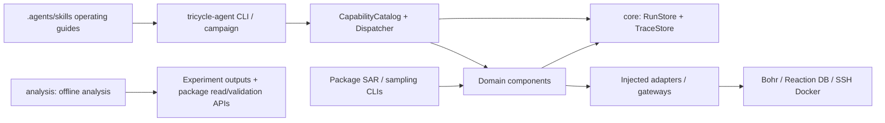

# Architecture

TriCycle composes domain packages in a `uv` workspace. The application registers components in [bootstrap.py](../apps/tricycle-agent/src/tricycle_agent/bootstrap.py), binds public capabilities in [capabilities.py](../apps/tricycle-agent/src/tricycle_agent/capabilities.py), and injects adapters during execution. `PluginRegistry` registers and looks up components; placing a file in a directory does not register a capability.

## Composition and dependencies

| Layer | Responsibility |
| --- | --- |
| `apps/tricycle-agent` | Request parsing, capability registration, execution guards, adapter assembly, cross-capability campaigns |
| Domain packages | Typed requests, pure plans, deterministic domain logic, run preparation, result validation |
| `tricycle-bohr` | Single-job `BohrJobSpec`/`BohrGateway` and shared model-task infrastructure |
| `tricycle-bohrsubmit` | Batch staging, Gaussian/DPA-Berny, job groups and lifecycle; `BohrCliGateway` centralizes external CLI calls |
| `tricycle-core` | Shared types, protocols, capability catalog, run records, traces, file and metric utilities |
| `analysis/` | Offline statistics and plots consuming package interfaces and run artifacts |

Each `pyproject.toml` declares package dependencies. SAR reuses Bohr/BohrSubmit; RitS reuses Bohr; ReactionOpt reuses RitS requests and commands; sampling's optional replay dependencies connect SAR, BohrSubmit, and database adaptation. Core does not depend on domain packages, and `packages/` neither reads nor executes source from `tools/`, `apps/`, or `analysis/`.

SAR exposes multi-model backends and benchmarks through package APIs/CLIs; `sar.train/finetune/infer` are its RxnResid capability interfaces. Local sampling selection is separate from remote replay controllers. `exploration.round` records single-round evidence; the application campaign orchestrates capabilities across rounds. See the [package index](../README.md#packages-and-entry-points).

## External operations and recovery

`plan` validates requests and produces plans; local preparation may write staging files. Default dry runs do not construct live clients, read credentials, access the network, or submit jobs. Live operations use injected adapters; destructive capabilities also check explicit confirmation. See the [plugin contract](plugin-contract.md).

For generic capabilities, `RunStore` persists `run.toml`, requests, plans, artifacts, and `resume.next_action`; `TraceStore` appends hash-chained events. Domain controllers add JSON/TSV/CSV records under their own state contracts. Recovery reads existing state and submission receipts instead of inferring job IDs from conversation or directory names. Reconcile unknown submission outcomes with the external system before any resubmission.

Gateways own platform communication retries; environment engines own model-dependency setup retries. Training and inference follow the selected recovery protocol. Authorization to execute computations does not authorize changes to algorithms, data splits, dependencies, or acceptance criteria.

## Workflows and model delivery

A typical exploration connects ReactionOpt candidate generation, sampling, Bohr computation, database import/export, and model updates. Each step has independent inputs and results; completion of one step does not establish acceptance of the next.

ReactionOpt profile generation has three independent branches: reactant conformers, product conformers, and reaction-level RitS transition states. They meet only in the final profile. SAR combines shared environments and runners through the current catalog and stages validated code, data, and assets. Maintain only the current implementation; never load execution source from historical runs. See [ReactionOpt](../packages/tricycle-reactionopt/README.md) and [SAR](../packages/tricycle-sar/README.md).

## Configuration, documentation, and artifacts

Capability requests and generic run metadata use TOML. Native model configuration, the SAR catalog, domain JSON state, and tables follow their own interfaces. Versions, hashes, images, and resource bindings belong in configuration and asset manifests; credentials come from the environment.

Documentation and skills describe current interfaces and reusable procedures. Experiment records, run figures, completion status, and one-off audits belong in Git-ignored artifact directories. Archive obsolete documentation byte for byte before removing it from tracking. Historical results remain independently verifiable; reruns create new runs with the current implementation. Archives must not become implicit dependencies of current code, tests, or guides.
