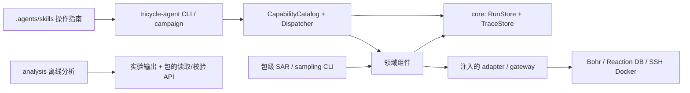

# 当前架构

TriCycle 使用 `uv` workspace 组合领域包。应用层在 [bootstrap.py](../apps/tricycle-agent/src/tricycle_agent/bootstrap.py) 注册组件，在 [capabilities.py](../apps/tricycle-agent/src/tricycle_agent/capabilities.py) 绑定公开能力，执行层注入 adapter。`PluginRegistry` 提供组件注册和查询；目录中的文件不会自动注册为能力。

## 组合与依赖

| 层 | 职责 |
| --- | --- |
| `apps/tricycle-agent` | 请求解析、能力注册、执行守卫、adapter 装配、跨能力 campaign |
| 领域包 | 类型化请求、纯计划、确定性领域逻辑、运行准备和结果校验 |
| `tricycle-bohr` | 单任务 `BohrJobSpec`/`BohrGateway` 与模型任务基础层 |
| `tricycle-bohrsubmit` | 批任务 staging、Gaussian/DPA-Berny、任务组与生命周期；`BohrCliGateway` 集中调用外部 CLI |
| `tricycle-core` | 公共类型、protocol、能力目录、运行记录、trace、文件和指标工具 |
| `analysis/` | 离线统计和绘图，读取包接口与运行产物 |

包依赖以各 `pyproject.toml` 为准。SAR 复用 Bohr/BohrSubmit；RitS 复用 Bohr；ReactionOpt 复用 RitS 请求与命令；sampling 的可选 replay 依赖接入 SAR、BohrSubmit 和数据库适配。core 不反向依赖领域包，`packages/` 不读取或执行 `tools/`、`apps/`、`analysis/` 的源码。

SAR 多模型后端和基准通过包级 API/CLI 暴露，`sar.train/finetune/infer` 是其中 RxnResid 的能力接口。sampling 的本地选择与远端回放控制器分开；`exploration.round` 记录单轮证据，应用 `campaign` 编排跨轮能力。各入口见[包索引](../README.md#包与入口)。

## 外部操作与恢复

`plan` 校验请求和生成计划；本地 prepare 可以写 staging。默认 dry-run 不构造 live 客户端，不读取凭据、访问网络或提交任务。live 操作必须使用注入的 adapter，破坏性能力还检查显式确认。具体契约见[插件说明](plugin-contract.md)。

通用能力的 `RunStore` 保存 `run.toml`、请求、计划、产物及 `resume.next_action`；`TraceStore` 追加带哈希链的事件。各领域控制器按自己的状态契约补充 JSON/TSV/CSV 记录。恢复读取已有状态和提交回执，不通过对话或目录名猜测 job ID。提交结果未知时先核对外部系统，不能无依据重提。

平台通信重试由 gateway 负责，模型依赖初始化重试由环境引擎负责，训练及推理按既定恢复协议执行。执行计算不自动授权更改算法、数据划分、依赖或验收标准。

## 工作流与模型交付

典型探索连接 ReactionOpt 候选生成、采样、Bohr 计算、数据库导入/导出和模型更新。每一步都有独立输入与结果，完成上一环节不代表下一环节已通过验收。

ReactionOpt profile 的反应物构象、产物构象与 reaction-level RitS TS 是三个独立分支，在最终 profile 汇总。SAR 则由当前 catalog 组合共享环境与 runner，准备时交付经校验的代码、数据和资产；只维护当前实现，不从历史 run 加载执行源码。模块细节见 [ReactionOpt](../packages/tricycle-reactionopt/README.md) 和 [SAR](../packages/tricycle-sar/README.md)。

## 配置、文档与产物

能力请求与通用运行元数据使用 TOML；模型原生配置、SAR catalog、领域 JSON 状态和表格各按所属接口处理。版本、哈希、镜像及资源绑定留在配置和资产清单，凭据由环境注入。

文档与技能维护当前接口和通用流程。具体实验记录、运行图表、完成状态和一次性审计报告留在 Git 忽略的产物目录；过时文档按原字节归档后移出跟踪。旧结果可独立核验，重跑使用当前实现创建新 run。归档不得成为当前代码、测试或操作文档的隐式依赖。
