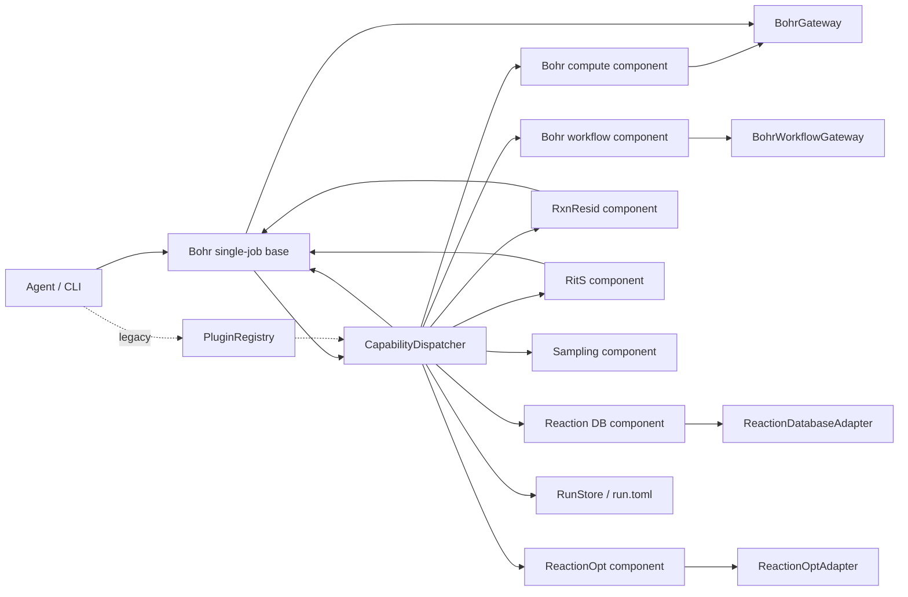

# 当前架构总览

> 本文档描述当前代码实现。面向 Codex 长期运行的能力组件目标架构见
> [`architecture-design.md`](architecture-design.md)。

TriCycle Agent 当前采用“能力分发层 + 领域组件 + 外部 adapter”的结构，
并保留 `PluginRegistry` 作为旧 API 兼容层：



## 一次探索的建议生命周期

```text
ReactionOpt 生成反应配置
        ↓
Sampling 从候选反应空间选择下一批
        ↓
Bohr 计算能力规划/提交计算
        ↓
Reaction DB 按批次创建 project、导入计算日志并整理反应关系
        ↓
数据库筛选环加成反应，导出 RitS / RxnResid 数据
        ↓
RxnResid / RitS 训练或推理
        ↓
模型输出回到采样策略，开始下一轮
```

每一步都可以先调用 `plan` 生成可审计的 `TaskPlan`。只有在显式注入非 dry-run adapter 后，才允许发生外部副作用。

## 包之间的依赖方向

```text
tricycle-agent ──> capability components ──> tricycle-core
tricycle-sar (RxnResid) ────> tricycle-bohr ──> tricycle-core
tricycle-rits ───> tricycle-bohr ──> tricycle-core
```

`tricycle-bohr` 是单任务 Bohr 基础层。`BohrJobSpec` 和 `BohrGateway` 定义平台边界，
`BohrJobExecutor` 统一处理计划的提交，`BohrModelJobRequest` 和 `BohrModelPlugin` 统一
RxnResid/RitS 的模型任务请求、artifact 合并、train/finetune/infer 计划和提交。`tricycle-bohrsubmit`
继续负责多 worker staging、Gaussian/DPA-Berny 和批量生命周期，不被模型组件直接依赖。

`tricycle-core` 不知道具体组件的实现；组合应用负责显式组合组件并登记能力映射。
这使得单个能力可以独立发现、测试和恢复，也避免在核心包内硬编码 Bohr 或模型服务细节。

`tricycle-bohrsubmit` 是 Bohr 计算边界之上的工作流组件：Python 负责可审计的任务目录、输入文件和生命周期状态，`BohrCliGateway` 负责外部 CLI。ORCA 暂时通过通用批量脚本接入，避免在没有任务 schema 时猜测输入格式。

TriCycle 请求文件和运行目录中的声明式元数据统一使用 TOML；具体任务的原生配置属于
输入 artifact，格式由任务决定。例如 RitS 的 Hydra YAML 文件由 RitS 自己读取，不属于
TriCycle 元项目配置。认证 token 等环境变量仍由运行进程注入，并与配置文件保持独立。
