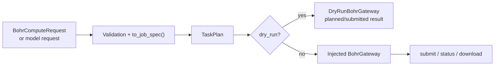

# tricycle-bohr

`tricycle-bohr` provides TriCycle Agent's common Bohr job boundary. It converts explicit computation/model requests into `BohrJobSpec` objects and plans, submits, queries, or downloads jobs through an injected gateway. It includes no Bohr network client and reads no credentials during dry-run.

## Capabilities and scope

The native plugin ID is `tricycle.bohr.compute`:

| Capability | Purpose |
| --- | --- |
| `compute.plan` | Validate a general computation request and produce a Bohr job plan |
| `compute.submit` | Submit a single job through an injected `BohrGateway` |
| `compute.status` | Query an existing job |
| `compute.download` | Download an existing job's results to a specified destination |

The application maps these capabilities to CLI names such as `bohr.compute.plan`, `bohr.compute.submit`, `bohr.job.status`, and `bohr.job.download`. Batch directories, worker partitioning, and Gaussian/DPA-Berny jobs belong to [`tricycle-bohrsubmit`](../tricycle-bohrsubmit/README.md).

## Request models

### General computation request

`BohrComputeRequest` describes a general job:

- `job_name`, `operation`, `image`, and optional `command`.
- `project_id` and `machine_type`.
- `input_artifacts` and `output_artifacts`.
- `parameters` and `tags`.

Image, project, and machine type may come from the request or `BOHR_IMAGE`, `BOHR_PROJECT_ID`, and `BOHR_MACHINE_TYPE`. `to_job_spec()` converts the request to core's `BohrJobSpec`.

### Model job request

`BohrModelJobRequest` is the common model job contract for RitS and RxnResid:

- `model_name`; the invoked `train` / `infer` / `finetune` capability supplies `mode`.
- `image`, `dataset`, `checkpoint`, and `code_artifact`.
- `input_directory`, `command`, and input/output artifacts.
- `project_id`, `machine_type`, and job `parameters`.

Validation enforces mode-specific required inputs: training typically requires a dataset; inference and fine-tuning require a checkpoint. Every model job must explicitly specify its code artifact, input directory, and actual launch command. [`tricycle-rits`](../tricycle-rits/README.md) and [`tricycle-sar`](../tricycle-sar/README.md) supply model-specific sources, entry points, and parameters.

User requests accept only canonical fields; unknown fields are errors. Generated plans are restored through `BohrJobSpec.from_mapping()`, strictly using the job contract's `name`, without reapplying request defaults or reading the environment. Status requests accept only `external_id`; download requests accept `external_id` and `destination`.

## Planning and execution boundary



`BohrJobExecutor` is the execution boundary:

- Dry-run uses `DryRunBohrGateway`, returning a deterministic `dry-run/<job-name>` identifier without network access.
- Live execution requires an injected `BohrGateway`; the external ID and message from submission are recorded in `TaskResult`.
- The package neither chooses credential sources nor hardcodes the `bohr` CLI, HTTP SDKs, or environment initialization into plugins.

`plan` supports local review. Real submission requires explicit `--live` at the application layer and a production adapter.

## CLI examples

A single computation request should at least specify a stable job name, image, and command:

```toml
job_name = "geometry-opt-demo"
operation = "compute"
image = "registry.example/chemistry:tag"
command = ["bash", "run.sh"]
project_id = "project-id"
machine_type = "<current platform specification appropriate for the computation>"
output_artifacts = ["results"]
```

Plan without submitting:

```bash
uv run --package tricycle-agent tricycle-agent plan \
  bohr.compute.plan request.toml --run-id bohr-plan-demo
```

Submission, status queries, and downloads require an application-registered gateway and the corresponding explicit capability:

```bash
uv run --package tricycle-agent tricycle-agent run \
  bohr.compute.submit request.toml --run-id bohr-submit-demo --live
```

These commands use the application entry point. This package does not provide default credential loading or remote submission implementations.

## Component relationships

- `tricycle-bohrsubmit` extends the `BohrGateway`/`BohrJobSpec` boundary into a batch lifecycle.
- `tricycle-rits` and `tricycle-sar` reuse `BohrModelJobRequest`, `BohrModelPlugin`, and the job executor.
- ReactionOpt profiles depend only on RitS request/command construction. The actual RitS profile sampler must still be injected separately; a general model job is not a TS pipeline result.

## Validation

```bash
uv run pytest packages/tricycle-bohr/tests
make check
```
