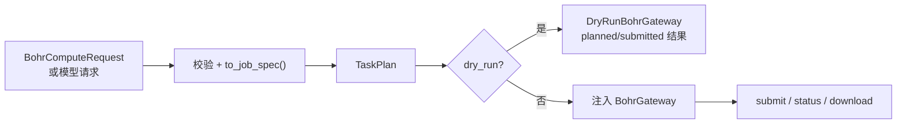

# tricycle-bohr

`tricycle-bohr` 是 TriCycle Agent 的通用 Bohr job 边界。它负责把明确的计算/模型请求
转换成 `BohrJobSpec`，并通过注入的 gateway 规划、提交、查询或下载任务。这个包不内置
Bohr 网络客户端，也不在 dry-run 中读取凭据。

## 能力与定位

原生插件 ID 为 `tricycle.bohr.compute`，能力包括：

| 能力 | 作用 |
| --- | --- |
| `compute.plan` | 校验一个通用计算请求并生成 Bohr job 计划 |
| `compute.submit` | 通过注入的 `BohrGateway` 提交单个 job |
| `compute.status` | 查询已有 job 状态 |
| `compute.download` | 将已有 job 的结果下载到指定位置 |

应用层将这些能力映射为 `bohr.compute.plan`、`bohr.compute.submit`、`bohr.job.status` 和
`bohr.job.download` 等 CLI 能力。批量目录、worker 分片以及 Gaussian/DPA-Berny 任务属于
[`tricycle-bohrsubmit`](../tricycle-bohrsubmit/README.md)，不在本包内实现。

## 请求模型

### 通用计算请求

`BohrComputeRequest` 描述一个通用 job：

- `job_name`、`operation`、`image`、可选 `command`；
- `project_id`、`machine_type`；
- `input_artifacts`、`output_artifacts`；
- `parameters`、`tags`。

`image`、项目和机器类型可以从请求读取，也可以由 `BOHR_IMAGE`、`BOHR_PROJECT_ID`、
`BOHR_MACHINE_TYPE` 提供。请求转化后由 `to_job_spec()` 生成 core 的 `BohrJobSpec`。

### 模型任务请求

`BohrModelJobRequest` 是 RitS 和 RxnResid 共用的模型任务契约，包含：

- `model_name`；`mode` 由所调用的 `train` / `infer` / `finetune` 能力传入；
- `image`、`dataset`、`checkpoint`、`code_artifact`；
- `input_directory`、`command`、输入/输出 artifact；
- `project_id`、`machine_type` 和任务 `parameters`。

它会校验不同模式的必需输入：训练通常需要 dataset，推理和微调需要 checkpoint；所有模型
任务都必须明确代码 artifact、输入目录和实际启动命令。具体模型的来源、入口和参数由
[`tricycle-rits`](../tricycle-rits/README.md) 或 [`tricycle-sar`](../tricycle-sar/README.md)
补充。

用户请求只接受上述规范字段，未知字段报错。已生成的计划通过 `BohrJobSpec.from_mapping()` 恢复，严格使用 job 契约中的 `name`，不会再套用请求默认值或读取环境。状态请求只接受 `external_id`；下载请求接受 `external_id` 和 `destination`。

## 规划和执行边界



`BohrJobExecutor` 是实际执行边界：

- dry-run 使用 `DryRunBohrGateway`，返回确定性的 `dry-run/<job-name>` 标识，不访问网络；
- live 模式必须注入 `BohrGateway`，提交结果中的外部 ID 和消息会回写 `TaskResult`；
- 本包不决定凭据来源，也不把 `bohr` CLI、HTTP SDK 或环境初始化硬编码进插件。

因此 `plan` 适合本地审查；真实提交必须在应用层明确选择 `--live` 并注入生产 adapter。

## CLI 示例

单个计算任务的请求至少应包含稳定 job 名称、镜像和命令，例如：

```toml
job_name = "geometry-opt-demo"
operation = "compute"
image = "registry.example/chemistry:tag"
command = ["bash", "run.sh"]
project_id = "project-id"
machine_type = "<按计算需求填写当前平台规格>"
output_artifacts = ["results"]
```

只规划，不提交：

```bash
uv run --package tricycle-agent tricycle-agent plan \
  bohr.compute.plan request.toml --run-id bohr-plan-demo
```

提交、查询和下载需要由应用注册 gateway，并显式使用对应能力：

```bash
uv run --package tricycle-agent tricycle-agent run \
  bohr.compute.submit request.toml --run-id bohr-submit-demo --live
```

上面的命令展示应用入口；本 package 本身不提供凭据读取或远程提交的默认实现。

## 与其它组件的关系

- `tricycle-bohrsubmit` 复用本包的 `BohrGateway`/`BohrJobSpec` 边界，扩展为批量生命周期。
- `tricycle-rits` 和 `tricycle-sar` 复用 `BohrModelJobRequest`、`BohrModelPlugin` 和 job 执行器。
- `tricycle-reactionopt` 的 profile 只依赖 `tricycle-rits` 的请求/命令构造；实际 RitS profile
  sampler 仍需单独注入，不能把通用模型 job 当作 TS pipeline 执行结果。

## 验证

```bash
uv run pytest packages/tricycle-bohr/tests
make check
```
