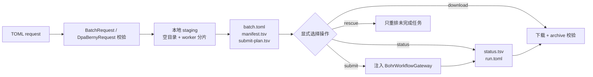

# tricycle-bohrsubmit

`tricycle-bohrsubmit` 是面向化学计算的 Bohr 工作流编排组件。它把任务文件展开为可审计的
本地 run 目录，生成 worker 分片和提交计划，并通过注入的 gateway 执行提交、查询、下载、
终止和 watch。Gaussian 与 DPA-Berny 有专用输入准备流程；其它任务可以使用通用批量脚本。

## 能力

原生插件 ID 为 `tricycle.bohr.submit`：

| 能力 | 作用 |
| --- | --- |
| `batch.prepare` | 展开任务 glob，复制脚本/公共文件并生成 worker 分片 |
| `batch.submit` | 提交已准备的 run 目录 |
| `batch.status` | 查询 run 对应的 Bohr jobs |
| `batch.download` | 下载所有 worker 结果（含失败 worker 的部分结果）并校验归档/manifest |
| `batch.terminate` | 终止指定 job 或 job group |
| `batch.watch` | 按状态轮询直到完成或达到限制 |
| `dpa-berny.prepare` | 为 DPA-Berny 或 Gaussian 生成输入和 worker 目录 |
| `dpa-berny.rescue` | 跳过已完成任务，为失败/未完成任务准备 rescue run |

应用层会将其映射为 `bohr.batch.*`、`dpa-berny.prepare` 和 `dpa-berny.rescue`。

## 工作流



`prepare` 是本地阶段，只能写入指定的空 run 目录；它不会提交远程任务。典型目录会包含：

- `request.toml`、`batch.toml` 和 `batch.env`；
- `manifest.txt`、`manifest.tsv`，记录输入任务和分片关系；
- 每个 worker 的脚本、任务文件和公共文件；
- `submit-plan.tsv`，作为提交前的审计清单；
- 运行后生成的 `submit-results.tsv`、`status.tsv`、`download-results.tsv` 和 ID 映射文件。

任务通过稳定的 checksum 分配到 worker，避免依赖 glob 返回顺序。staging 会拒绝非空输出
目录、越界路径、无任务输入或不明确的脚本配置。

下载按 `submit-results.tsv` 中每个有 job ID 的 worker 尝试，包括 `status.tsv` 标记为
`FAILED` 的 worker；worker 失败只表示其中至少有一个任务失败，不能据此丢弃同一 worker
中的其它日志和结果。下载报告会逐 worker 记录成功或失败。

## 请求模型

### `BatchRequest`

适合已有任务脚本的批量工作流，主要字段包括：

- `task_patterns` / `tasks`、`workers`；
- 二选一的 `script` 或 `worker_script`；
- `image`、`project_id`、`machine_type`；
- `common_paths`、`out_dir`、job group、dataset/backward files；
- reschedule、运行时、节点数和额外 Bohr 参数。

项目和机器类型也可从 `BOHR_PROJECT_ID`、`BOHR_MACHINE_TYPE` 读取；凭据不在 request 中表示。

### `DpaBernyRequest`

用于从 XYZ 任务生成 DPA-Berny/Gaussian 输入，主要字段包括：

- `xyz_patterns`、`workers`、`engine`（`dpa` 或 `gaussian`）；
- DPA 的 `model_path`，或 Gaussian 的 `functional` 与 `basis`；
- `task_type`（`ts` / `opt` / `auto`）、charge、multiplicity、资源和 route；
- fixed/multi-stage checkpoint、constraint 和失败处理选项；
- 与批量请求相同的镜像、项目、机器、输出和 Bohr 提交参数。

当前没有独立的 ORCA 输入契约；ORCA 任务应使用 `BatchRequest` 加显式 worker script。

### Rescue

`RescueRequest` 以已有 run 为输入，读取任务/状态清单并生成新 run。已成功任务不会再次排队，
从而避免恢复时重复消耗计算资源。

## CLI 示例

只准备本地目录：

```bash
uv run --package tricycle-agent tricycle-agent run \
  bohr.batch.prepare request.toml \
  --run-id batch-demo

uv run --package tricycle-agent tricycle-agent inspect \
  --run-dir 'runs/<date>/<timestamp>/batch-demo'
```

确认 `manifest.tsv` 和 `submit-plan.tsv` 后，才执行已准备 run 的后续生命周期操作：

```bash
uv run --package tricycle-agent tricycle-agent run \
  bohr.batch.submit 'runs/<date>/<timestamp>/batch-demo' \
  --run-id batch-submit-demo --live
```

DPA-Berny 示例请求见 [`configs/example-dpa-berny-request.toml`](../../configs/example-dpa-berny-request.toml)。
所有真实远程动作都需要应用注入 `BohrWorkflowGateway`；测试可使用
`InMemoryBohrGateway`，不依赖 Bohr CLI 或网络。

## 生命周期和安全边界

- `BohrWorkflowGateway` 扩展 core 的 `BohrGateway`，提供 job group、终止、列举和 ID 解析能力。
- `BohrCliGateway` 是本包唯一的 Bohr CLI subprocess adapter；插件逻辑不直接启动外部命令。
- 下载会检查 archive 成员、CRC、manifest 和指纹，并使用安全解压路径；失败时保留 run 状态供审查。
- `run.toml` 的 `resume.next_action` 是恢复入口；不要依赖聊天上下文或手工猜测外部 job ID。
- 默认规划和 prepare 不读取认证、不发起网络请求、不提交真实任务。

## 验证

```bash
uv run pytest packages/tricycle-bohrsubmit/tests
make check
```
