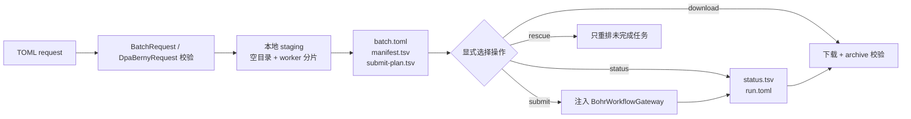

# tricycle-bohrsubmit

`tricycle-bohrsubmit` 是面向化学计算的 Bohr 工作流编排组件。它把任务文件展开为可审计的
本地 run 目录，生成 worker 分片和提交计划，并通过注入的 gateway 执行提交、查询、下载、
终止和 watch。Gaussian 与 DPA-Berny 有专用输入准备流程；其它任务可以使用通用批量脚本。

## 能力

原生插件 ID 为 `tricycle.bohr.submit`：

| 能力 | 作用 |
| --- | --- |
| `batch.prepare` | 展开任务 glob，复制脚本/公共文件并生成 worker 分片 |
| `batch.submit` | 提交已准备的 run 目录 |
| `batch.status` | 查询 run 对应的 Bohr jobs |
| `batch.download` | 下载所有 worker 结果（含失败 worker 的部分结果）并校验归档/manifest |
| `batch.terminate` | 终止指定 job 或 job group |
| `batch.watch` | 按状态轮询直到完成或达到限制 |
| `dpa-berny.prepare` | 为 DPA-Berny 或 Gaussian 生成输入和 worker 目录 |
| `dpa-berny.rescue` | 跳过已完成任务，为失败/未完成任务准备 rescue run |

应用层会将其映射为 `bohr.batch.*`、`dpa-berny.prepare` 和 `dpa-berny.rescue`。

## 工作流



`prepare` 是本地阶段，只能写入指定的空 run 目录；它不会提交远程任务。典型目录会包含：

- `request.toml` 和 `batch.toml`；
- `manifest.txt`、`manifest.tsv`，记录输入任务和分片关系；
- 每个 worker 的脚本、任务文件和公共文件；
- `submit-plan.tsv`，作为提交前的审计清单；
- 运行后生成的 `submit-results.tsv`、`status.tsv`、`downloads/download-results.tsv`。

文件任务通过稳定的 checksum 分配到 worker；内嵌任务表按声明顺序轮流分配，无需为分片改写任务文件名。staging 会拒绝非空输出
目录、越界路径、无任务输入或不明确的脚本配置。

下载按 `submit-results.tsv` 中每个有 job ID 的 worker 尝试，包括 `status.tsv` 标记为
`FAILED` 的 worker；worker 失败只表示其中至少有一个任务失败，不能据此丢弃同一 worker
中的其它日志和结果。下载报告会逐 worker 记录成功或失败。任务 ID 原样传给 gateway 并保留在报告中；
用于本地下载目录或终止日志文件名时，对路径分隔符等字符进行百分号编码。实际下载位置以报告的 `download_dir` 为准。

## 请求模型

### `BatchRequest`

适合已有任务脚本的批量工作流，主要字段包括：

- `task_patterns`，或者 `task_defaults` + `task_specs`；两种输入互斥；
- `workers`；
- 二选一的 `script` 或 `worker_script`；
- `image`、`project_id`、`machine_type`；
- `common_paths`、`out_dir`、job group、dataset/backward files；
- reschedule、运行时、节点数和额外 Bohr 参数。

请求只接受当前模型声明的字段；未知字段与旧别名均报错。`out_dir`、`common_paths`、`dataset_paths`、`extra_submit_args` 分别表示输出目录、共享输入、数据集路径与额外提交参数。应用 CLI 可在准备请求中保存 `continue_on_error`、`interval`、`max_iterations` 和 `download_when_complete`，用于后续生命周期操作；这些选项不进入 worker 准备模型。

项目和机器类型也可从 `BOHR_PROJECT_ID`、`BOHR_MACHINE_TYPE` 读取；凭据不在 request 中表示。

### `DpaBernyRequest`

用于从 XYZ 任务生成 DPA-Berny/Gaussian 输入，主要字段包括：

- `xyz_patterns`、`workers`、`engine`（`dpa` 或 `gaussian`）；
- DPA 的 `model_path`，或 Gaussian 的 `functional` 与 `basis`；
- `task_type`（`ts` / `opt` / `auto`）、charge、multiplicity、资源和 route；
- fixed/multi-stage checkpoint、constraint 和失败处理选项；
- 与批量请求相同的镜像、项目、机器、输出和 Bohr 提交参数。

资源约束按计算引擎执行：`engine="dpa"` 必须选择 GPU 节点，`engine="gaussian"`
必须选择 CPU 节点。`machine_type` 使用明确带 NVIDIA/GPU 或 CPU 标识的平台规格；
无法识别的规格也会拒绝。准备、提交（含 dry-run）和 rescue 均检查这一约束，
`extra_submit_args` 不允许用 `--machine_type` / `-t` 或配置文件覆盖它。
DPA 的 Bash worker 强制 `DEVICE=cuda`，在启动模型服务前检查 Torch CUDA、DeepMD
实际设备及一次 GPU 前向/反向运算，记录 `results/dpa-device.json`；失败立即退出，
不回退到 CPU。DPA-Berny 中 Gaussian 的优化流程在 CPU 执行、DPA 能量与梯度在 GPU
执行，因此整个任务必须申请 GPU 节点。纯 Gaussian 任务只能申请 CPU 节点。
验收 DPA smoke 时同时核对 GPU 设备证据、模型服务能量/梯度请求和优化结果；CPU
运行即使完成优化也不能计为通过。

当前没有独立的 ORCA 输入契约；ORCA 任务应使用 `BatchRequest` 加显式 worker script。

### Rescue

`RescueRequest.source_run` 指向已有 run，资源及工作流配置只读取 `batch.toml`；以此为输入，读取任务/状态清单并生成新 run。已成功任务不会再次排队，
从而避免恢复时重复消耗计算资源。新目录中的 `rescue-summary.tsv` 记录逐任务状态和处理动作。
资源配置仍须满足 DPA/GPU、Gaussian/CPU 约束；启动脚本从包内当前实现生成，
复用源任务的输入与模型资产，不沿用旧 worker 脚本。

## CLI 示例

只准备本地目录：

```bash
uv run --package tricycle-agent tricycle-agent run \
  bohr.batch.prepare request.toml \
  --run-id batch-demo

uv run --package tricycle-agent tricycle-agent inspect \
  --run-dir 'runs/<date>/<timestamp>/batch-demo'
```

确认任务清单、`submit-plan.tsv` 和 `resume.next_action = "bohr.batch.submit"` 后，才执行已准备 run 的提交：

```bash
uv run --package tricycle-agent tricycle-agent resume \
  --run-dir 'runs/<date>/<timestamp>/batch-demo' --live
```

DPA-Berny 示例请求见 [`configs/example-dpa-berny-request.toml`](../../configs/example-dpa-berny-request.toml)。
`resume` 执行状态中记录的下一动作，不能当作固定提交命令；已有 `run.toml` 不再通过 `run` 初始化。
所有真实远程动作都需要应用注入 `BohrWorkflowGateway`；测试可使用
`InMemoryBohrGateway`，不依赖 Bohr CLI 或网络。

## 生命周期和安全边界

CLI adapter 策略配置使用 `[bohr]` 和 `[retry]` 表，见
[`example-bohr.toml`](../../configs/example-bohr.toml)。省略项使用默认值；平铺字段、未知表和未知字段均拒绝，拼写错误不会静默变成默认重试策略。

- `BohrWorkflowGateway` 扩展 core 的 `BohrGateway`，提供 job group、终止、列举和 ID 解析能力。
- `BohrCliGateway` 是本包唯一的 Bohr CLI subprocess adapter；插件逻辑不直接启动外部命令。
- 下载会检查 archive 成员、CRC、manifest 和指纹，并使用安全解压路径；失败时保留 run 状态供审查。
- `run.toml` 的 `resume.next_action` 是恢复入口；不要依赖聊天上下文或手工猜测外部 job ID。
- 默认规划和 prepare 不读取认证、不发起网络请求、不提交真实任务。

## 验证

```bash
uv run pytest packages/tricycle-bohrsubmit/tests
make check
```

## 公共参数与任务差异

同一模型的折或随机种子实验用一份请求即可：`task_defaults` 保存公共字段，`task_specs` 每行只有 `name` 和差异字段（例如 `fold`、`seed`）。任务行不能重写公共字段；需要变化的字段只放在任务行中。名称必须唯一且为安全 basename。

staging 将它们展开成现有 worker 要求的 TOML，轮流分配到 worker，并记录任务映射与输入哈希。完整任务文件属于派生上传输入，不再单独维护源配置。已有任务文件通过 `task_patterns` 显式选择。SAR 内嵌任务请求只保存批次 `tasks.tsv` 和 worker 运行所需的 `manifest.txt`，不生成重复的 worker `manifest.tsv`。
