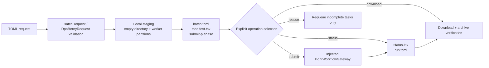

# tricycle-bohrsubmit

`tricycle-bohrsubmit` orchestrates Bohr workflows for chemistry computations. It expands task files into auditable local run directories, creates worker partitions and submission plans, and uses an injected gateway for submission, status, download, termination, and watch operations. Gaussian and DPA-Berny have dedicated input preparation; other jobs can use general batch scripts.

## Capabilities

`BohrCliGateway.reconcile_submission(name, group_id)` performs a read-only, group-filtered inventory query for uncertain submissions. It returns `found` with the public job ID or `absent` only when the pagination metadata proves the inventory is complete. Incomplete inventories, multiple exact-name matches, or missing public IDs raise an error; no submission is made. Callers persist the returned inventory and apply their bounded recovery policy. The replay controller requires two spaced absence confirmations before any new submit.

The native plugin ID is `tricycle.bohr.submit`:

| Capability | Purpose |
| --- | --- |
| `batch.prepare` | Expand task globs, copy scripts/shared files, and partition workers |
| `batch.submit` | Submit a prepared run directory |
| `batch.status` | Query the run's Bohr jobs |
| `batch.download` | Download every worker's results, including partial outputs from failed workers, and verify archives/manifests |
| `batch.terminate` | Terminate specified jobs or job groups |
| `batch.watch` | Poll status until completion or a configured limit |
| `dpa-berny.prepare` | Generate inputs and worker directories for DPA-Berny or Gaussian |
| `dpa-berny.rescue` | Skip completed tasks and prepare a rescue run for failed/incomplete tasks |

The application maps these to `bohr.batch.*`, `dpa-berny.prepare`, and `dpa-berny.rescue`.

## Workflow



`prepare` is local and writes only to the specified empty run directory; it does not submit remote jobs. A typical directory contains:

- `request.toml` and `batch.toml`.
- `manifest.txt` and `manifest.tsv`, recording input tasks and worker assignments.
- Scripts, task files, and shared files for each worker.
- `submit-plan.tsv`, the pre-submission audit list.
- After execution, `submit-results.tsv`, `status.tsv`, and `downloads/download-results.tsv`.

File tasks are assigned by stable checksum; inline task tables are distributed round-robin in declaration order without renaming task files. Staging rejects nonempty output directories, path escapes, missing task inputs, and ambiguous script configurations.

Download attempts every worker with a job ID in `submit-results.tsv`, including workers marked `FAILED` in `status.tsv`. A failed worker means at least one task failed; it does not justify discarding other logs and results from that worker. The download report records success/failure per worker. Job IDs pass unchanged to the gateway and remain unchanged in reports. Path separators and similar characters are percent-encoded when IDs appear in local download directories or termination log filenames. The report's `download_dir` is authoritative for the actual download location.

## Request models

### `BatchRequest`

For batch workflows using existing task scripts, key fields include:

- Either `task_patterns` or `task_defaults` + `task_specs`; these input forms are mutually exclusive.
- `workers`.
- Exactly one of `script` or `worker_script`.
- `image`, `project_id`, and `machine_type`.
- `common_paths`, `out_dir`, job group, dataset/backward files.
- Rescheduling, runtime, node count, and additional Bohr arguments.

Requests accept only current model fields; unknown fields and legacy aliases are errors. `out_dir`, `common_paths`, `dataset_paths`, and `extra_submit_args` specify the output directory, shared inputs, dataset paths, and extra submission arguments respectively. The application CLI may retain `continue_on_error`, `interval`, `max_iterations`, and `download_when_complete` in preparation requests for subsequent lifecycle operations; these options do not enter the worker preparation model.

Project and machine type may also come from `BOHR_PROJECT_ID` and `BOHR_MACHINE_TYPE`. Requests never contain credentials.

### `DpaBernyRequest`

For generating DPA-Berny/Gaussian inputs from XYZ tasks, key fields include:

- `xyz_patterns`, `workers`, and `engine` (`dpa` or `gaussian`).
- DPA `model_path`, or Gaussian `functional` and `basis`.
- `task_type` (`ts` / `opt` / `auto`), charge, multiplicity, resources, and route.
- Fixed/multi-stage checkpoints, constraints, and failure handling.
- The same image, project, machine, output, and Bohr submission fields as batch requests.

Resource constraints follow the engine: `engine="dpa"` requires a GPU node, while `engine="gaussian"` requires a CPU node. `machine_type` must identify an explicit NVIDIA/GPU or CPU platform specification; unrecognized specifications are rejected. Preparation, submission (including dry-run), and rescue enforce this requirement. `extra_submit_args` cannot override it through `--machine_type`, `-t`, or a configuration file.

DPA Bash workers enforce `DEVICE=cuda`. Before starting the model service, they check Torch CUDA, the actual DeepMD device, and one GPU forward/backward pass, recording `results/dpa-device.json`. Failure exits immediately without CPU fallback. In DPA-Berny, Gaussian optimization runs on CPU while DPA energy/gradient evaluation runs on GPU, so the complete job requires a GPU node. Pure Gaussian jobs require CPU nodes. DPA smoke acceptance checks GPU device evidence, model-service energy/gradient requests, and optimization results together. CPU execution cannot pass even if optimization completes.

There is no dedicated ORCA input contract. Use `BatchRequest` with an explicit worker script for ORCA jobs.

### Rescue

`RescueRequest.source_run` points to an existing run. Resource and workflow settings come only from `batch.toml`; task/status manifests then drive preparation of a new run. Successful tasks are not requeued, avoiding duplicate computation. `rescue-summary.tsv` in the new directory records each task's status and action.

Resource settings must still satisfy DPA/GPU and Gaussian/CPU requirements. Launch scripts are generated from the current packaged implementation; rescue reuses source task inputs and model assets, not old worker scripts.

## CLI examples

Prepare a local directory only:

```bash
uv run --package tricycle-agent tricycle-agent run \
  bohr.batch.prepare request.toml \
  --run-id batch-demo

uv run --package tricycle-agent tricycle-agent inspect \
  --run-dir 'runs/<date>/<timestamp>/batch-demo'
```

After verifying the task manifest, `submit-plan.tsv`, and `resume.next_action = "bohr.batch.submit"`, submit the prepared run:

```bash
uv run --package tricycle-agent tricycle-agent resume \
  --run-dir 'runs/<date>/<timestamp>/batch-demo' --live
```

See [`configs/example-dpa-berny-request.toml`](../../configs/example-dpa-berny-request.toml) for a DPA-Berny request. `resume` executes the next action recorded in state; it is not a fixed submission command. Do not initialize an existing `run.toml` through `run` again. Every real remote operation requires an application-injected `BohrWorkflowGateway`; tests can use `InMemoryBohrGateway` without the Bohr CLI or network.

## Lifecycle and safety boundaries

CLI adapter policy uses `[bohr]` and `[retry]` tables; see [`example-bohr.toml`](../../configs/example-bohr.toml). Omitted options use defaults. Flat fields, unknown tables, and unknown fields are rejected, so misspellings cannot silently select default retry behavior.

- `BohrWorkflowGateway` extends core's `BohrGateway` with job groups, termination, listing, and ID resolution.
- `BohrCliGateway` is this package's only Bohr CLI subprocess adapter; plugin logic never launches external commands directly.
- Downloads check archive members, CRCs, manifests, and fingerprints, and use safe extraction paths. Failures preserve run state for review.
- `run.toml.resume.next_action` is the recovery entry point; do not rely on chat context or guessed external job IDs.
- Default planning and preparation read no authentication, perform no network requests, and submit no real jobs.

## Validation

```bash
uv run pytest packages/tricycle-bohrsubmit/tests
make check
```

## Shared parameters and task differences

Fold or seed experiments for one model use a single request. `task_defaults` holds common fields; each `task_specs` row contains only `name` and differing fields such as `fold` or `seed`. Rows cannot override shared fields; any varying field belongs only in the rows. Names must be unique, safe basenames.

Staging expands these rows into the TOML required by existing workers, assigns them round-robin, and records task mappings and input hashes. Complete task files are derived upload inputs, not separately maintained source configurations. Select existing task files explicitly with `task_patterns`. SAR inline-task requests retain only batch `tasks.tsv` and the worker-required `manifest.txt`, without duplicate worker `manifest.tsv` files.

### Referenced inputs

`BohrJobSpec.parameters.input_assets_manifest` points to a `tricycle.asset-input/v1` or v2 manifest. New batch, DPA/Gaussian, and rescue workflows prepare worker inputs in temporary directories and publish them to `artifacts/task-assets`. Each worker directory in the run retains only `input-assets.json`; `batch.toml.input_assets` binds the complete input tree. TSV `input_dir` identifies the input record directory and must not be used directly as the Bohr CLI upload directory.

After verifying shared assets, the CLI adapter assembles independent inputs in a temporary directory, calls submission, and cleans up on both success and failure. New records do not require `input_directory`; existing records can use it for an overlay of differing files. Before submission, the method, complete input tree, and manifest bindings are verified. Rescue resolves original tasks and models from the same references and generates current worker launch scripts. Existing physical input directories remain readable; historical runs are not automatically migrated. Preparation stays offline. The CLI still uploads all required inputs per job; local sharing does not imply remote caching across jobs.

### Transfer scope

Batch staging and direct CLI uploads reject installed environments and caches
using core's transfer checks, including environment files inside ZIP/tar inputs.
The error identifies the offending path. Prepare a clean input bundle containing
source, dependency declarations, scripts, data, and required weights; do not change
the selected environment or rewrite frozen assets to bypass a failure.

Submission requires a nonempty `backward_files` list or typed `output_artifacts`.
Use named result directories and explicit file types (`results/`, `worker.log`,
`*.xyz`); `.`, `*`, recursive globs, wildcard directories, and environment paths
are rejected. `extra_submit_args` cannot override input paths or selector config.

Downloads first enter an OS temporary directory. Environment/cache paths in loose
files or ZIP/tar members reject publication into the destination. Existing evidence
remains unchanged; temporary downloads are removed on success or failure. Batch
downloads retain their existing per-worker failure report and archive CRC checks.
The current CLI cannot filter an already-created remote archive while downloading:
an old contaminated result may still consume network/temporary space before it is
rejected. Narrow the remote result package or retrieve explicit scientific outputs
through an appropriate adapter; repeated download cannot repair that package.
