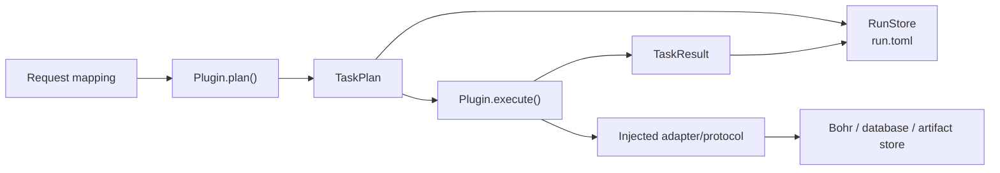

# tricycle-core

`tricycle-core` provides TriCycle Agent's shared contracts and runtime infrastructure. It depends only on the Python standard library, contains no chemistry, model, or platform business logic, and never depends on plugins.

## Responsibilities

The package provides these stable boundaries for all components:

| Module | Purpose |
| --- | --- |
| `models` | Cross-component models such as `Artifact`, `TaskPlan`, `TaskResult`, `ExecutionContext`, `ReactionRecord`, and `BohrJobSpec` |
| `protocols` | External dependency interfaces, including `BohrGateway`, `ReactionRepository`, `ArtifactStore`, and `ReactionOptAdapter` |
| `capabilities` | `CapabilityManifest`, `CapabilityBinding`, and `CapabilityCatalog` for capability declaration, validation, and dispatch |
| `plugin` / `registry` | The `Component` protocol, `PluginBase`, and `PluginRegistry` |
| `run_state` / `run_paths` | Auditable, resumable run state stored in `run.toml` |
| `trace` | Append-only execution events in hash-chain JSONL, verification, and large-payload references |
| `toml` / `env` | Restricted TOML I/O, atomic file updates, and `.env` discovery/loading helpers |
| `io` / `metrics` / `training_protocol` | Shared file operations, regression metrics, and training binding loading/validation |
| `errors` | Input, integration configuration, run-state, and artifact errors |
| `transfer` | Shared checks for installed environments/caches, bounded result selectors, and validated download publication |
| `record_ledger` / `record_io` | Transactional live namespaces, compressed contents, audit chains, and explicit logical I/O; no domain dependencies |
| `mail` | Injectable TLS SMTP sender with lazy environment configuration; used by trajectory and balance alerts |

## Core objects



- `PluginManifest` describes component identity, version, type, capabilities, and dependencies.
- `TaskPlan` is a JSON-safe execution plan containing a task ID, input artifacts, parameters, and metadata.
- `TaskResult` records result states such as `planned`, `submitted`, `running`, `succeeded`, and `failed`, together with output artifacts.
- `ExecutionContext` carries `run_id`, the working directory, `dry_run`, run metadata, and an injectable `TraceSink`.
- `Artifact` represents files, directories, checkpoints, structured data, and remote job results in a common format.

`TraceStore` writes events to `<run_dir>/trace/events.jsonl`. Each line contains a sequence number, the previous event's hash, and its own hash; appends use an interprocess file lock. Before audit or recovery, `verify()` checks sequence continuity, run ID, and the full hash chain. Event payloads must be JSON-safe. `write_payload()` stores large payloads as references with SHA-256 hashes.

## Plugins and capabilities

Plugins implement `PluginBase.manifest` and `PluginBase.plan`. `CapabilityCatalog` also maintains explicit bindings from capability IDs to components and operations. Before dispatch, it validates input types, side-effect levels, authentication requirements, dry-run support, and dependencies. Placing a component under `packages/` does not authorize execution: application bootstrap must register it explicitly.

By default, `PluginBase.execute()` only handles dry-run plan results. Non-dry-run execution without the required adapter raises `IntegrationNotConfiguredError`; core does not implicitly create network clients or read platform credentials.

## External service protocols

Core defines interfaces without providing production platform implementations:

- `BohrGateway`: submit, query, and download a single Bohr job.
- `ReactionRepository`: write reaction records.
- `ReactionOptAdapter`: execute a ReactionOpt configuration or profile.
- `CandidateScorer`: score candidates.
- `ArtifactStore`: save and retrieve artifacts.

Production adapters are injected at the application composition layer. Tests and dry-runs can use in-memory implementations. Model components, the reaction database, and ReactionOpt therefore do not need knowledge of specific HTTP, CLI, credential, or cloud implementations.

## Run state

`RunStore` atomically writes state to `<run_dir>/run.toml` using the `tricycle.run/v1` schema. State can include:

- Run and execution stages.
- `resume.next_action` and external job IDs.
- Input/output artifacts and fingerprints.
- Final results, errors, and adapter metadata.

`RunStore` supports creation, opening, reading, writing, and updating for inspection, recovery, and auditing. Writes replace a temporary file atomically, preventing partially written state after interruption. If no run directory is specified, `timestamped_run_directory` uses local time to generate `runs/YYYY-MM-DD/HH-MM-SS.ffffff±ZZZZ/<run-id>`.

## Example

```python
from pathlib import Path

from tricycle_core import Artifact, ExecutionContext, TaskPlan

context = ExecutionContext(run_id="demo", workdir=Path("runs/demo"), dry_run=True)
plan = TaskPlan(
    task_id="demo/task",
    plugin_id="example.plugin",
    operation="example",
    inputs=(Artifact("input", "inputs/data.json", kind="file"),),
    parameters={"mode": "check"},
)
```

Plugins should use explicit dataclass requests rather than place business rules in core's generic mappings. Only fields shared across plugins belong here; domain models belong in their respective packages.

## Validation

Core contract tests are in [`tests/`](tests/). Workspace-level cross-component tests remain in the repository's root `tests/` directory:

```bash
uv run --frozen --all-packages pytest packages/tricycle-core/tests
```

See [`docs/plugin-contract.md`](../../docs/plugin-contract.md) for development requirements.

## Shared immutable assets

`asset_store` stores files by SHA-256 in a caller-specified project store: `blobs/` holds unique bytes, `manifests/` records tree paths, hashes, sizes, and executable bits, and `trees/` exposes read-only directory views. Identical files share inodes across trees. Mutable sources are independently copied before publication, so checkout edits cannot change frozen assets. Reads verify hashes and fail on missing or changed assets; they never substitute current source or automatically refresh historical bindings.

`put_file` / `put_tree` return serializable references. `externalize_tree` creates shared-view links for result directories; new inputs use the reference-record interfaces below. `materialize_input` expands `tricycle.asset-input/v1` or v2 tree references, file references, and optional overlays into an independent temporary upload directory, rejecting path escapes and conflicts. References contain the store root, so moving the store requires explicit reference migration; copying a run alone does not permit deleting its shared store. There is no automatic garbage collection. Retain every object still referenced by a run.

Asset tree manifests also bind directory structure, including empty directories. New manifests use `tricycle.asset-tree/v2`; existing v1 run references remain readable with their original hashes. `materialize_directory` expands a verified directory view into an independent writable execution copy. Callers verify references before materialization.

New asset writes and transfer boundaries reject installed environments and caches,
including `.venv`, `venv`, `pyvenv.cfg` in renamed environments, `conda-meta`,
`site-packages`, `.cache`, `.pip-cache`, and Python/tool caches. Source, dependency
declarations, launch scripts, data, and model checkpoints remain valid assets.
ZIP and tar-family member names are checked without rewriting the archives.
Existing asset references remain readable; validation does not migrate or delete
historical objects. New tree publication retains its existing bytecode omission
but rejects other contaminated input instead of silently changing its dependencies.

`transfer.validate_result_selector` requires named relative output directories or
file patterns with explicit extensions, such as `results/`, `worker.log`, or
`*.xyz`. Whole-workspace, recursive, wildcard-directory, and environment selectors
are rejected. `publish_download` checks a disposable download before publishing
files; identical existing files are reused and conflicting evidence is rejected.

## Run records and input storage

New runs retain requests/protocol bindings, input references and hashes, execution state, logs, and results. Apply [run record scope](../../docs/run-records.md): every retained file must belong to an identifiable task and support execution, verification, or recovery. The timestamp helper only formats a path; it does not authorize storing arbitrary outputs under `runs/`. Independent audits, offline figures/reports, host-service state, and disposable checks use their separate roots. Input data, splits, weights, and worker delivery trees reside in the shared asset store; runs retain neither input entities nor input symlinks. Hard links are only an internal local deduplication mechanism; copying is the fallback, and callers do not need to support hard links.

`freeze_inputs(directory, paths, store)` publishes and verifies `input-assets.json` before removing the corresponding input entities. In `tricycle.asset-input/v2`, `trees` maps delivery-relative paths to tree references, whose `path` selects a directory within the tree; `files` maps delivery-relative paths to file references and records executable bits. The v1 tree list is still read by merging trees at the root.

`resolve_input` reads and verifies inputs by logical path for local analysis/preparation. Before execution/upload, `materialize_input(manifest, None, destination)` creates an independent writable copy, preserving empty directories and executable bits. Callers manage temporary directory lifetimes. Missing or corrupted shared assets prevent execution; current source or other data must not fill the gaps. Historical runs are not automatically rewritten or cleaned up, and asset cleanup must account for every referenced object.

Live replay records use the shared transactional record interfaces described in
[live replay records](../../docs/compact-replay-records.md). Database transactions
never span external RPCs. Physical file I/O remains available for worker delivery
and immutable external assets; callers explicitly choose logical record I/O.
