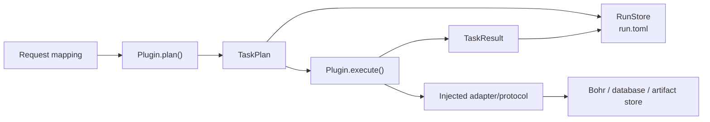

# tricycle-core

`tricycle-core` 是 TriCycle Agent 的公共契约层和运行时基础设施。它只依赖 Python
标准库，不实现具体的化学、模型或平台业务，也不反向依赖任何插件。

## 职责

这个包为所有组件提供以下稳定边界：

| 模块 | 作用 |
| --- | --- |
| `models` | `Artifact`、`TaskPlan`、`TaskResult`、`ExecutionContext`、`ReactionRecord`、`BohrJobSpec` 等跨组件数据模型 |
| `protocols` | `BohrGateway`、`ReactionRepository`、`ArtifactStore`、`ReactionOptAdapter` 等外部依赖接口 |
| `capabilities` | `CapabilityManifest`、`CapabilityBinding`、`CapabilityCatalog`，用于声明、校验和分发能力 |
| `plugin` / `registry` | `PluginBase`、`PluginRegistry` 以及旧 `Plugin` 名称的兼容入口 |
| `run_store` | 以 `run.toml` 保存可审计、可恢复的运行状态 |
| `trace` | 以 hash-chain JSONL 保存 append-only 执行事件，并提供校验和大 payload 引用 |
| `toml` / `env` | 受限 TOML 读写、原子文件更新和 `.env` 查找/加载辅助函数 |
| `errors` | 输入错误、集成未配置、运行状态和 artifact 错误 |

## 核心对象



- `PluginManifest` 描述组件身份、版本、类型、能力和依赖。
- `TaskPlan` 是 JSON-safe 的执行计划，记录 task ID、输入 artifact、参数和元数据。
- `TaskResult` 记录 `planned`、`submitted`、`running`、`succeeded`、`failed` 等结果状态以及输出 artifact。
- `ExecutionContext` 携带 `run_id`、工作目录、`dry_run`、运行元数据和可注入的 `TraceSink`。
- `Artifact` 用统一格式表示文件、目录、checkpoint、结构数据和远程任务结果。

`TraceStore` 将事件写入 `<run_dir>/trace/events.jsonl`，每一行包含序号、前一事件 hash 和自身
hash，并在追加时使用进程间文件锁。`verify()` 可在审计或恢复前检查序号连续性、run ID 和
整条 hash 链；事件 payload 只允许 JSON-safe 值，较大的内容可通过 `write_payload()` 保存为
带 SHA-256 的引用。

## Plugin 与 capability

插件实现 `PluginBase` 的 `manifest` 和 `plan`。`CapabilityCatalog` 另外维护能力 ID 到
组件/操作的显式绑定，并在分发前校验输入类型、副作用级别、认证要求、dry-run 支持和依赖。
组件不会因为被放在 `packages/` 下就自动获得执行权限；应用层必须在 bootstrap 中显式注册。

`PluginBase.execute()` 的默认行为只处理 dry-run 计划结果。非 dry-run 执行如果没有对应的
adapter，会抛出 `IntegrationNotConfiguredError`，因此 core 不会偷偷创建网络客户端或读取
平台凭据。

## 外部服务 protocol

core 只定义接口，不提供真实平台实现：

- `BohrGateway`：提交、查询和下载单个 Bohr job；
- `ReactionRepository`：写入反应记录；
- `ReactionOptAdapter`：执行 ReactionOpt 配置或 profile；
- `CandidateScorer`：对候选进行评分；
- `ArtifactStore`：保存和读取 artifact。

生产 adapter 在应用组合层注入，测试和 dry-run 可以使用内存实现。这样模型组件、反应数据库
和 ReactionOpt 不需要知道具体 HTTP、CLI、凭据或云平台实现。

## 运行状态

`RunStore` 将状态原子写入 `<run_dir>/run.toml`，当前 schema 为 `tricycle.run/v1`。状态中
可以保存：

- 运行和执行阶段；
- `resume.next_action` 以及外部 job ID；
- 输入/输出 artifact 和指纹；
- 最终结果、错误和 adapter 元数据。

`RunStore` 支持创建、打开、读取、写入和更新，适合 `inspect`、恢复和审计。写入使用临时
文件替换，避免中途失败留下半份状态文件。

## 使用示例

```python
from tricycle_core import Artifact, ExecutionContext, TaskPlan

context = ExecutionContext(run_id="demo", workdir="runs/demo", dry_run=True)
plan = TaskPlan(
    task_id="demo/task",
    plugin_id="example.plugin",
    operation="example",
    inputs=(Artifact("input", "inputs/data.json", kind="file"),),
    parameters={"mode": "check"},
)
```

实际插件应直接使用明确的 dataclass request，而不是把业务规则塞进 core 的通用 mapping。
跨插件共享的字段才放入本包；具体领域模型应留在对应 package 中。

## 验证

core 的契约测试位于 [`tests/`](tests/)；workspace 级跨组件测试仍位于根目录 `tests/`：

```bash
uv run --frozen --all-packages pytest packages/tricycle-core/tests
```

开发约束见 [`docs/plugin-contract.md`](../../docs/plugin-contract.md)。
