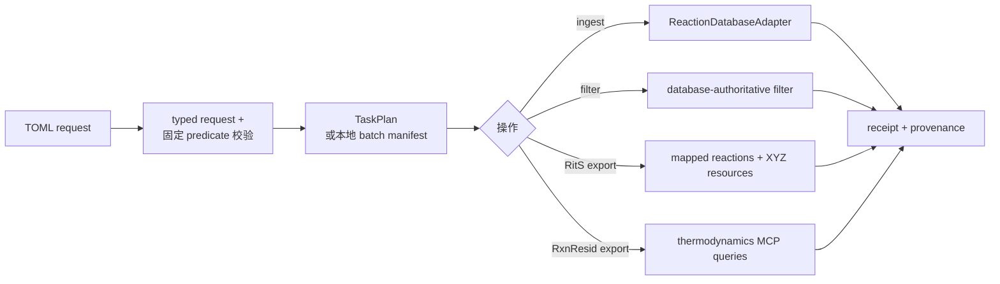

# tricycle-reaction-db

`tricycle-reaction-db` 是反应计算日志进入数据库以及从数据库导出训练数据的边界组件。
它负责请求校验、批次文件边界、数据库权威筛选条件、导出字段契约和 provenance receipt；
具体数据库 API、凭据和 schema 由注入的 adapter 实现。

## 能力

原生插件 ID 为 `tricycle.reaction-database`：

| 能力 | 作用 |
| --- | --- |
| `reaction.validate` | 校验兼容的单反应记录 |
| `reaction.ingest` | 通过 repository/adapter 录入单条反应记录 |
| `reaction.upsert` | 暴露兼容的 repository 写入边界 |
| `reaction.batch.validate` | 解析并审计一个计算日志批次 |
| `reaction.batch.ingest` | 一个新 project 导入一个批次 |
| `reaction.filter.cycloaddition` | 使用固定 cycloaddition rxn-SMARTS 筛选清洗数据 |
| `reaction.space.rits.export` | 导出 RitS 所需 mapped reaction + TS structure |
| `reaction.space.rxnresid.export` | 导出 RxnResid 所需能量和分阶段耗时 |
| `reaction.space.export` | 兼容旧名称的 RxnResid 导出入口 |

应用层的常用操作名是 `reaction-db.ingest`、`reaction-db.batch-import`、
`reaction-db.filter`、`reaction-db.export-rits` 和 `reaction-db.export-rxnresid`。

## 批次导入边界

`ReactionBatchImportRequest` 强制一次请求只创建一个内部 database project 并导入一个批次：

- project 使用小写 slug 和 name 描述，不能带已有 `project_id`；
- batch root 必须存在，默认只递归选择 `downloads/` 下的 `*.log`；
- symlink、越界文件、非普通文件和空批次会被拒绝；
- 计划保存 log 数量、总字节数和 manifest digest；
- Bohr 来源必须保留 job group ID、Bohr project ID、workflow 和初猜来源 provenance；
- 未显式提供 idempotency key 时，根据 project、batch 和 manifest digest 确定性生成。

这保证一次批量导入不会误把 Gaussian 输入、worker 输出或 sibling 目录文件上传到数据库。

## 数据库权威筛选

筛选固定使用数据库实际的 `reaction_smarts` predicate：

```text
[#6,#7]=,:[#6,#7].[#6,#7]=,:[#6,#7]-,:[#6,#7]=,:[#6,#7]>>[#6,#7]1[#6,#7][#6,#7][#6,#7]=,:[#6,#7][#6,#7]1
```

请求必须是 `reaction_filter="cycloaddition"`、`cleaned_only=true`，并使用上面的完整
`reaction_smarts`。`reaction_class` 不受支持；TriCycle 不在本地重新解释反应类别，也不从
日志自行推断 mapped reaction 关系。

## 两类标准导出

### RitS

`RitsDatasetExportRequest` 的最低字段契约为：

- `mapped_reaction_smiles`；
- 对应的 `ts_structure`，默认以 XYZ 物化；
- 数据库 project ID、固定 reaction SMARTS 和导出行数/provenance。

MCP adapter 通过 `compose_query` 调用数据库 `MappedReactionQueryService.list_mapped_reactions`
执行固定 reaction-SMARTS 筛选，再调用 `export_mapped_reaction_transition_state_geometries` 按
`after_binding_id` 游标读取 bounded pages。该导出工具返回 mapped-SMILES key、verified geometry
和逐原子 map number；adapter 按 map number 排序坐标并逐页物化 XYZ。成功 receipt 记录
`RITS_EXPORT_API_CONTRACT`、筛选与几何 MCP 工具 provenance、页数及导出行数。

### RxnResid

`RxnResidDatasetExportRequest` 通过数据库 MCP `compose_query` 接口导出：

- `mapped_reaction_smiles`；
- `reaction_free_energy`、`activation_free_energy`；
- `reactant_compute_seconds`、`transition_state_compute_seconds`、`product_compute_seconds`。

adapter 先按内部 `project_id` 和实际 `reaction_smarts` 分页读取 mapped reactions，再以每批最多 24 条
alias 查询读取 materialized thermodynamics profile。每行能量和阶段耗时取自同一个 `profiles[0]`；不从
本地日志重算或拼接。没有 profile 或 profile 格式无效时导出失败，缺少反应/活化能量的记录会排除并
统计原因，null 阶段耗时保留为空。receipt 记录 MCP 查询 provenance、project ID、筛选式、页数、批次、
行数及单位，不保存 bearer token。
默认项目固定为 ground-truth 的内部 ID `00000000-0000-7000-8000-000000000201`。未显式传入
destination 时，CSV 与 `receipt.json` 写入
`$TRICYCLE_RUN_ROOT/YYYY-MM-DD/<本地时间戳>/record/`（`TRICYCLE_RUN_ROOT` 未设置时使用 `runs/`）。

## 架构和 adapter 边界



`ReactionDatabaseAdapter` 提供 live 的导入、筛选和两种导出方法；仓库内置的
`McpReactionDatabaseAdapter` 通过数据库的 Streamable HTTP MCP endpoint 调用
`create_project` 和 `compose_query`；RxnResid 数据通过分页 mapped-reaction 和 materialized thermodynamics MCP 查询导出；默认导入模式使用数据库的
`POST /api/upload-batches` 创建 durable queue，再通过
`POST /api/upload-batches/{batch_id}/files` multipart 批量上传日志字节。该批量接口与单文件
`upload_calculation_log` 共用 RustFS staging 和后台 worker，不依赖数据库服务可见的共享目录。
将 `TRICYCLE_REACTION_DB_MCP_UPLOAD_MODE=mcp` 可启用逐文件 MCP 兼容模式。adapter 的导入
receipt 表示文件已提交到持久化队列（`submitted`），保留每个队列 ID 和状态，但不等待异步
MolOP 解析或填充清洗反应数量。
`ReactionRepository` 保留单条记录兼容边界。dry-run 只解析请求、发现文件、生成计划和 receipt
形状，不写数据库、不发 MCP 请求、不创建远程 project。测试可使用 `InMemoryReactionRepository`
或内存 adapter。MCP endpoint/token、REST bearer token、organization ID 和超时策略只从 live
环境变量读取，不能保存进请求 TOML。`TRICYCLE_REACTION_DB_REST_TOKEN` 必须是数据库接受的
OIDC/REST bearer token；MCP access token 只可用于 `/mcp/`，不会回退用于 REST。

需要核验数据库连接时，可调用 `McpReactionDatabaseAdapter.list_projects()`；这是只读 MCP
`list_projects` 操作，不会创建 project 或提交文件。

## CLI 示例

批次导入请求见 [`configs/example-reaction-db-batch-import.toml`](../../configs/example-reaction-db-batch-import.toml)，
筛选/导出示例见：

- [`configs/example-reaction-db-filter.toml`](../../configs/example-reaction-db-filter.toml)；
- [`configs/example-reaction-db-rits-export.toml`](../../configs/example-reaction-db-rits-export.toml)；
- [`configs/example-reaction-db-rxnresid-export.toml`](../../configs/example-reaction-db-rxnresid-export.toml)。

例如只规划 RitS 导出：

```bash
uv run --package tricycle-agent tricycle-agent plan \
  reaction-db.export-rits \
  configs/example-reaction-db-rits-export.toml --run-id db-rits-export-demo
```

真实导入或导出需要应用注入 adapter 并显式进入 live 路径；请求文件不应保存数据库凭据。

## 结果和验证

成功 receipt 至少记录 project ID、筛选器、行数、目标文件、API contract 和实际请求形状。
RxnResid 校验 mapped-reaction 与 thermodynamics `compose_query` provenance；RitS 校验数据库筛选与分页 geometry
MCP 工具 provenance。
错误 endpoint、`reaction_class`、缺少请求证明或单位信息都会被拒绝。

```bash
uv run pytest packages/tricycle-reaction-db/tests tests/test_framework.py
make check
```

更完整的对象层次、查询边界和 skill 入口见 [`docs/reaction-db.md`](../../docs/reaction-db.md)。
