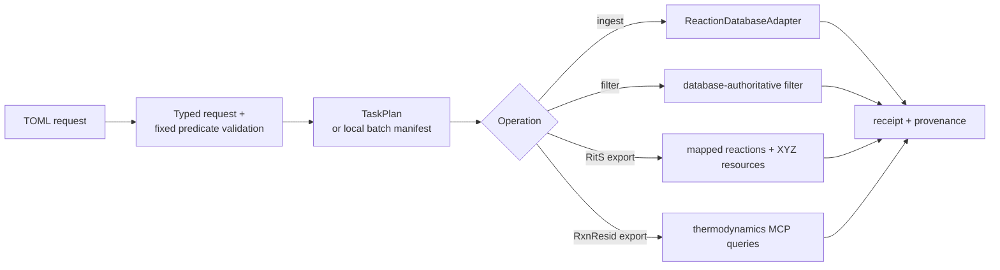

# tricycle-reaction-db

`tricycle-reaction-db` is the boundary for importing reaction calculation logs into a database and exporting training data. It handles request validation, batch file boundaries, database-authoritative filters, export field contracts, and provenance receipts. Injected adapters implement the actual database API, credentials, and schema.

Native sampling-pool export and adaptation live in `pools.py`; `substrate_adaptation.py` contains the sole implementation of substrate stereochemical identity matching. Install `tricycle-reaction-db[adaptation]` for RDKit; ordinary database interfaces require no chemistry dependencies. Use the package CLI directly:

Reusable pool exports default to `artifacts/datasets/<date>/<timestamp>/database-sampling-pools/`. Their manifest retains export/adaptation provenance alongside the data; downstream runs reference the bundle. Explicit output roots remain supported. Individual task execution records still follow [run record scope](../../docs/run-records.md).

```bash
uv run --package tricycle-reaction-db --extra adaptation python -m tricycle_reaction_db.pools export --config configs/database-sampling-pools.toml
uv run --package tricycle-reaction-db --extra adaptation python -m tricycle_reaction_db.pools adapt --config configs/database-sampling-pools.toml --root /absolute/export --output-root /absolute/new-adaptation
```

`export` defaults to an offline plan and reads the database through an adapter only with explicit `--live`. `adapt` verifies the native export receipt and preserves every source field and row. Neither operation depends on sampling, analysis, or tools.

Requests accept only model-declared fields. Batch import uses `slug` / `name` in `[project]` and `batch_id` / `root` in exactly one `[batch]`; single-record validation uses `[record]`. Export directories use `destination`. Legacy aliases, flat project fields, and `batches` input are rejected.

## Capabilities

The native plugin ID is `tricycle.reaction-database`:

| Capability | Purpose |
| --- | --- |
| `reaction.validate` | Validate one reaction record |
| `reaction.ingest` | Ingest one reaction record through a repository/adapter |
| `reaction.upsert` | Expose the repository write boundary |
| `reaction.batch.validate` | Parse and audit one calculation-log batch |
| `reaction.batch.ingest` | Import one batch into one new project |
| `reaction.filter.cycloaddition` | Filter cleaned data using the fixed cycloaddition rxn-SMARTS |
| `reaction.space.rits.export` | Export mapped reactions and TS structures for RitS |
| `reaction.space.rxnresid.export` | Export energies and stage-specific timings for RxnResid |

Common application operation names are `reaction-db.ingest`, `reaction-db.batch-import`, `reaction-db.filter`, `reaction-db.export-rits`, and `reaction-db.export-rxnresid`.

## Batch import boundary

`ReactionBatchImportRequest` enforces one new internal database project and one batch per request:

- Describe the project with a lowercase slug and name; an existing `project_id` is not allowed.
- The batch root must exist. By default, select only `*.log` recursively under `downloads/`.
- Reject symlinks, escaping paths, nonregular files, and empty batches.
- Record log count, total bytes, and manifest digest in the plan.
- Preserve Bohr job group ID, Bohr project ID, workflow, and initial-guess provenance for Bohr sources.
- If no explicit idempotency key is supplied, derive one deterministically from the project, batch, and manifest digest.

This prevents accidental upload of Gaussian inputs, worker outputs, or sibling-directory files during batch import.

## Database-authoritative filtering

Filtering uses the database's actual `reaction_smarts` predicate:

```text
[#6,#7]=,:[#6,#7].[#6,#7]=,:[#6,#7]-,:[#6,#7]=,:[#6,#7]>>[#6,#7]1[#6,#7][#6,#7][#6,#7]=,:[#6,#7][#6,#7]1
```

Requests must specify `reaction_filter="cycloaddition"`, `cleaned_only=true`, and the complete `reaction_smarts` above. `reaction_class` is unsupported. TriCycle neither reinterprets reaction classes locally nor infers mapped reaction relationships from logs.

## Standard exports

### RitS

The minimum `RitsDatasetExportRequest` field contract includes:

- `mapped_reaction_smiles`.
- The corresponding `ts_structure`, materialized as XYZ by default.
- Database project ID, fixed reaction SMARTS, exported row count, and provenance.

Through `compose_query`, the MCP adapter calls the database's `MappedReactionQueryService.list_mapped_reactions` with the fixed reaction-SMARTS filter. It then calls `export_mapped_reaction_transition_state_geometries` in bounded pages using the `after_binding_id` cursor. This tool returns mapped-SMILES keys, verified geometries, and per-atom map numbers. The adapter sorts coordinates by map number and materializes XYZ files page by page. A successful receipt records `RITS_EXPORT_API_CONTRACT`, filtering and geometry MCP tool provenance, page count, and exported row count.

### RxnResid

`RxnResidDatasetExportRequest` exports through the database MCP `compose_query` interface:

- `mapped_reaction_smiles`.
- `reaction_free_energy` and `activation_free_energy`.
- `reactant_compute_seconds`, `transition_state_compute_seconds`, and `product_compute_seconds`.

The adapter first pages mapped reactions by internal `project_id` and the actual `reaction_smarts`, then reads materialized thermodynamics profiles using batches of at most 24 aliased queries. Each row's energies and stage timings come from the same `profiles[0]`; they are neither recomputed nor assembled from local logs. Missing or malformed profiles fail the export. Records missing reaction or activation energies are excluded with counted reasons; null stage timings remain empty. Receipts record MCP query provenance, project ID, filter, pages, batches, row counts, and units, without bearer tokens.

The [export request model](src/tricycle_reaction_db/models.py) supplies the default project; actual tasks should bind their intended project explicitly. Without an explicit `destination`, the CSV and `receipt.json` are written to `$TRICYCLE_RUN_ROOT/YYYY-MM-DD/<local-timestamp>/record/`; `TRICYCLE_RUN_ROOT` defaults to `runs/`.

## Architecture and adapter boundary



`ReactionDatabaseAdapter` provides live import, filtering, and both export methods. The bundled `McpReactionDatabaseAdapter` calls `create_project` and `compose_query` through the database's Streamable HTTP MCP endpoint. RxnResid export uses paginated mapped-reaction and materialized thermodynamics MCP queries. Import creates a durable queue with `POST /api/upload-batches`, then uploads log bytes through multipart `POST /api/upload-batches/{batch_id}/files`. This batch API shares RustFS staging and background workers with single-file `upload_calculation_log` and requires no database-visible shared directory.

The import receipt means files have entered the durable queue (`submitted`). It retains every queue ID and status but does not wait for asynchronous MolOP parsing or fill in cleaned-reaction counts. `ReactionRepository` supplies the single-record write boundary. Dry-run only parses requests, discovers files, and creates plans/receipt shapes; it writes no database records, sends no MCP requests, and creates no remote projects. Tests can use `InMemoryReactionRepository` or an in-memory adapter.

MCP endpoint/token, REST bearer token, organization ID, and timeout policy are read only from live environment variables and must never be saved in request TOML. `TRICYCLE_REACTION_DB_REST_TOKEN` must be an OIDC/REST bearer token accepted by the database. MCP access tokens are only for `/mcp/` and are never reused as a REST fallback.

To verify connectivity, call `McpReactionDatabaseAdapter.list_projects()`. This read-only MCP `list_projects` operation creates no projects and submits no files.

## CLI examples

See [`configs/example-reaction-db-batch-import.toml`](../../configs/example-reaction-db-batch-import.toml) for batch import. Filtering/export examples:

- [`configs/example-reaction-db-filter.toml`](../../configs/example-reaction-db-filter.toml).
- [`configs/example-reaction-db-rits-export.toml`](../../configs/example-reaction-db-rits-export.toml).
- [`configs/example-reaction-db-rxnresid-export.toml`](../../configs/example-reaction-db-rxnresid-export.toml).

Plan a RitS export:

```bash
uv run --package tricycle-agent tricycle-agent plan \
  reaction-db.export-rits \
  configs/example-reaction-db-rits-export.toml --run-id db-rits-export-demo
```

Live import/export requires an application-injected adapter and explicit live execution. Request files must not contain database credentials.

## Results and validation

A successful receipt records at least project ID, filter, row count, destination files, API contract, and actual request shape. RxnResid validates mapped-reaction and thermodynamics `compose_query` provenance; RitS validates database filtering and paginated geometry MCP tool provenance. Incorrect endpoints, `reaction_class`, missing request evidence, and missing units are rejected.

```bash
uv run pytest packages/tricycle-reaction-db/tests tests/test_framework.py
make check
```

See [`docs/reaction-db.md`](../../docs/reaction-db.md) for the full object hierarchy, query boundaries, and skill entry points.
