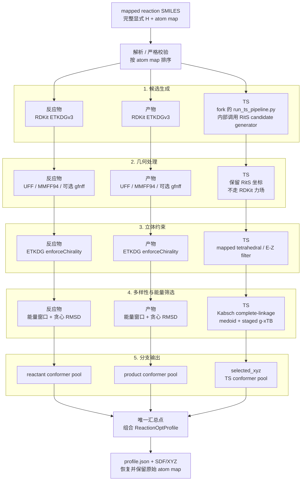

# tricycle-reactionopt

`tricycle-reactionopt` 从一个严格校验的 mapped reaction SMILES 生成 ReactionOpt profile：输入解析后分出三个独立分支，分别采样反应物构象、产物构象，并将 mapped reaction connectivity 交给 RitS pipeline 生成、过滤、聚类和筛选 TS 构象。

RitS 是 reaction-level 的 TS 生成器，直接消费 mapped reaction connectivity。反应物构象、产物构象和 RitS TS 是三个独立分支，只有最终组合 profile 时才汇总三者。实现也不会使用原 ReactionOpt 的 product-backward、`4+2` 拉伸或其它旧 TS 初猜策略。

## 输入约定

输入是 mapped reaction SMILES，支持以下两种格式：

```text
reactants>>products
reactants>agents>products
```

中间 `agents` 段目前只用于兼容 reaction SMILES 格式，不参与结构构建或 RitS 输入。参与 profile 的反应物端和产物端必须同时满足以下条件：

1. 每一个原子都有唯一且为正整数的 atom map，例如 `[C:101]`、`[H:102]`。
2. 反应物端和产物端的 atom map 集合完全一致。
3. 相同 atom map 在两端代表相同元素。
4. 氢必须显式写成独立的、带 atom map 的 `[H:<map>]` 原子，并通过化学键连接到对应重原子。
5. 不允许隐式氢，也不允许用 `[CH3:1]`、`[NH2:2]` 这类在重原子原子标记中存储氢的写法代替独立氢原子。
6. 反应物和产物中的多分子组分使用 `.` 分隔；每个组分中的所有原子都必须满足完整映射和显式氢约定。

例如，下面的写法满足输入合约：

```text
[C:1]([H:2])([H:3])([H:4])([H:5])>>[C:1]([H:2])([H:3])([H:4])([H:5])
```

下面的写法会被拒绝，因为氢是隐式的，或氢没有作为独立原子进行映射：

```text
CC>>CC
[CH3:1][CH3:2]>>[CH3:1][CH3:2]
```

解析阶段不会替输入补氢、猜 atom map 或自动修复未映射原子。它会按 atom map 对两端原子排序，检查原子数、映射集合和元素一致性，并根据两端键矩阵计算 forming/breaking bonds。校验失败时不会开始构象采样，也不会提交 RitS 推理任务。

## 从 reaction SMILES 到 profile 的流程



图中每一列代表相近的功能阶段，每一行代表一个独立分支；对齐不表示三条分支共享实现或必须并行运行。当前 Python 编排可以按固定顺序调用它们，但 TS 行的 `run_ts_pipeline.py` 是 RitS fork 中新增的 pipeline 脚本，不属于官方 RitS 发布内容。TS 分支的最终结果来自该脚本的筛选输出，不是未经后处理的原始 RitS candidate。

### 1. 解析和严格校验

`ReactionProfileRequest` 是 profile 工作流的请求对象。解析阶段通过 `Reaction.from_rxn_smiles(...)` 创建 `Reaction` 和两端的 `Species`，并保留原始 mapped SMILES、分子组分、原子映射和显式氢信息。

校验重点是“完整”而不是“尽量补全”：实现不会替输入补氢、猜 atom map 或把未映射原子自动映射。解析后会按 atom map 对两端原子排序，并保存反应物/产物键矩阵以及 forming/breaking bonds。这些 connectivity 信息是 RitS 的输入基础；反应物和产物的 3D 坐标不是 RitS 的必需输入。

### 2. 分支 A/B：反应物端和产物端分别采样构象

反应物端和产物端分别调用同一个 `ConformerSamplingConfig` 执行独立采样；默认参数相同，但不会共享候选构象、坐标或随机采样结果。实现入口分别是 `Reaction.sample_reactant_conformers(...)` 和 `Reaction.sample_product_conformers(...)`。profile builder 不会把两端先合并成一个采样任务，也不会把任一端坐标传给 RitS：

- `reactant_conformers`：合并后的反应物端构象池；
- `product_conformers`：合并后的产物端构象池。

如果某一端包含多个 `.` 分隔的组分，它们可以在该端分支内部合并为一个 RDKit 结构来生成该端的构象池；这只是该分支内部的结构表示，不会把反应物池和产物池先合并，也不会把它们的 3D 坐标传给 RitS。

每一端的基本步骤是：

1. 用 RDKit 根据显式氢完整的分子图进行 ETKDG 3D embedding，并尝试生成目标数量的候选构象。
2. 对候选构象进行力场优化。支持 UFF、MMFF94；安装可选 GFN-FF 依赖时也可以请求 GFN-FF。
3. 根据优化后的能量窗口和 RMSD 阈值去除高能或重复构象。
4. 将结果保留为带 atom map 的构象池。

#### RDKit 分支是否复用了 RitS 的采样流程

结论：没有复用 `run_ts_pipeline.py`，也没有把 RitS 的 TS 后处理复制到反应物/产物构象分支。
两者只有在“先生成多个候选，再按能量和结构差异筛选”的抽象目标上相似；具体实现和适用对象不同：

| 环节 | RDKit 反应物/产物构象分支 | RitS reaction-level TS pipeline |
| --- | --- | --- |
| 候选生成 | `ETKDGv3` + `EmbedMultipleConfs` 生成 3D 构象 | RitS 根据 mapped reaction connectivity 生成 TS candidates |
| 几何优化 | 对每个候选执行 `UFF` 或 `MMFF94`；请求 `gfnff` 时使用可选的 Python `gfnff`/ASE 优化器 | 不调用这里的 RDKit 力场优化器；使用 RitS 生成的 TS 坐标进入后续 pipeline |
| 立体约束 | ETKDG 设置 `enforceChirality=True`，属于嵌入时约束；不是 mapped tetrahedral/E-Z 结果过滤 | 执行 pipeline 的 mapped tetrahedral/E-Z stereo filter |
| 结构多样性 | 按力场能量排序后，使用对齐 RMSD 做贪心去重，并受 `rms_threshold` 和 `max_conformers` 限制；当前比较的是整个分子坐标 | 默认取重原子，使用 Kabsch RMSD 的 complete-linkage 聚类，并确定每个 cluster 的 medoid |
| 能量筛选 | 使用 UFF/MMFF94/GFN-FF 优化器返回的能量；可应用 `energy_window`，不是 g-xTB 能量 | 使用 fork pipeline 配置的 `xtb --gxtb --sp` 做 medoid 预筛选，再对保留 cluster 成员分阶段评估 |
| 最终结果 | `reactant_conformers` 或 `product_conformers` 构象池 | `selected_xyz` 中每个保留 cluster 的最低能 TS 构象 |

因此，RDKit 分支确实有自己的候选生成、力场能量排序和 RMSD 去重，但不执行 RitS 特有的
TS candidate 生成、mapped tetrahedral/E-Z 过滤、complete-linkage/medoid 聚类或 g-xTB staged
ranking。反过来，RitS 分支也不会读取 RDKit 生成的反应物/产物坐标。`gfnff` 与 RitS pipeline
使用的 `g-xTB` 不是同一个环节：前者是可选的前后体构象优化器，后者是 TS cluster 筛选时的
`xtb --gxtb --sp` 单点能量评估。

如果请求 GFN-FF 但 GFN-FF 不能初始化某个分子图，已安装 GFN-FF 依赖时会记录失败并回退到 UFF；若依赖本身未安装，则按配置错误处理。这个 fallback 只影响反应物/产物构象优化，不会改变 TS 生成器，TS 仍然只能来自 RitS。

每个构象池的大小由 `sampling.target_conformers`、`sampling.max_conformers`、能量窗口和 RMSD 阈值共同决定；两个池的数量也不要求相等。

#### fork pipeline 的归属和运行时输入

`scripts/run_ts_pipeline.py` 是本项目使用的 RitS fork 中新增并维护的脚本，不属于官方 RitS
发布内容。它可以复用官方 RitS 的模型、checkpoint 和底层 candidate generator，但脚本自身的
candidate 组织、stereo 过滤、聚类和 g-xTB 排序逻辑以 fork 中的实现为准；不能假定只下载官方
RitS 仓库就能得到这个入口。

因此，`code_artifact`/`input_directory` 必须指向包含该脚本的 fork checkout。若请求需要记录
可复现 provenance，应将 fork 的仓库地址和 commit 作为 pipeline 代码来源记录；根 README 中的
官方 RitS revision 只表示默认模型/checkpoint 来源，不代表 `run_ts_pipeline.py` 的来源。

### 3. 分支 C：reaction-level RitS TS pipeline

RitS 的输入边界是 `RitsTransitionStateInput`，包含：

- 原始 mapped `reaction_smiles`；
- 按 atom-map 排序后的 `reactant_smiles`；
- 按 atom-map 排序后的 `product_smiles`；
- `RitsInferenceConfig`，其中 `[rits.pipeline]` 保存 `run_ts_pipeline.py` 的参数。

它不包含 `reactant`/`product` 3D molecule。因此 `Reaction.build_profile(...)` 可以直接从已解析的 reaction connectivity 启动这个分支，并且对整个 reaction 只调用一次 `sampler.sample(request)`；生成多少个原始 TS candidate 由 `RitsInferenceConfig.n_samples` 控制，最终 TS 数量由 pipeline 的立体过滤、聚类和能量筛选决定。

RitS 适配层负责：

- 根据 `RitsInferenceConfig` 调用 `tricycle_rits.commands.build_ts_pipeline_command`；
- 将单条 mapped reaction 写入 pipeline 的 `--reactions` 输入文件；pipeline 内部再调用 RitS 生成器；
- 使用 pipeline 的 stereo filter、Kabsch RMSD 聚类和 g-xTB ranking，不把反应物/产物 XYZ 传给 RitS；
- 固定并记录 RitS 源码 revision，保证推理来源可追溯；
- 读取 `selected_xyz` 目录和 `summary.json`，将筛选后的 XYZ 解析成 TS 结构；
- 按反应物模板检查 TS 原子数量、元素和顺序，再复制映射后的模板拓扑与 atom map。

由于当前 fork pipeline 的预处理要求 atom map 连续为 `1..N`，adapter 只在 worker 的临时输入文件中
将原始 map 按升序重编号；这不会改变 profile 的语义。读取 `selected_xyz` 后会按原始 reaction
template 恢复用户输入的 atom map，因此最终三个结构池和 `profile.json` 仍使用同一套原始映射。

`run_ts_pipeline.py` 默认执行以下顺序：

1. 用 RitS 从 mapped reaction connectivity 生成 `n_samples` 个 TS candidate；
2. 按 mapped tetrahedral/E-Z 符号过滤立体约束；
3. 对重原子坐标做 complete-linkage Kabsch RMSD 聚类，并确定每个 cluster 的 medoid；
4. 先对 medoid 做 g-xTB 单点能量评估，按 reaction 内能窗保留 cluster；
5. 对保留 cluster 的全部成员再做 g-xTB 单点能量评估，每个 cluster 选择最低能成员。

这里的 g-xTB 是 pipeline 配置提供的、支持 `--gxtb` 的 `xtb` 可执行文件，不是把 GFN2-xTB checkpoint 训练能量误认为运行时能量。RitS 仍然直接从反应物/产物 connectivity 生成 TS，不需要手工 TS 初猜；实现不会从产物端反向逐步推导 TS，也不会把旧项目的 product-backward 或 `4+2` product-stretch 作为 fallback。

### 4. 唯一汇总点：profile 组合

三个分支完成后才汇总为 `ReactionProfile`。在汇总前，三个分支之间没有结构数据依赖。最终 profile 包含三个彼此独立的结构集合：

```text
ReactionProfile
├── reaction                    # mapped reaction + bond changes
├── reactant_conformers         # 独立反应物端构象池
├── product_conformers          # 独立产物端构象池
└── transition_state_conformer_set  # reaction-level RitS TS 池
```

`ReactionProfile.atom_map_numbers` 是整条 reaction 的全局 atom-map 顺序，三个结构池中的
每个 molecule 都必须严格使用这套原子顺序和 map。`profile.json` 在顶层保存
`atom_map_numbers` 和 `atom_order`，同时在 `reaction` 字段中保存完整的反应映射、元素和键变化。
SDF 保留分子原子属性；XYZ 本身只表达元素、坐标和原子顺序，因此读取 XYZ 时必须结合
`profile.json` 或原始 reaction template 恢复 atom map。

profile 只保存三个分支的结果，不自动生成 `pre/ts/post` 路径。`ReactionPathContext` 仍可通过 `build_reaction_path_context()` 单独取得，用于需要键矩阵、差异结构或立体化学参考的下游组件；它不是当前 RitS sampler 的输入。旧的 path guess API 不属于当前 reaction-level profile 流程，避免悄悄回退到旧 TS 策略。

## 代码调用链

```text
ReactionOptPlugin.plan_profile(...)
└─ Reaction.from_rxn_smiles(...)
   └─ Reaction.plan_rits_jobs(...)
      └─ RitsInferenceConfig.to_bohr_job(...)
         └─ build_ts_pipeline_command(--reactions, --generate, ...)

ReactionOptPlugin.execute_profile(..., sampler, ...)
├─ plan_profile(...)                  # 先校验并生成一条 reaction-level 计划
├─ Reaction.from_rxn_smiles(...)
└─ Reaction.build_profile(...)
   ├─ sample_reactant_conformers(...)
   │  └─ sample_conformer_ensemble(reactants, ...)
   ├─ sample_product_conformers(...)
   │  └─ sample_conformer_ensemble(products, ...)
   └─ sample_transition_states(sampler, ...)
      ├─ RitsTransitionStateInput(...)
      ├─ sampler.sample(request)       # 每个 reaction 一次；adapter 执行完整 pipeline
      ├─ coerce_sampler_result(...)
      └─ normalize_transition_state_structures(...)
```

`plan_profile` 不会实际运行构象采样，只会创建一条 reaction-level RitS pipeline job 描述；计划中的 TS pipeline 输出路径默认为 `outputs/reaction-ts-pipeline`，并在计划参数中记录需要写入 `inputs/reaction.smiles` 的 mapped reaction 内容。真实执行时，adapter 在内部负责 staging 输入文件并调用 `run_ts_pipeline.py`。

## 规划与执行边界

profile workflow 将确定性本地逻辑和外部推理分开：

- `plan_profile(...)`：解析并校验 reaction，生成 JSON-safe 的 ReactionOpt/RitS job plan。默认路径不读取凭据、不发起网络请求、不提交真实任务，适合本地开发、审查和 dry-run。
- `execute_profile(...)`：必须显式注入 RitS sampler adapter，执行反应物构象、产物构象和 reaction-level TS 三个独立分支；结果可以写入指定输出目录。
- `RitsInferenceConfig`：保存模型、镜像、资源、采样数量、`run_ts_pipeline.py` 参数和 provenance 等推理参数；默认配置只描述任务，不代表已经提交任务。

pipeline 的 `device` 必须使用上游生成器接受的设备名，例如 `cuda:0` 或 `cpu`；不能写成
`auto`，因为 `run_ts_pipeline.py` 会把该值继续传给内部的 `generate_reaction_queue.py`。

典型的 dry-run 命令：

```bash
uv run --frozen --all-packages tricycle-agent plan \
  reactionopt.profile \
  configs/example-reactionopt-profile-request.toml \
  --run-id profile-smoke
```

该命令只生成计划 JSON。真实执行需要在应用层注册 `reactionopt_profile_adapter`，由 adapter 注入实际的 RitS 执行能力；插件本身不硬编码云平台、凭据或网络客户端。

## 输出内容

成功执行后，`ReactionProfile` 至少包含：

- 原始 reaction 与已验证的完整 atom mapping / explicit-H 标记；
- 独立的反应物端 conformer pool；
- 独立的产物端 conformer pool；
- reaction-level RitS TS conformer pool；
- RitS 配置、采样元数据，以及 adapter 返回的任务/来源信息（若 adapter 提供）。

指定输出目录并使用 `file_format="both"` 时，输出目录结构类似：

```text
<output_dir>/
├── profile.json
├── reactants.sdf
├── reactants.xyz
├── products.sdf
├── products.xyz
├── transition_states.sdf
└── transition_states.xyz
```

`transition_states.sdf` 和 `transition_states.xyz` 保存 `run_ts_pipeline.py` 的 selected TS 构象，而不是所有未筛选 candidate。adapter 返回的 pipeline `summary.json`、cluster 和 energy provenance 会保留在 profile metadata 中。profile 默认不会创建 `paths/`，因为没有将某个 reactant conformer、TS conformer 和 product conformer 人为绑定成一条路径。

## 开发与验证

在仓库根目录运行：

```bash
uv run --frozen --all-packages pytest
uv run --frozen --all-packages ruff check .
```

示例请求见 [`configs/example-reactionopt-profile-request.toml`](../../configs/example-reactionopt-profile-request.toml)。实现和测试分别位于：

- [`src/tricycle_reactionopt/reaction_profile.py`](src/tricycle_reactionopt/reaction_profile.py)：反应解析、独立反应物/产物构象池和 profile 组装；
- [`src/tricycle_reactionopt/conformers.py`](src/tricycle_reactionopt/conformers.py)：反应物/产物构象采样和去重；
- [`src/tricycle_reactionopt/rits.py`](src/tricycle_reactionopt/rits.py)：RitS pipeline 配置、命令和
  `LocalRitsPipelineSampler` adapter，以及 TS 结构解析；
- [`tests/`](tests/)：完整显式氢、完整映射、独立反应物/产物分支、pipeline command、atom-map 恢复、dry-run
  和输出 round-trip 测试。
