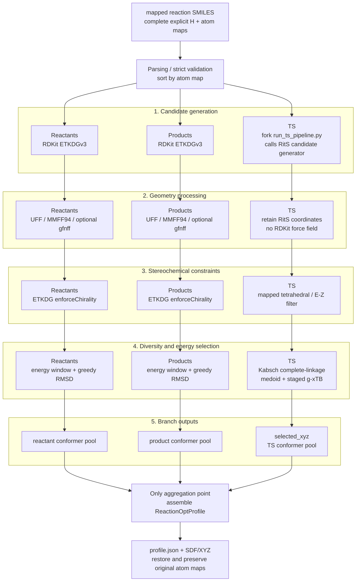

# tricycle-reactionopt

`tricycle-reactionopt` builds a ReactionOpt profile from strictly validated mapped reaction SMILES. Parsing feeds three independent branches: reactant conformer sampling, product conformer sampling, and a RitS pipeline that generates, filters, clusters, and selects TS conformers from mapped reaction connectivity.

`reactionopt.enumerate-da` also generates fully atom-mapped Diels–Alder reaction SMILES candidates from multiple ene/diene substrate pairs and writes `mapped-reactions.csv`. By default, it preserves specified input E/Z constraints and enumerates unspecified, noninvertible product stereocenters. Invertible atoms receive no product stereochemical annotation and are not enumerated as separate stereoisomers. This step only creates candidate lists; it neither creates nor submits calculation jobs automatically. See the [reactionopt-enumerate-da skill](../../.agents/skills/reactionopt-enumerate-da/SKILL.md) and `configs/example-reactionopt-da-enumerate-request.toml`.

RitS is a reaction-level TS generator consuming mapped reaction connectivity directly. Reactant conformers, product conformers, and RitS TS structures remain independent until final profile assembly. The implementation does not use the original ReactionOpt product-backward, `4+2` stretching, or other legacy TS-guess strategies.

Request parsing accepts current fields only. Profiles use `reaction_smiles`, `sampling`, `rits`, and `output_dir`; enumeration uses `output_dir`. Within `rits`, source/checkpoint assets are `code_artifact` and `checkpoint_artifact`, the container checkpoint path is `checkpoint_path`, and the upload directory is `input_directory`. Unknown fields and legacy spellings are errors.

## Input contract

Mapped reaction SMILES support two forms:

```text
reactants>>products
reactants>agents>products
```

The middle `agents` segment is accepted for format compatibility but does not participate in structure construction or RitS input. Both reactant and product sides must satisfy all of these conditions:

1. Every atom has a unique positive-integer atom map, such as `[C:101]` or `[H:102]`.
2. Reactant and product atom-map sets are identical.
3. A given atom map identifies the same element on both sides.
4. Hydrogens appear as separate, mapped `[H:<map>]` atoms bonded to their heavy atoms.
5. Neither implicit hydrogens nor hydrogen counts embedded in heavy-atom tokens such as `[CH3:1]` or `[NH2:2]` can substitute for separate hydrogen atoms.
6. Multiple molecular components use `.` separators; every atom in every component follows the complete-mapping and explicit-hydrogen requirements.

This example satisfies the contract:

```text
[C:1]([H:2])([H:3])([H:4])([H:5])>>[C:1]([H:2])([H:3])([H:4])([H:5])
```

These examples are rejected because hydrogens are implicit or are not separately mapped atoms:

```text
CC>>CC
[CH3:1][CH3:2]>>[CH3:1][CH3:2]
```

Parsing does not add hydrogens, guess atom maps, or repair unmapped atoms. It sorts both sides by atom map, checks atom counts, mapping sets, and elements, and derives forming/breaking bonds from the two bond matrices. Failed validation prevents conformer sampling and RitS inference submission.

## From reaction SMILES to a profile



Each stage groups comparable functions across independent branches. Alignment does not imply shared implementations or mandatory parallel execution. Current Python orchestration may invoke branches in a fixed order. The TS branch's `run_ts_pipeline.py` is maintained in a RitS fork and is not part of the official release. Its final selected output, rather than raw RitS candidates, supplies the TS results.

### 1. Parsing and strict validation

`ReactionProfileRequest` represents the profile request. `Reaction.from_rxn_smiles(...)` constructs `Reaction` and endpoint `Species`, preserving original mapped SMILES, molecular components, atom maps, and explicit hydrogens.

Validation requires complete inputs: it never adds hydrogens, guesses maps, or automatically maps atoms. After sorting by atom map, it stores reactant/product bond matrices and forming/breaking bonds. This connectivity supplies RitS inputs; endpoint 3D coordinates are not required.

### 2. Branches A/B: independent reactant and product conformers

The reactant and product sides independently use `ConformerSamplingConfig`. Defaults are identical, but candidate conformers, coordinates, and random sampling results are not shared. The entry points are `Reaction.sample_reactant_conformers(...)` and `Reaction.sample_product_conformers(...)`. The profile builder neither combines both sides into one sampling task nor sends either side's coordinates to RitS:

- `reactant_conformers`: the combined reactant-side conformer pool.
- `product_conformers`: the combined product-side conformer pool.

Within one side, multiple `.`-separated components may be combined into a single RDKit structure to generate that side's pool. This is an internal branch representation; it does not combine reactant and product pools or pass their 3D coordinates to RitS.

Each side follows these steps:

1. Use RDKit ETKDG embedding on the complete explicit-hydrogen graph to attempt the target number of 3D conformers. An empty result or exception triggers random-coordinate embedding. If that still yields no conformers, fail explicitly instead of inventing linear coordinates for optimization.
2. Optimize candidate geometries with UFF or MMFF94; GFN-FF is available when its optional dependencies are installed and requested.
3. Remove high-energy or duplicate conformers using the optimized energy window and RMSD threshold.
4. Retain the resulting pool with atom maps.

#### RDKit and RitS sampling responsibilities

RDKit endpoint branches do not reuse `run_ts_pipeline.py` or copy RitS TS postprocessing. Both generate multiple candidates and select by energy/structural difference, but their implementations and targets differ:

| Stage | RDKit reactant/product branches | Reaction-level RitS TS pipeline |
| --- | --- | --- |
| Generation | `ETKDGv3` + `EmbedMultipleConfs` produce 3D conformers | RitS generates TS candidates from mapped reaction connectivity |
| Geometry optimization | UFF/MMFF94 per candidate; optional Python `gfnff`/ASE optimizer when requested | Uses RitS TS coordinates without these RDKit force-field optimizers |
| Stereochemistry | `enforceChirality=True` constrains embedding; this is not mapped tetrahedral/E-Z output filtering | Pipeline mapped tetrahedral/E-Z stereo filter |
| Diversity | Sort by force-field energy, then greedily deduplicate aligned RMSD under `rms_threshold` and `max_conformers`; currently compares whole-molecule coordinates | Heavy atoms by default, complete-linkage clustering using Kabsch RMSD, then a medoid per cluster |
| Energy selection | UFF/MMFF94/GFN-FF optimizer energies with optional `energy_window`, not g-xTB energies | Configured `xtb --gxtb --sp` medoid prescreening followed by staged evaluation of retained cluster members |
| Output | `reactant_conformers` or `product_conformers` | Lowest-energy TS conformer per retained cluster in `selected_xyz` |

RDKit branches implement their own generation, force-field energy ordering, and RMSD deduplication. They do not perform RitS-specific TS generation, mapped tetrahedral/E-Z filtering, complete-linkage/medoid clustering, or staged g-xTB ranking. RitS does not read RDKit endpoint coordinates. `gfnff` is an optional endpoint conformer optimizer; `g-xTB` is the TS cluster selection's `xtb --gxtb --sp` single-point evaluation.

If requested GFN-FF cannot initialize a molecular graph despite installed dependencies, the implementation records the failure and falls back to UFF. Missing GFN-FF dependencies are a configuration error. This fallback affects only reactant/product optimization; RitS remains the sole TS generator.

Pool sizes depend jointly on `sampling.target_conformers`, `sampling.max_conformers`, the energy window, and the RMSD threshold. Reactant and product pools need not have equal sizes.

#### Fork pipeline ownership and runtime inputs

`scripts/run_ts_pipeline.py` is added and maintained in the RitS fork used by this project, outside the official RitS release. It can reuse official models, checkpoints, and candidate generators; its candidate organization, stereo filtering, clustering, and g-xTB ranking are defined by the fork. Downloading official RitS alone does not provide this entry point.

`code_artifact`/`input_directory` must point to the fork checkout containing that script. Reproducible provenance should record the fork repository and commit as the pipeline code source. The model revision in [RitS model assets](../tricycle-rits/src/tricycle_rits/assets/rits-model.toml) identifies the default model/checkpoint source, not `run_ts_pipeline.py`.

`RitsInferenceConfig()` and `from_mapping()` read default `source_repository` and `source_revision` from the same model asset configuration. Explicit request values take precedence; Python source stores no separate revision.

### 3. Branch C: reaction-level RitS TS pipeline

`RitsTransitionStateInput` defines the RitS input boundary:

- Original mapped `reaction_smiles`.
- Atom-map-sorted `reactant_smiles`.
- Atom-map-sorted `product_smiles`.
- `RitsInferenceConfig`, whose `[rits.pipeline]` contains `run_ts_pipeline.py` parameters.

It contains no `reactant`/`product` 3D molecules. `Reaction.build_profile(...)` can start this branch directly from parsed connectivity, calling `sampler.sample(request)` once for the entire reaction. `RitsInferenceConfig.n_samples` controls raw TS candidate count; stereo filtering, clustering, and energy selection determine the final count.

The RitS adapter:

- Calls `tricycle_rits.commands.build_ts_pipeline_command` from `RitsInferenceConfig`.
- Writes one mapped reaction to the pipeline's `--reactions` file; the pipeline then invokes the RitS generator.
- Uses pipeline stereo filtering, Kabsch RMSD clustering, and g-xTB ranking without sending reactant/product XYZ to RitS.
- Pins and records RitS source revision for traceable inference.
- Reads `selected_xyz` and `summary.json`, parsing selected XYZ into TS structures.
- Checks TS atom counts, elements, and ordering against the reactant template, then copies mapped template topology and atom maps.

The fork's preprocessing requires consecutive maps `1..N`. Only in temporary worker input does the adapter renumber original maps in ascending order, preserving profile semantics. After reading `selected_xyz`, it restores user atom maps from the original reaction template. All three final pools and `profile.json` therefore use the original mapping.

By default, `run_ts_pipeline.py`:

1. Generates `n_samples` TS candidates from mapped connectivity with RitS.
2. Filters stereochemical constraints using mapped tetrahedral/E-Z signs.
3. Performs complete-linkage Kabsch RMSD clustering on heavy atoms and identifies cluster medoids.
4. Evaluates medoid g-xTB single-point energies and retains clusters within the reaction-specific energy window.
5. Evaluates all members of retained clusters with g-xTB and selects each cluster's lowest-energy member.

Here, g-xTB is a pipeline-configured `xtb` executable supporting `--gxtb`. It is not the GFN2-xTB checkpoint's training energy reused as a runtime energy. RitS generates TS directly from endpoint connectivity without manual TS guesses. The implementation neither derives TS backward from products nor falls back to legacy product-backward or `4+2` product-stretch strategies.

### 4. Final profile assembly

The three branches combine into `ReactionProfile` only after completion. Before assembly there are no structural-data dependencies between branches. The profile contains three independent structure collections:

```text
ReactionProfile
├── reaction                    # Mapped reaction and bond changes
├── reactant_conformers         # Independent reactant-side conformer pool
├── product_conformers          # Independent product-side conformer pool
└── transition_state_conformer_set  # Reaction-level RitS TS pool
```

`ReactionProfile.atom_map_numbers` defines global reaction atom order. Every molecule in every pool must use exactly those maps and that order. `profile.json` stores top-level `atom_map_numbers` and `atom_order`, plus complete mapping, elements, and bond changes in `reaction`. SDF preserves molecular atom properties. XYZ contains only elements, coordinates, and atom order, so restoring maps requires `profile.json` or the original reaction template.

Profiles store branch results without automatically generating `pre/ts/post` paths. Downstream components needing bond matrices, difference structures, or stereochemical references can separately call `build_reaction_path_context()` for `ReactionPathContext`; it is not an input to the current RitS sampler. Legacy path-guess APIs are outside the reaction-level profile workflow, preventing silent fallback to old TS strategies.

## Call graph

```text
ReactionOptPlugin.plan_profile(...)
└─ Reaction.from_rxn_smiles(...)
   └─ Reaction.plan_rits_jobs(...)
      └─ RitsInferenceConfig.to_bohr_job(...)
         └─ build_ts_pipeline_command(--reactions, --generate, ...)

ReactionOptPlugin.execute_profile(..., sampler, ...)
├─ plan_profile(...)                  # Validate and create one reaction-level plan
├─ Reaction.from_rxn_smiles(...)
└─ Reaction.build_profile(...)
   ├─ sample_reactant_conformers(...)
   │  └─ sample_conformer_ensemble(reactants, ...)
   ├─ sample_product_conformers(...)
   │  └─ sample_conformer_ensemble(products, ...)
   └─ sample_transition_states(sampler, ...)
      ├─ RitsTransitionStateInput(...)
      ├─ sampler.sample(request)       # Once per reaction; adapter runs full pipeline
      ├─ Validate RitsTransitionStateResult return type
      └─ normalize_transition_state_structures(...)
```

`plan_profile` performs no conformer sampling. It creates one reaction-level RitS pipeline job description, defaulting to `outputs/reaction-ts-pipeline`, and records the mapped reaction content to write to `inputs/reaction.smiles` in plan parameters. During live execution, the adapter stages this file and invokes `run_ts_pipeline.py` internally.

Samplers must implement `sample(request)` returning `RitsTransitionStateResult`; ordinary callables and bare structure lists do not satisfy the interface.

## Planning and execution boundary

The profile workflow separates deterministic local logic from external inference:

- `plan_profile(...)` parses/validates the reaction and generates a JSON-safe ReactionOpt/RitS job plan. Its default path reads no credentials, sends no network requests, and submits no jobs, supporting local development, review, and dry-run.
- `execute_profile(...)` requires an explicitly injected RitS sampler adapter and executes independent reactant, product, and reaction-level TS branches. Results can be written to a specified output directory.
- `RitsInferenceConfig` holds model, image, resources, sample count, `run_ts_pipeline.py` parameters, and provenance. A default configuration describes a job; it does not mean submission has occurred.

Pipeline `device` must use an upstream generator-supported name such as `cuda:0` or `cpu`, not `auto`: `run_ts_pipeline.py` passes it to `generate_reaction_queue.py`.

Typical dry-run:

```bash
uv run --frozen --all-packages tricycle-agent plan \
  reactionopt.profile \
  configs/example-reactionopt-profile-request.toml \
  --run-id profile-smoke
```

This produces plan JSON only. Live execution requires an application-registered `reactionopt_profile_adapter` that injects actual RitS execution. The plugin hardcodes no cloud platform, credentials, or network client.

## Outputs

A successful `ReactionProfile` contains at least:

- The original reaction and verified complete atom mapping / explicit-H annotations.
- An independent reactant conformer pool.
- An independent product conformer pool.
- A reaction-level RitS TS conformer pool.
- RitS configuration, sampling metadata, and adapter-supplied job/source information when available.

With an output directory and `file_format="both"`, the layout is:

```text
<output_dir>/
├── profile.json
├── reactants.sdf
├── reactants.xyz
├── products.sdf
├── products.xyz
├── transition_states.sdf
└── transition_states.xyz
```

`transition_states.sdf` and `transition_states.xyz` contain selected TS conformers from `run_ts_pipeline.py`, not all unfiltered candidates. Adapter-returned pipeline `summary.json`, cluster, and energy provenance remain in profile metadata. Profiles do not create `paths/` by default because they do not artificially bind one reactant, TS, and product conformer into a path.

## Development and validation

Run from the repository root:

```bash
uv run --frozen --all-packages pytest
uv run --frozen --all-packages ruff check .
```

See [`configs/example-reactionopt-profile-request.toml`](../../configs/example-reactionopt-profile-request.toml). Implementation and tests:

- [`src/tricycle_reactionopt/reaction_profile.py`](src/tricycle_reactionopt/reaction_profile.py): reaction parsing, independent endpoint pools, and profile assembly.
- [`src/tricycle_reactionopt/conformers.py`](src/tricycle_reactionopt/conformers.py): endpoint conformer sampling and deduplication.
- [`src/tricycle_reactionopt/rits.py`](src/tricycle_reactionopt/rits.py): RitS pipeline configuration/commands, `LocalRitsPipelineSampler`, and TS parsing.
- [`tests/`](tests/): complete explicit hydrogens, complete mapping, independent endpoint branches, pipeline commands, atom-map restoration, dry-run, and output round trips.
