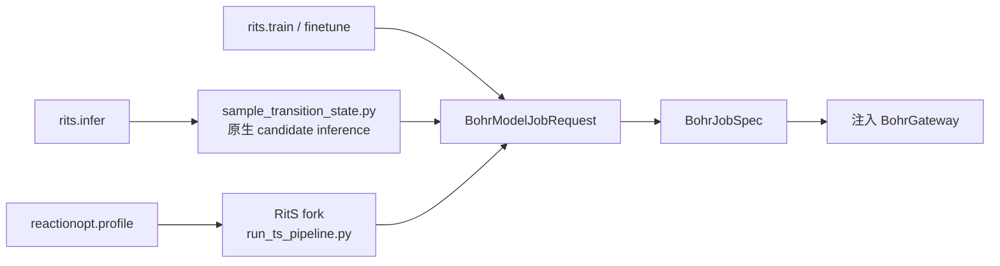

# tricycle-rits

`tricycle-rits` 是 RitS 模型任务组件：它为训练、微调和推理请求构造可审计的 Bohr job，
并固定模型来源、revision、入口和协议 provenance。它本身不把 Bohr 网络访问或模型执行写死
在 package 内，实际提交仍由共享 Bohr adapter 注入。

## 能力

原生插件 ID 为 `tricycle.rits`：

| 能力 | 作用 |
| --- | --- |
| `rits.train` | 规划 RitS 训练任务 |
| `rits.finetune` | 从 checkpoint 微调/继续训练 |
| `rits.infer` | 规划原生 RitS TS candidate inference |
| `rits.bohr-submit` | 复用共享 Bohr 模型任务提交边界 |

训练、微调和推理都继承 [`tricycle-bohr`](../tricycle-bohr/README.md) 的
`BohrModelJobRequest`，要求明确的代码 artifact、输入目录和实际启动命令。

## 模型资产和版本

默认模型资产位于 [`src/tricycle_rits/assets/rits-model.toml`](src/tricycle_rits/assets/rits-model.toml)。
`load_default_model_asset()` 只读取本地 TOML，`require_checkpoint()` 可校验 checkpoint 存在及
SHA256；不会在加载资产时联网下载代码或权重。

`RitsPlugin.plan_job()` 会把以下 provenance 固定到计划中：

- `source_repository`、`source_revision`；
- 当前 mode 对应的 upstream entrypoint；
- `upstream_protocol`（训练、`sample_transition_state` 推理或微调协议）。

如果请求提供了冲突的来源/入口，计划会失败，避免同一个能力 ID 在不同源码上产生不可比较
的任务。

## 命令构造

`tricycle_rits.commands` 只负责确定性地构造 argv，不执行命令：

| builder | 入口/用途 |
| --- | --- |
| `build_training_command` | `scripts/train.py` 的训练命令 |
| `build_finetune_command` | 通过 `finetune_from` 从 checkpoint 微调 |
| `build_resume_command` | 通过 `resume` 恢复训练 |
| `build_inference_command` | `scripts/sample_transition_state.py` 的原生推理 |
| `build_ts_pipeline_command` | 配置 fork 中 `scripts/run_ts_pipeline.py` 的 pipeline 命令 |

原生 inference 只允许四种输入形式之一：SMILES pair、XYZ pair、`reaction_smarts` 或
`reaction_file`。它负责生成 RitS candidates，不等同于完整的 ReactionOpt profile 后处理。

## 与 ReactionOpt profile 的关系

这是当前实现中必须明确区分的两个层次：

1. 普通 `rits.infer` 使用固定的官方 RitS 推理入口
   `scripts/sample_transition_state.py`，适合直接构造模型 inference job。
2. `reactionopt.profile` 使用的完整 TS 分支调用 RitS fork 中的
   `scripts/run_ts_pipeline.py`。该脚本是 fork 后新增并维护的 pipeline，**不属于官方 RitS
   发布内容**。它可以复用官方模型/checkpoint 和 candidate generator，但 stereo filter、聚类、
   medoid 预筛选和 g-xTB staged ranking 由 fork pipeline 实现。

因此，ReactionOpt profile 请求的 `code_artifact`/`input_directory` 必须指向包含该脚本的 fork
checkout；不能只上传官方 RitS 仓库就假定 pipeline 入口存在。默认模型 TOML 中记录的官方
repository/revision只表示基础模型 provenance，不表示 fork pipeline 的来源。



ReactionOpt 的三分支、显式氢/原子映射输入约束、TS pipeline 内部筛选和最终 profile 输出见
[`tricycle-reactionopt/README.md`](../tricycle-reactionopt/README.md)。RitS 包不接收或匹配
ReactionOpt 的反应物/产物端点构象；profile 中三个分支彼此独立。

## 请求示例

仓库提供：

- [`configs/example-rits-train-request.toml`](../../configs/example-rits-train-request.toml)；
- [`configs/example-rits-infer-request.toml`](../../configs/example-rits-infer-request.toml)；
- [`configs/example-rits-finetune-request.toml`](../../configs/example-rits-finetune-request.toml)。

默认只规划：

```bash
uv run --package tricycle-agent tricycle-agent plan \
  rits.infer configs/example-rits-infer-request.toml --run-id rits-infer-demo
```

真实执行需要显式 `--live`、有效的输入 artifact/checkpoint 和注入的 Bohr adapter。模型任务
通常由上传目录中的 `bash run.sh` 安装当前代码并调用命令构造器产生的 argv；镜像不会被当作
代码版本的替代品。

## 验证

```bash
uv run pytest packages/tricycle-rits/tests
make check
```

RitS 推理 skill 的操作边界见 [`.agents/skills/rits-infer/SKILL.md`](../../.agents/skills/rits-infer/SKILL.md)。
