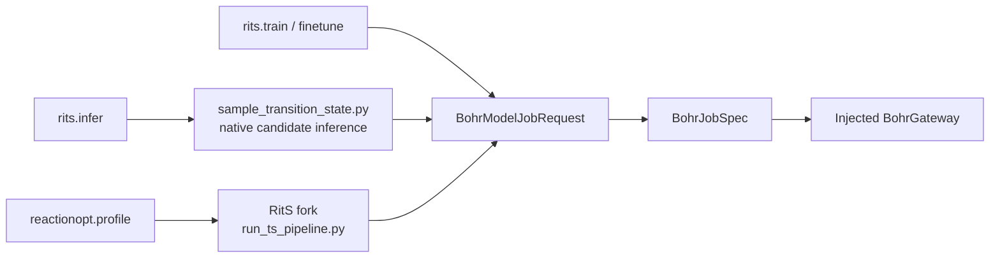

# tricycle-rits

`tricycle-rits` builds auditable Bohr jobs for RitS training, fine-tuning, and inference, binding model source, revision, entry points, and protocol provenance. A shared injected Bohr adapter handles Bohr submission. For internal-network execution, a separate SSH protocol/gateway handles staging and job management; training runs in the user-specified Docker GPU container.

## Capabilities

The model job plugin ID is `tricycle.rits`; the SSH lifecycle plugin ID is `tricycle.rits.ssh`:

| Capability | Purpose |
| --- | --- |
| `rits.train` | Plan RitS training |
| `rits.finetune` | Fine-tune/continue training from a checkpoint |
| `rits.infer` | Plan native RitS TS candidate inference |
| `rits.bohr-submit` | Reuse the shared Bohr model job submission boundary |
| `rits.ssh.finetune` | Upload a bundle and launch fine-tuning in a remote Docker GPU container |
| `rits.ssh.status` / `rits.ssh.logs` | Query container job state and training logs |
| `rits.ssh.terminate` / `rits.ssh.download` | Stop a job or download explicitly selected training artifacts |

Training, fine-tuning, and inference all inherit [`tricycle-bohr`](../tricycle-bohr/README.md)'s `BohrModelJobRequest`, requiring explicit code artifacts, input directories, and actual launch commands.

## Model assets and versions

Default model assets are configured in [`src/tricycle_rits/assets/rits-model.toml`](src/tricycle_rits/assets/rits-model.toml). This file owns `model.repository`, `model.revision`, `model.checkpoint_sha256`, and checkpoint paths. Skills read those fields and describe procedures without copying concrete commits/hashes or changing whenever binding values change. `load_model_asset()` reads only local TOML; `require_checkpoint()` verifies checkpoint existence and SHA-256. Asset loading never downloads source or weights.

Asset configuration uses `schema = "tricycle.rits-model/v1"` and a `[model]` table, the only two allowed top-level fields. The table accepts only fields declared by `RitsModelAsset`. `revision_kind` must be `git-commit`; optional `checkpoint_dataset` records the weights' source dataset.

`RitsPlugin.plan_job()` binds this provenance into each plan:

- `source_repository` and `source_revision`.
- The current mode's upstream entry point.
- `upstream_protocol` for training, `sample_transition_state` inference, or fine-tuning.

Requests with conflicting sources or entry points fail planning, preventing incomparable jobs under the same capability ID.

## Command construction

`tricycle_rits.commands` deterministically builds argv without executing commands:

| Builder | Entry point/purpose |
| --- | --- |
| `build_training_command` | Training through `scripts/train.py` |
| `build_finetune_command` | Fine-tuning from a checkpoint through `finetune_from` |
| `build_resume_command` | Resuming training through `resume` |
| `build_inference_command` | Native inference through `scripts/sample_transition_state.py` |
| `build_ts_pipeline_command` | The configured fork's `scripts/run_ts_pipeline.py` pipeline |

Native inference accepts exactly one of four input forms: a SMILES pair, an XYZ pair, `reaction_smarts`, or `reaction_file`. It generates RitS candidates; it does not perform the complete ReactionOpt profile postprocessing.

## Relationship to ReactionOpt profiles

Two execution layers must remain distinct:

1. Ordinary `rits.infer` uses the pinned official RitS inference entry point, `scripts/sample_transition_state.py`, to construct model inference jobs directly.
2. The complete TS branch in `reactionopt.profile` calls the RitS fork's `scripts/run_ts_pipeline.py`. This pipeline was added and is maintained in the fork; it is **not part of the official RitS release**. It may reuse official models/checkpoints and the candidate generator, while the fork pipeline implements stereo filtering, clustering, medoid prescreening, and staged g-xTB ranking.

ReactionOpt profile requests must therefore point `code_artifact`/`input_directory` at a fork checkout containing that script. Uploading the official RitS repository does not provide the pipeline entry point. The official repository/revision in the default model TOML records base-model provenance, not the fork pipeline's source.



See [`tricycle-reactionopt/README.md`](../tricycle-reactionopt/README.md) for the three branches, explicit-hydrogen/atom-mapping requirements, internal TS pipeline filters, and final profile outputs. The RitS package neither receives nor matches ReactionOpt reactant/product endpoint conformers; all three profile branches are independent.

## Request examples

The repository provides:

- [`configs/example-rits-train-request.toml`](../../configs/example-rits-train-request.toml).
- [`configs/example-rits-infer-request.toml`](../../configs/example-rits-infer-request.toml).
- [`configs/example-rits-finetune-request.toml`](../../configs/example-rits-finetune-request.toml).

Plan only by default:

```bash
uv run --package tricycle-agent tricycle-agent plan \
  rits.infer configs/example-rits-infer-request.toml --run-id rits-infer-demo
```

Live execution requires explicit `--live`, valid input artifacts/checkpoints, and an injected Bohr adapter. Model jobs typically use `bash run.sh` in the upload directory to install current code and execute argv produced by the command builders. An image does not substitute for a source version.

## Internal-network Docker/SSH fine-tuning

All SSH lifecycle requests accept only fields declared by `RitsSshFinetuneRequest`; unknown fields fail planning.

`OpenSshRitsGateway` registers an SSH-backed Docker endpoint through `docker context create remote --docker host=ssh://...` and transfers files using OpenSSH/scp. `docker --context remote info/run/inspect/logs/stop` manages remote container lifecycle. Training uses `docker run --gpus ...` to execute the command in the requested image. The remote GPU host needs a Docker daemon and NVIDIA Container Toolkit, and the SSH user needs Docker socket access. The image must support the host NVIDIA driver and provide compatible PyTorch, CUDA, Python, and RitS dependencies.

SSH authentication uses the existing local agent/config; requests do not accept passwords or private-key contents. Configure known_hosts and SSH config for noninteractive authentication and strict host-key verification. An existing Docker context pointing to another endpoint is never overwritten.

Default planning reads no keys or SSH config, accesses neither the network nor remote Docker, and uploads no data. Only explicit `--live` injects and executes the OpenSSH/Docker context adapter. Containers remain detached for remote inspection; Docker logs provide training stdout/stderr. Containers always set `WANDB_MODE=disabled` and `WANDB_DISABLED=true`.

The training image in `docker/cu130/` starts from the remote host's existing Python 3.12/CUDA 12.8 runtime, upgrades PyTorch to official 2.12.0+cu130, and installs RitS runtime dependencies. Source code is not included in the image. Build it with:

```bash
docker --context remote build -t tricycle/rits-training:torch2.12.0-cu130 packages/tricycle-rits/docker/cu130
```

The fine-tuning bundle remains mounted at `/workspace/job`. Image setting `RITS_DEPS_IN_IMAGE=1` lets the mounted-source installer skip repeated dependency downloads while retaining GPU/version validation and editable installation for direct training-code updates.

```bash
uv run --package tricycle-agent tricycle-agent plan \
  rits.ssh.finetune configs/example-rits-ssh-finetune-request.toml \
  --run-id rits-internal-smoke

uv run --package tricycle-agent tricycle-agent run \
  rits.ssh.finetune configs/example-rits-ssh-finetune-request.toml \
  --run-id rits-internal-smoke --live
```

Use `rits.ssh.status`, `rits.ssh.logs`, `rits.ssh.terminate`, and `rits.ssh.download` for status, logs, stopping, and selected output downloads. Stopping is a destructive capability and requires `--confirm`. Downloads permit only explicitly configured remote relative paths, avoiding retrieval of the complete data bundle. See the [rits-ssh-finetune skill](../../.agents/skills/rits-ssh-finetune/SKILL.md) for CLI requests and safety boundaries.

SSH submission checks the complete bundle before contacting Docker/SSH. Installed
environments, cache directories, renamed venv markers, and environment members in
ZIP/tar inputs are rejected by the shared core transfer policy. Supply clean source,
dependency declarations, data, and required checkpoints; the selected container
environment remains authoritative. Downloads reject environment selectors, stage
selected outputs temporarily, and validate them before publication. Contamination
inside a selected remote directory is detected after transfer; temporary files are
discarded, existing local evidence is preserved, and the error identifies the path.

## Validation

```bash
uv run pytest packages/tricycle-rits/tests
make check
```

See [`.agents/skills/rits-infer/SKILL.md`](../../.agents/skills/rits-infer/SKILL.md) for the inference skill's operational boundaries.
