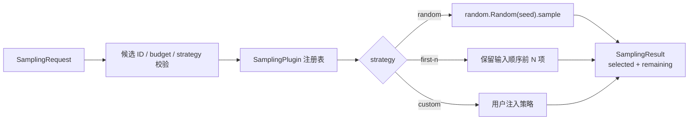

# tricycle-sampling

`tricycle-sampling` 提供候选空间和可替换采样策略，是探索循环中“从候选集合选择下一批
反应”的无副作用组件。它不访问候选数据库、不评分远程模型，也不把选择结果写回外部系统。

## 能力

原生插件 ID 为 `tricycle.sampling`：

| 能力 | 作用 |
| --- | --- |
| `candidate.validate` | 由请求模型校验候选 ID、预算和策略 |
| `candidate.select` | 按已注册策略选择候选 |
| `strategy.register` | 在进程内注册自定义策略 |

默认注册两个策略：`random` 和 `first-n`。

## 输入和输出

`SamplingRequest` 的主要字段如下：

| 字段 | 说明 |
| --- | --- |
| `candidates` | 候选列表；每项包含唯一 `candidate_id` 和任意 `payload` |
| `budget` | 选择数量，必须为非负整数且不超过候选数量 |
| `strategy` | 已注册策略名称，默认 `random` |
| `seed` | 随机策略的可复现种子，可为空 |
| `metadata` | 供上层循环保留的附加信息 |

返回的 `SamplingResult` 包含 `selected`、`remaining`、策略名称、seed 和 metadata，并提供
`selected_ids` 便于写入运行状态或下游请求。



`random` 使用局部 `random.Random(seed)`，不会污染全局随机状态；相同候选顺序、预算和 seed
会得到相同结果。策略只接收候选和参数，不应在 `select()` 中产生网络或文件写副作用。

## TOML 示例

完整示例见 [`configs/example-sampling-request.toml`](../../configs/example-sampling-request.toml)：

```toml
strategy = "random"
budget = 2
seed = 42

[[candidates]]
candidate_id = "rxn-001"
payload = { reaction_smiles = "A>>B" }

[[candidates]]
candidate_id = "rxn-002"
payload = { reaction_smiles = "C>>D" }
```

通过组合应用执行：

```bash
uv run --package tricycle-agent tricycle-agent run \
  candidate.select configs/example-sampling-request.toml --run-id sampling-demo
```

这条能力不需要 `--live`，也不需要 Bohr、数据库或模型凭据。

## 自定义策略

策略只需实现 `SamplingStrategy` protocol：

```python
class MyStrategy:
    name = "my-strategy"

    def select(self, candidates, budget, seed):
        # 返回长度不超过 budget 的 Candidate 序列
        return tuple(candidates[:budget])
```

然后将实例传给 `SamplingPlugin`，或调用 `register_strategy()` 注册。默认不允许覆盖已有
名称；需要替换时必须显式设置 `replace=True`，避免应用启动顺序悄悄改变采样语义。

## 边界与恢复

候选 ID 重复、budget 超界、策略不存在或请求字段类型不正确时，计划直接失败。修正请求后
使用新的运行实例即可；选择过程不创建远程任务，因此没有提交、轮询或远程恢复阶段。若要把
结果写入候选数据库，应由另一个显式 adapter/组件处理。

## 验证

```bash
uv run pytest tests/test_framework.py -k sampling
make check
```
