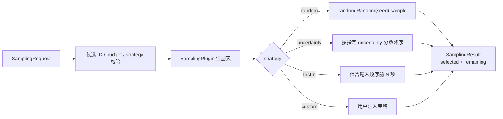

# tricycle-sampling

`tricycle-sampling` 提供候选空间和可替换采样策略，是探索循环中“从候选集合选择下一批
反应”的无副作用组件。它不访问候选数据库、不评分远程模型，也不把选择结果写回外部系统。

## 能力

原生插件 ID 为 `tricycle.sampling`：

| 能力 | 作用 |
| --- | --- |
| `candidate.validate` | 由请求模型校验候选 ID、预算和策略 |
| `candidate.select` | 按已注册策略选择候选 |
| `strategy.register` | 在进程内注册自定义策略 |

默认还注册 `agent-authored-acquisition`：它逐轮读取请求携带的 agent 编写公式、模型质量摘要、
已采样分布摘要和候选成本字段，以固定版本的安全数值表达式解释器打分。公式不是注册的固定
baseline，采集函数和上下文随轮次保存在探索轨迹中。传统策略包括 `random`、`first-n`、
`predictive-uncertainty`、`epistemic-uncertainty` 和 `aleatoric-uncertainty`。后三者按候选的不确定性分数从高到低
选择；`random` 与论文中的 `random_selection` 等价。论文中的
`predictive_unc_based`、`epistemic_unc_based` 和 `aleatoric_unc_based` 名称也作为兼容别名
接受。

## 输入和输出

`SamplingRequest` 的主要字段如下：

| 字段 | 说明 |
| --- | --- |
| `candidates` | 候选列表；每项包含唯一 `candidate_id` 和任意 `payload` |
| `budget` | 选择数量，必须为非负整数且不超过候选数量 |
| `strategy` | 已注册策略名称，默认 `random` |
| `seed` | 随机策略的可复现种子，可为空 |
| `metadata` | 供上层循环保留的附加信息 |

不确定性策略要求每个候选的 `payload` 含有对应的模型分数：
RxnResid 最新版原生输出的 `predictive_variance`、`epistemic_variance` 或
`aleatoric_variance` 优先，也接受对应的 `*_std`、历史 `*_unc` 和完整拼写
`*_uncertainty`。variance/std 是目标物理单位下的不确定性量，排序时优先使用 variance；如果
提供 `posterior_probabilities`，则可由模块推导论文 baseline 所需分数。
采样模块不会自行加载模型或查询外部服务。

返回的 `SamplingResult` 包含 `selected`、`remaining`、策略名称、seed 和 metadata，并提供
`selected_ids` 便于写入运行状态或下游请求。

## 智能体编写的采集函数

选择 `agent-authored-acquisition` 时，请求必须含有 `metadata.agent_acquisition`，包括
`tricycle.agent-acquisition/v1` schema、每轮唯一 `function_id`、`expression`、
`cost_expression`、rationale、已采样分布摘要、模型精度摘要和证据来源。候选 payload 必须带有
`product_count` 和 `mean_product_atom_count`；成本表达式必须使用这两个字段，并为每个候选生成
正的成本估计。每个候选还需提供 `[0, 1]` 范围的 `sampled_novelty`，表示相对已有样本分布的
新颖性。仓库级 `agent-authored-acquisition` skill 要求调用 RDKit 结构分析工具生成新颖度、局部密度
和结构描述符，并将工具产物路径/hash 与分析依据记录在每轮 provenance 中；采样包接收这些数值字段，
不自行解析化学结构。采集表达式必须组合 `sampled_novelty`、模型精度、采样分布摘要和成本，并根据
本轮证据使用有区分力的结构字段，使每轮证据实际改变候选相对排序；表达式以高分优先选择，同分按
candidate ID 排序。

每次决策还必须引用已下载到本地的 Bohr `status.tsv` 和 `download-results.tsv` 绝对路径及
SHA-256。采样包会校验所有 worker 已进入 `SUCCEEDED`/`FAILED` 终态、结果状态为 `DOWNLOADED`，
并检查各自 `download-manifest.txt` 列出的 artifact 确实存在；它不负责提交、查询或下载计算任务。

公式使用 `tricycle.safe-numeric-expression/v1`，只支持候选数值字段、`context`、`estimated_cost`、
基础算术/比较/条件表达式及 `abs`、`exp`、`log`、`log1p`、`max`、`min`、`sqrt`。采样包不会使用
Python `eval`，不允许 import、随机数、文件、网络或系统状态访问。操作说明和请求示例见
[`agent-authored-acquisition` skill](../../.agents/skills/agent-authored-acquisition/SKILL.md) 和
[`configs/example-agent-authored-exploration-round-request.toml`](../../configs/example-agent-authored-exploration-round-request.toml)。



`random` 使用局部 `random.Random(seed)`，不会污染全局随机状态；相同候选顺序、预算和 seed
会得到相同结果。策略只接收候选和参数，不应在 `select()` 中产生网络或文件写副作用。

### 四种论文基线

论文面向二分类反应可行性预测。对于同一个候选，若模型对后验参数采样得到
`p_i = P(y=1 | x, w_i)`，三种熵分数为：

```text
p_bar       = mean(p_i)
predictive  = H(Bernoulli(p_bar))
aleatoric   = mean(H(Bernoulli(p_i)))
epistemic   = predictive - aleatoric
```

这里的 `H` 使用自然对数。四种 baseline 的选择规则是：

| 策略 | 选择的候选 | 在探索循环中的含义 |
| --- | --- | --- |
| `predictive-uncertainty` | `predictive_variance` 最大（兼容 `predictive_std`/`predictive_unc`） | 总体预测最不确定，兼顾模型知识不足和反应/数据本身噪声 |
| `epistemic-uncertainty` | `epistemic_variance` 最大（兼容 `epistemic_std`/`epistemic_unc`） | 模型知识不确定性最大，优先填补模型的知识空白，通常最适合 active learning |
| `aleatoric-uncertainty` | `aleatoric_variance` 最大（兼容 `aleatoric_std`/`aleatoric_unc`） | 反应结果的内在随机性/实验噪声最大；适合作为对照，也可用于研究可重复性 |
| `random` | 固定 seed 下均匀随机抽取 | 不使用模型信息的控制组 |

实现还接受 `payload.posterior_probabilities = [p_1, p_2, ...]`，会在本地计算上面的三个分数；
如果同时提供了显式分数，则显式分数优先。排序相同分数时保持输入顺序。

RxnResid 的 evidential regression 输出可以直接作为候选 payload。其
`predictive_variance = aleatoric_variance + epistemic_variance`；主动学习通常选择
`epistemic_variance` 最大的候选，预测区间 `lower_95`/`upper_95` 可随 payload 一并保存但不参与
排序。

## TOML 示例

完整示例见 [`configs/example-sampling-request.toml`](../../configs/example-sampling-request.toml)：

```toml
strategy = "random"
budget = 2
seed = 42

[[candidates]]
candidate_id = "rxn-001"
payload = { reaction_smiles = "A>>B" }

[[candidates]]
candidate_id = "rxn-002"
payload = { reaction_smiles = "C>>D" }
```

使用论文的 predictive uncertainty baseline：

```toml
strategy = "predictive-uncertainty"
budget = 2

[[candidates]]
candidate_id = "rxn-001"
payload = { reaction_smiles = "A>>B", predictive_variance = 0.12, epistemic_variance = 0.05, aleatoric_variance = 0.07 }

[[candidates]]
candidate_id = "rxn-002"
payload = { reaction_smiles = "C>>D", predictive_variance = 0.63, epistemic_variance = 0.48, aleatoric_variance = 0.15 }
```

通过组合应用执行：

```bash
uv run --package tricycle-agent tricycle-agent run \
  candidate.select configs/example-sampling-request.toml --run-id sampling-demo
```

这条能力不需要 `--live`，也不需要 Bohr、数据库或模型凭据。

将模型推理结果转成候选 payload 后，四种策略都通过同一个入口执行：

```bash
uv run --package tricycle-agent tricycle-agent run \
  candidate.select configs/example-sampling-uncertainty-request.toml --run-id sampling-unc-demo
```

只需把 `strategy` 改为 `epistemic-uncertainty` 或 `aleatoric-uncertainty` 即可比较三种不确定性
baseline；将其改为 `random` 并保留 `seed`，即可得到可复现的随机控制组。每轮实验后，把本轮
`selected` 候选交给 ReactionOpt/Bohr，实验或计算得到标签后合并回训练集、重新推理并再次采样。
在本项目的四种 baseline 中，默认都是选择“分数最高”的候选；若目标是挑选最稳健、最可重复的
反应，应另行实现/注册按 `aleatoric_unc` 升序的策略，而不是把这里的 aleatoric baseline 解释成
“低噪声优先”。

## 自定义策略

策略只需实现 `SamplingStrategy` protocol：

```python
class MyStrategy:
    name = "my-strategy"

    def select(self, candidates, budget, seed):
        # 返回长度不超过 budget 的 Candidate 序列
        return tuple(candidates[:budget])
```

然后将实例传给 `SamplingPlugin`，或调用 `register_strategy()` 注册。默认不允许覆盖已有
名称；需要替换时必须显式设置 `replace=True`，避免应用启动顺序悄悄改变采样语义。

## 边界与恢复

候选 ID 重复、budget 超界、策略不存在或请求字段类型不正确时，计划直接失败。修正请求后
使用新的运行实例即可；选择过程不创建远程任务，因此没有提交、轮询或远程恢复阶段。若要把
结果写入候选数据库，应由另一个显式 adapter/组件处理。

## 验证

```bash
uv run --frozen --all-packages pytest packages/tricycle-sampling/tests
```
