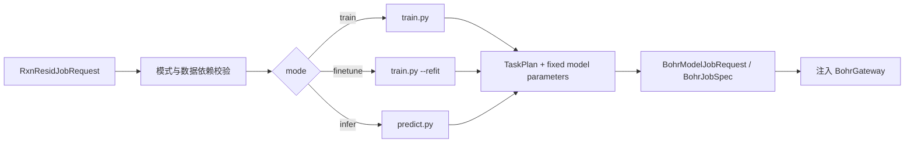

# tricycle-sar

`tricycle-sar` 是统一的 SAR 多模型协议与任务组件，管理模型后端、已验证的环境与训练/评估
协议、任务输入准备、执行器规划、五折基准和结果归档。当前包含 11 个模型后端，RxnResid
是其中之一；采样实验也通过本包复用 RxnResid 后端。

统一框架通过模型 profile 保留各模型的科学方法与环境差异，共用协议校验、环境初始化、
任务装配和结果处理。采样策略及其文献基线由
[`tricycle-sampling`](../tricycle-sampling/README.md) 管理。

## 能力与入口

| 入口 | 作用 |
| --- | --- |
| `list_backends()` / `get_backend(model)` | 查询、选择模型的当前方法 |
| `ModelBackend.prepare()` / `python -m tricycle_sar prepare` | 为所选模型准备训练/评估输入，绑定数据、划分、代码与环境 |
| `tricycle_sar.preparation` / `python -m tricycle_sar benchmark` | 组织共同数据和划分下的多模型基准 |
| `tricycle_sar.submission` / `python -m tricycle_sar requests` | 装配 Bohr 精简任务请求，保留内网执行器的方法绑定 |
| `python -m tricycle_sar results` | 校验结果、使用当前后端准备重跑、索引固定资产 |
| `get_backend("rxnresid")` / `tricycle_sar.sampling_runtime` | 为逐轮采样复用 RxnResid 训练、refit 和推理 |

当前后端包括：

| 模型组 | 后端 ID |
| --- | --- |
| 指纹模型 | `fingerprint_rf`、`fingerprint_extra_trees`、`fingerprint_ridge` |
| 分子模型 | `molclr`、`uam` |
| 反应图模型 | `chemprop_cgr`、`chemprop_multicomponent`、`rxnresid`、`rxngraphormer` |
| 序列模型 | `t5chem`、`reactiont5` |

`SarPlugin` 及 `sar.train`、`sar.finetune`、`sar.infer` 保留为 RxnResid 的任务接口。
跨模型任务使用上面的后端与基准入口；各模型支持的训练、评估或独立推理操作由其方法定义。

## 已验证的模型后端

版本与完整性绑定由配置维护，技能只引用配置入口与校验流程：

| 配置/清单 | 负责的绑定 |
| --- | --- |
| [`assets/rxnresid-model.toml`](src/tricycle_sar/assets/rxnresid-model.toml) | RxnResid 能力的 `model.repository`、`model.revision` 与原生入口 |
| [`backends/catalog.json`](src/tricycle_sar/backends/catalog.json) | 当前后端组合、执行器、镜像、资源和资产声明 |
| [`backends/environments/`](src/tricycle_sar/backends/environments/) | 各模型源码 revision、依赖与初始化参数 |
| [`backends/SHA256SUMS`](src/tricycle_sar/backends/SHA256SUMS) | 随包交付的运行文件校验值，由 catalog 的 `integrity` 引用 |

运行时从这些配置和清单读取预期值，准备与提交时校验，运行记录保存实际绑定。更新绑定值不要求更新技能；仅配置接口或操作流程改变时同步说明。这里不复制具体 commit 或校验值。

RxnResid 资产配置使用 `schema = "tricycle.rxnresid-model/v1"` 和 `[model]` 表，顶层只允许这两个字段；表内只接受 `RxnResidModelAsset` 声明的字段，`revision_kind` 只能为 `git-commit`。
环境引擎由 catalog 交付为 `common/sar_model_envs/engine.py` 并直接执行；worker、采样和本地环境入口共用这份实现。

环境初始化与训练/推理脚本经过 smoke 验证，直接维护本包内的当前实现。当前入口为 `backends/catalog.json`。所有模型通过 `backends/environments/engine.py` 初始化环境，通过 `backends/execution.py` 调度训练内核；`workers/unified.sh` 负责进入这个共同执行入口。profile 记录模型之间的镜像、源码、依赖、设备和安装差异，共同安装逻辑不再复制。`SHA256SUMS` 同时绑定 SAR 代码和实际交付的 core 共享文件；展开的 worker 文件表仅在准备阶段派生。

指标计算、原子写入、TOML、文件哈希和独立源码快照使用 `tricycle-core`。远程任务携带同一批源码文件组成 `sar_runtime` 命名空间，无需依赖本机 checkout。预测行校验及路径到底物对的聚合使用 `tricycle_sar.predictions`：预测均值按路径求平均，方差按路径求和，校验输入覆盖与非负方差。常数标签不输出未定义的 R²。

`backends/assets/` 中 MolCLR/UAM 的原始 README 随第三方资产保留，用于来源与引用；其中安装命令和论文实验不是 TriCycle 的执行指南。当前初始化方式以本包环境配置为准，不执行上游旧依赖安装示例。

只保留一份 catalog、registry、executor 和完整性索引，每个模型对应一套当前方法。没有历史 catalog、源码快照、兼容变体或自动回退加载。代码修改同步更新受影响的完整性绑定；未预期的漂移仍拒绝。

```python
from pathlib import Path
from tricycle_sar import get_backend

backend = get_backend("rxnresid")
backend.prepare(
    Path("dataset.csv"),
    Path("splits.csv"),
    Path("worker-input"),
    fold=0,
)
```

RxnResid 按环境配置使用指定源码并继承镜像环境；两种 Chemprop 共用环境与训练适配器；三个指纹模型共用 CPU runner。UAM/MolCLR 复用分子模型 runner，保留各自已验证设置，其中 MolCLR 使用配置指定的预训练权重。ReactionT5 随输入提供配置指定的本地权重/tokenizer/config，缺失或校验失败时在准备/提交前拒绝，不在训练节点临时从 HF 拉取；RXNGraphormer 按配置使用内网执行器。模型训练内核继续表达各自的科学协议；环境创建、解释器选择、阶段监督和输出处理经过共享入口。环境或代码漂移会被拒绝。其他模型的测试集推理由原训练/评估 runner 完成，RxnResid 另提供已验证的 `predict.py` 独立推理入口；不声称新增了其他模型的独立 checkpoint 推理协议。

数据、划分和模型实现分别管理。CPU/分子模型的科学参数保存在复用模板中，数据路径及哈希在准备时绑定，不把数据规模或某次快照哈希固化成模型限制。所有新任务和重跑都选择当前后端。已发布结果中的方法 ID 仅记录当时的计算来源，不指向可执行历史实现。

当前 worker 直接使用 `workers/unified.sh`，不保留模型名、环境类别或 `tools/` 下的 shell 薄转发。`workers/launch.sh` 负责执行与结果收集，`workers/base/sar_worker_common.sh` 负责公共运行上下文。

模型前后向 smoke 的唯一探针在 `diagnostics/model_probe.py`，由 catalog 和完整性索引绑定后交付。`preparation.smoke` 从已安装包读取探针，不依赖仓库 tools 路径；`--group-config` 必须显式传入任务组配置，不读取历史实验组。本地资产必须完整，worker 不保留在线下载脚本。

只读镜像清单使用 `python -m tricycle_sar.diagnostics.inventory --out-dir <目录>`。Bohr 输入通过 `python -m tricycle_sar.preparation.inventory --config configs/example-sar-inventory.toml --out-dir <新目录>` 准备，生成 `bohr-inventory.toml` 后再走正常 batch 流程。该清单检查可用解释器、模块和 GPU，不代表模型训练或推理通过。

## 实验记录与归档

发布结果的 `manifest.json` 使用 `backend.sha256` 记录计算来源。缺失该字段或携带旧哈希字段均报错；
核验不改写已有结果，也不要求其记录的哈希等于当前后端哈希。

`prepare_modelling` 使用包内当前后端及其完整性绑定。公共设置、方法选择及派生输入校验只记录在一份 `run.toml` 中，数据与统一划分通过共享资产引用保存；不另写 request/source/commands/scope/preflight/integrity 摘要。原生 snapshot/split/bundle 文件只在执行准备目录派生，供当前 runner 使用，不作为另一套模型定义或正式结果。

`tricycle_sar.submission` 使用 `records.compact_tasks` 提取相同字段，包括嵌套配置与哈希表。请求只包含 `task_defaults` 和逐 fold/seed/round 的 `task_specs`；完整逐折 TOML 在 Bohr staging 派生。`tricycle_sar.preparation` 统一调用包内方法装配 CPU、分子、原生及补充模型；调用方直接使用包内接口，`tools/` 中的 SAR Python 薄转发已移除。

先复制并填写 [`example-sar-benchmark.toml`](../../configs/example-sar-benchmark.toml) 的模型、数据/划分路径与 SHA-256；复制到其他目录时同步调整 `training_protocol.reference`。模板不引用本机报告，已有实验必须复用原划分。

`dataset`、`split` 拒绝未知字段。复用划分必须同时提供非空 `split.path` 和有效 `split.sha256`；文件缺失或哈希不符时停止，不重新生成替代划分。只有两项均未提供时，才按所选协议生成新实验的划分。

```bash
uv run --all-packages python -m tricycle_sar validate
uv run --all-packages python -m tricycle_sar benchmark prepare --config /path/to/filled-benchmark.toml --run-dir /path/to/new-run
uv run --all-packages python -m tricycle_sar requests --benchmark-run /path/to/new-run --out-dir /path/to/requests --job-group-name experiment --group-config /path/to/group.toml
```

这些命令本地规划，不安装模型环境、训练、联网或提交。镜像、环境初始化、训练/预测和执行器直接来自已验证的后端；不能根据节点错误换环境或安装配方。固定资产缺失或哈希错误时，在创建任务输出前拒绝。

`requests` 和 `preparation.classical/molecular/native/additional/all_models/smoke/environment` 必须传入 `--group-config`；
Python API 对应 `group_config=Path(...)`，配置提供 `project_id` 与 `job_group_id`。
可复制并填写 [`example-sar-bohr-group.toml`](../../configs/example-sar-bohr-group.toml)。没有隐式任务组默认值；`additional.prepare` 和 `write_bohr_request` API 也可显式传入 `project_id` 并指定新组名。
`--job-group-name` 指定新任务组名称时清空旧组 ID，并为后续提交设置 `auto_job_group=true`。

## 环境检查与重跑

模型 smoke 使用各准备模块的 `--include-smoke`；RxnResid/ReactionT5 的前向与反向 probe 使用 `python -m tricycle_sar.preparation.smoke`。probe 和环境检查直接交付共享执行入口，以 Bohr staging 的 `__bohr_task_script.sh` 文件名记录输入哈希，不调用要求完整预测表的训练结果收集器。

环境检查先生成输入引用与提交请求；固定资产在本地校验，上传时临时展开，执行时使用同一个初始化引擎：

```bash
uv run --all-packages python -m tricycle_sar.preparation.environment --model rxnresid --out-dir /path/to/environment-inputs --group-config /path/to/group.toml
uv run --all-packages python -m tricycle_sar results prepare --result-dir /path/to/published-results --model rxnresid --fold 0 --out-dir /path/to/rerun-inputs --retain-checkpoint
```

第二个命令保留正式结果的数据和划分，按当前后端生成重跑输入。所有准备命令均不安装或训练模型，不提交远程任务。模型选择使用 `--model`，实际 Bohr 请求由上述准备入口生成。

`tools/prepare_bohr_demo.py` 分别委托 RitS 和 SAR 包。其中的 RxnResid 演示使用当前采样实验的 `path_id/rxn_smiles/ene_id/diene_id/prod_id/G_T_activate` 格式，保持输入身份，接受任意来源的符合该格式的 CSV；逐轮累计标签训练、refit 和演示训练复用 `rxnresid.fit_all_revealed`。RitS 准备验证当前资产中的源码 revision 和 checkpoint 哈希，源码快照与原目录使用独立文件。

## 精简任务输出

包内 launcher 调用共享模型 worker，并直接收集训练目录中的科学结果；不复制整个 model-runs。

| 输出 | 内容 |
| --- | --- |
| `results/predictions.csv` | 所有已完成任务的预测，以 model/fold/reaction_id 区分 |
| `results/metrics.csv` | 从同一预测表重算的各折指标 |
| `results/status.csv` | 完成/失败、exit code、初始化重试次数、失败原因和下一步动作 |
| `worker.log` | 平台收集的一份运行日志 |

初始化由所有模型共用的环境引擎处理。pip 安装、curl 下载和 git fetch 的临时网络错误最多执行 3 次命令，间隔 5 秒、15 秒；每次 pip 安装最多 450 秒，初始化命令共享 1,800 秒累计预算。pip 自身的请求级重试仍受这个时限约束。镜像源拒绝访问、网络故障或返回空版本列表时可切到官方 PyPI；官方源仍无所需版本则直接失败，显式指定的安装源不被替换。重试保留已安装依赖和 pip 缓存，超时后先清理命令及其子进程再重试。

依赖冲突、哈希错误、证书错误、磁盘不足和代码错误直接失败。继承镜像 Torch 的 GPU 环境在安装前执行实际 CUDA 检查；检查无论成功或失败，都在 `worker.log` 记录 Python/Torch 路径、CUDA runtime、宿主驱动、驱动 API 版本和实际加载的 CUDA 库。失败记录 `failure_reason=cuda_preflight_failed`、`next_action=inspect_error`；先对照镜像、解释器和动态库证据定位问题，不凭报错文字判定节点故障或建议换节点。网络重试耗尽记录 `next_action=retry_job`，其他故障记录 `inspect_error`。这些动作是外层恢复依据，不会在 worker 内提交新的 Bohr 任务。训练和推理不自动整段重跑，未建立可靠 checkpoint 恢复协议时保留失败。

每次初始化命令的次数、耗时、预算和重试原因写入 `worker.log` 的 `[init-attempt]` 事件。精简输出将 `initialization_retries`、`failure_reason`、`next_action` 合入既有 `status.csv`，不另建日志副本。当前共用实现直接维护；明确的代码变更同步更新受影响的完整性绑定，不为常规修复复制一套历史实现。

默认不下载 checkpoint、安装目录、环境清单或阶段日志。需要继续训练时使用 `retain_checkpoint=True` / `--retain-checkpoint`，保留模型文件和必要配置；采样轨迹必须显式保留其后续 refit/infer 所需 checkpoint。已有任务保留原绑定。重跑在新目录中使用当前后端生成输入，准备阶段不提交任务。

`collect`/`publish` 直接读取这些合并表，不恢复逐折 CSV。Bohr 下载目录可通过 `--prediction-dir` 传入：

```bash
uv run --all-packages python -m tricycle_sar benchmark publish --run-dir /path/to/completed-run --prediction-dir /path/to/downloads --out-dir /path/to/result-package
```

实验报告和结果包保存在 Git 忽略的 `reports/` 或 `artifacts/`，不纳入源码提交；指南只说明接口与验收范围。

正式结果仅由 `tricycle_sar.results.publish` 导出：冻结数据/划分、一份 OOF、指标、分组方法绑定和一个科学 manifest；后端定义路径与 SHA 合入该 manifest，不再生成 protocol-ref。不得递归复制 run 或加入 raw/provenance/inputs、任务回执、执行日志及 checkpoint。同模型同方法的折合并为一行。大资产按固定哈希外置。

正式结果不复制核验、输入准备、资产索引或绘图脚本，也不重复绘图环境。统一使用包内复现入口：

```bash
uv run --all-packages python -m tricycle_sar results verify --result-dir /path/to/result-package
uv run --all-packages python -m tricycle_sar results prepare --result-dir /path/to/result-package --model rxnresid --fold 0 --out-dir /path/to/inputs
uv run --all-packages python -m tricycle_sar results assets --result-dir /path/to/result-package --file /path/to/fixed-asset --out-dir /path/to/shared-assets
```

`results prepare` 复用结果包的模型、折、数据和划分，使用当前后端准备新任务。`results assets` 按当前后端索引固定资产。`results verify` 独立校验已记录的数据、划分、OOF、指标及文件完整性，不加载当时的执行源码；返回的 `verification_scope` 为 `recorded-scientific-results`。上述操作不联网或执行模型训练，写入目录必须在报告外部。`verify` 不需要 NumPy、Matplotlib 或模型依赖；输入准备需要 NumPy。

离线分析与绘图统一位于根目录 [`analysis/`](../../analysis/README.md)，共用该目录的分析依赖锁。
`tricycle-sar` 提供结果校验和数据读取接口，分析代码调用这些接口。项目根目录的绘图入口为：

```bash
uv run --project analysis --locked python -m analysis.sar render --result-dir /path/to/result-package --out-dir /path/to/figures
```

GT 分布及底物组残差使用同一分析环境，通过 `python -m analysis.sar distributions --result-dir /path/to/result-package --out-dir /path/to/distributions` 生成总体图、三张独立图（PNG/PDF/SVG）及统计 JSON；`--style publication` 使用投稿布局并导出 SVG/PDF/PNG/TIFF。描述统计实现位于 `analysis/sar/distributions.py`。总体与组内残差按路径等权；组内残差为路径活化自由能减去 `(ene_id, diene_id)` 组均值，保留单路径组的零残差并另展示多路径组。组均值残差按组等权，以全部组均值的平均值为中心。全部尾部保留，方差及标准差使用 ddof=0；不是模型预测误差。输出必须在结果包之外，拒绝覆盖非空目录。

加 `--style publication` 使用 183 mm 三面板科研版式：主图为直方图，辅助图为 ECDF；导出可编辑 SVG、嵌入字体 PDF、300 dpi PNG 和 600 dpi TIFF。输出包含图注、替代文本、图形规格、可视化证据与来源哈希，以及由 Matplotlib 实测的文字/面板布局，供科研绘图技能执行审计。代码与绘图依赖统一维护在根目录 `analysis/`，报告引用该实现；版式不声明已核验特定期刊要求。

结果数值复算与重新训练分别核验。输入从包内后端与冻结数据/划分重新生成，不承诺恢复原上传目录或重新训练逐位一致。

## RxnResid 任务接口

原生插件 ID 为 `tricycle.sar`：

| 能力 | 作用 |
| --- | --- |
| `sar.train` | 规划 RxnResid 训练任务 |
| `sar.finetune` | 从 checkpoint 执行 refit/微调 |
| `sar.infer` | 规划 `predict.py` 推理任务 |
| `sar.bohr-submit` | 复用共享 Bohr 模型任务提交边界 |

`SarPlugin` 使用 `RxnResidJobRequest` 描述任务，底层复用
[`tricycle-bohr`](../tricycle-bohr/README.md) 的 `BohrModelPlugin`。

## RxnResid 模型资产和固定协议

默认资产位于 [`src/tricycle_sar/assets/rxnresid-model.toml`](src/tricycle_sar/assets/rxnresid-model.toml)。
它记录 repository、commit、配置路径、训练/推理入口和新版 evidential 不确定度输出字段；资产
读取是本地操作，不会自动联网。

`SarPlugin.plan_job()` 会校验并写入：

- `source_repository` 和 `source_revision`；
- train/infer/finetune 对应的 upstream entrypoint；
- `predict` 推理协议和 `refit` 微调协议；
- 默认 `config_path`、训练入口和推理入口。
- `uncertainty_method` 和 `uncertainty_fields`，其中 `epistemic_variance` 可供主动学习采样。

请求中提供冲突的源码版本或入口会被拒绝。这样生成的 Bohr 计划可以独立审查，不依赖运行
机器当前 checkout 的隐式版本。

`sar.*` 请求使用共享命令 builder，并匹配后端的镜像与机器类型。规划时核对本地源码与固定归档，
记录输入文件哈希；缺少本地目录的 dry-run 只产生待补齐计划。提交必须已有完整输入，并再次核对
输入及后端绑定；`single_job.py` 交付 `sampling_runtime` 的同一环境、源码与 API，随后调用原生入口。
自定义数据和原生配置仍由请求提供，不要求反应数据库字段。准备只写本地 run，不安装或提交。
本地命令装配也需要读取原生 YAML 来判断累计标签训练模式，因此 PyYAML 是本包的基础依赖，
随包安装；它不依赖 GPU 镜像或模型环境提供。

新版 `predict.py` 直接生成 `aleatoric_variance`、`epistemic_variance`、`predictive_variance`、
对应标准差和 95% 区间。将预测行放入候选 `payload` 后，可直接交给
[`tricycle-sampling`](../tricycle-sampling/README.md) 的 uncertainty 策略。

## RxnResid 命令构造

`tricycle_sar.commands` 生成命令参数但不启动外部进程：

| builder | 作用 |
| --- | --- |
| `build_training_command` | 生成 `train.py` 训练命令，支持 fold、split、epoch、device 等参数 |
| `build_finetune_command` | 生成 `train.py --refit --checkpoint ...`，使用新的 optimizer |
| `build_inference_command` | 生成 `predict.py --checkpoint --data --output` 推理命令 |

训练命令会检查多种 from-scratch 方案及其阶段 epoch 配置不能互相冲突；推理命令至少需要
checkpoint、输入数据和输出路径，可选 batch、CPU/mixed precision 及 component ID 列。

采样 worker 直接调用 `get_backend("rxnresid").training_command()`、`refit_command()` 和
`inference_command()`；这些接口复用上述 builder，可传 `source_directory` 和
`route_vocabulary`。route 词表适配、逐轮数据配置、全已揭示标签划分与 checkpoint 数据更新
集中在 [rxnresid.py](src/tricycle_sar/rxnresid.py)，采样调用方直接使用这些接口。

[sampling_runtime.py](src/tricycle_sar/sampling_runtime.py) 为采样任务本地交付 SAR 包、固定源码
归档和共享环境初始化文件；源码版本读取当前模型资产，不从历史 readiness 回退源码版本。
`stage(root)` 只准备文件，`verify(root)` 核对绑定，worker 执行时才调用共享初始化入口。
新任务绑定 `backends/catalog.json` 与 `SHA256SUMS`，镜像、源码和依赖版本由模型 profile 定义。
五折任务保留自己的 split；逐轮任务传入本轮已揭示数据与本轨迹 checkpoint，epoch/batch/seed
由实验共同配置提供。两个任务复用模型后端，数据划分仍表达各自评价问题。

累计标签划分标记为 `active_learning_all_selected_train` 时，后端自动选择
`--train-on-train-valid-from-scratch`，主模型、辅助模型和演示复用该规则；正常五折训练保留其验证集协议。
模型选择使用同一注册表中的具体后端名称；Chemprop 分别使用 `chemprop_cgr` 和 `chemprop_multicomponent`。准备模型子集只生成该子集的任务与资产。
CPU 环境的初始化监督由环境类型决定，使用 CPU 检查并隐藏 CUDA。

当前入口修正执行和安装路径解析，环境配方、模型源码、固定权重与依赖版本沿用已验证内容；
代码修复直接更新共用实现及受影响的绑定。共享 core 文件按已安装模块位置解析，
支持 workspace 与标准 `site-packages` 布局。

公共包交付 `py.typed`。实现旁的 `.pyi` 只声明静态接口，不执行或另存训练实现；
参数、默认值位置与 dataclass 字段由一致性测试核对。mypy 校验调用接口，Pyright 继续扫描实际源码，
方法完整性与运行回归分别检查；接口声明随当前实现同步维护。

预测校验按 `path_id` 与组件身份核对逐路径覆盖，底物对聚合保留多路径。
底物 ID 按字符串处理，`001` 和 `1` 是不同身份；科学结果先在临时目录完整核验，再发布到解析后的目标路径。

## RxnResid 任务工作流



这个任务插件负责规划和描述输入输出 artifact。实际代码、checkpoint、数据及原生 YAML 配置由
请求的 artifact/input directory 上传；worker 直接复用当前共享初始化入口和镜像环境。默认 dry-run 不访问 Bohr、不读取凭据。

## RxnResid 请求示例

仓库提供：

- [`configs/example-rxnresid-train-request.toml`](../../configs/example-rxnresid-train-request.toml)；
- [`configs/example-rxnresid-infer-request.toml`](../../configs/example-rxnresid-infer-request.toml)；
- [`configs/example-rxnresid-finetune-request.toml`](../../configs/example-rxnresid-finetune-request.toml)。

只规划一个推理任务：

```bash
uv run --package tricycle-agent tricycle-agent plan \
  sar.infer configs/example-rxnresid-infer-request.toml --run-id sar-infer-demo
```

真实提交需要显式 `--live`，并由应用注入 Bohr adapter。任务完成后的 job 状态、结果下载和
失败恢复使用 core 的 `run.toml`，不依赖对话上下文。

## RxnResid 数据输入与应用适配

RxnResid 是通用的反应性质回归模型，模型层消费原生配置、反应数据和 checkpoint。`sar.train`、`sar.finetune`、`sar.infer` 不依赖反应数据库，也不要求数据库项目、记录身份或导出流程。用户可提供自己的 CSV 与原生配置；反应列、目标列、条件列、component ID 列和 route 列由配置指定。具体映射与模型的 component roles 保持一致。

当前五折与采样实验选择 `rxn_smiles/G_T_activate/path_id/ene_id/diene_id/prod_id` 作为应用数据约定。这些列名与按底物对的划分、采样、方差聚合属于实验适配层。`write_round_config`、`write_all_train_manifest`、`fit_all_revealed` 是该累计标签训练协议的便利入口，通用训练直接使用用户的原生配置。

[`tricycle-reaction-db`](../tricycle-reaction-db/README.md) 提供一种可选数据来源，负责数据库查询和导出；其他来源的数据也可以接入 RxnResid。数据库的筛选与身份映射规则由数据库 adapter 负责，模型接口保持与数据来源无关。

## 验证

```bash
uv run pytest packages/tricycle-sar/tests
make check
```

操作边界见 [`.agents/skills/sar-infer/SKILL.md`](../../.agents/skills/sar-infer/SKILL.md) 以及
对应的 train/finetune skill。

采样 runtime 只交付 RxnResid 的已校验方法及所需资产。staging 生成当前后端的单模型目录投影，
保留原 method ID、文件 hash、源码、环境与训练参数；不交付其他模型的 tokenizer、源码归档或权重。
该目录是 worker 交付产物，不是另一份维护中的后端定义。跨 run 的资产去重由 core 的资产库负责，
采样控制器记录共享引用，提交 adapter 只在上传期间展开它们。

所有 SAR 后端的 benchmark 工作区、单模型准备目录和 batch `common/` 使用
`artifacts/task-assets` 内容寻址资产库；相同数据、源码、tokenizer 和固定权重跨 fold/run
共享文件，准备目录仅保留 `input-assets.json` 与请求记录，不保留输入目录软链接。batch 的完整输入引用记录在
`batch.toml.input_assets`，提交前同时校验方法、输入和共享资产。
benchmark 的 dataset、splits 和 workspace 通过 `tricycle_core.asset_store.resolve_input` 读取；
分析与结果发布保留原始数据/划分哈希，不再直接读取 run 下的输入路径。
`results prepare` 返回 `run_dir` 与 `input_assets_manifest`；命令中的路径相对于展开后的执行目录。
内部执行器调用 `tricycle_sar.delivery.materialize` 将记录展开到自行管理的临时目录。
Bohr adapter 只在上传期间展开独立可写输入并清理临时目录。内网或本地执行器先调用
`tricycle_sar.delivery.materialize(prepared, disposable)`，再传送或执行该临时目录，
避免传送指向本机资产库的符号链接；执行结束仅保存结果并清理临时输入。
当前 Bohr CLI 仍需逐作业上传必需资产，这不等于远端跨作业缓存。

worker 的 `results/` 仅收集合并预测、指标、状态和诊断。`retain_checkpoint=true`
按各模型 runner 的最终保存路径选择新模型：经典模型的 `model.joblib`，MolCLR/UAM/
ReactionT5/RXNGraphormer 的 `best.pt`，RxnResid 的 `checkpoint.pt`，Chemprop 的
`train/model_*/best.pt`，以及 T5Chem 最终模型与配套 tokenizer/config。
不按文件扩展名递归归档；上传权重、refit 输入、预处理数据、优化器和中间 checkpoint
不属于下载结果。未请求的模型/折不会被本任务新收集。

原生 `sar.train/finetune/infer` 必须声明相对 `--output`，且与上传输入及运行源码目录分离。
原生计算先写临时工作目录，再把新 checkpoint、预测和诊断发布到声明的结果路径；
下载选择器固定为该结果路径与 `worker.log`，不会回传 `job-inputs/` 或运行资产。

已完成任务的 `modelling_benchmark.collect` 使用 `check_data` 核对冻结数据/划分及输入哈希，
随后校验全模型五折预测的覆盖、行身份、目标与有限指标；科学评估不要求当前后端仍与历史
执行版本相同。用于准备/执行的 `check` 仍须校验精确方法与资产绑定，不能用结果核验替代它。
