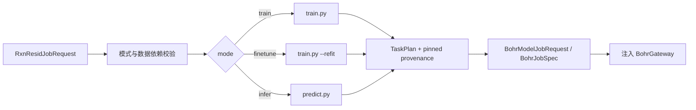

# tricycle-sar

`tricycle-sar` 是 RxnResid 模型任务组件。虽然包名和能力保留 `sar.*` 兼容命名，但实际模型
是 RxnResid，负责训练、微调/重拟合和推理任务的请求校验、命令构造及 Bohr 规划。

## 能力

原生插件 ID 为 `tricycle.sar`：

| 能力 | 作用 |
| --- | --- |
| `sar.train` | 规划 RxnResid 训练任务 |
| `sar.finetune` | 从 checkpoint 执行 refit/微调 |
| `sar.infer` | 规划 `predict.py` 推理任务 |
| `sar.bohr-submit` | 复用共享 Bohr 模型任务提交边界 |

`SarPlugin` 和命名更明确的 `RxnResidPlugin` 都可作为入口，底层复用
[`tricycle-bohr`](../tricycle-bohr/README.md) 的 `BohrModelPlugin`。

## 模型资产和固定协议

默认资产位于 [`src/tricycle_sar/assets/rxnresid-model.toml`](src/tricycle_sar/assets/rxnresid-model.toml)。
它记录 repository、commit、配置路径、训练/推理入口和新版 evidential 不确定度输出字段；资产
读取是本地操作，不会自动联网。

`SarPlugin.plan_job()` 会校验并写入：

- `source_repository` 和 `source_revision`；
- train/infer/finetune 对应的 upstream entrypoint；
- `predict` 推理协议和 `refit` 微调协议；
- 默认 `config_path`、训练入口和推理入口。
- `uncertainty_method` 和 `uncertainty_fields`，其中 `epistemic_variance` 可供主动学习采样。

请求中提供冲突的源码版本或入口会被拒绝。这样生成的 Bohr 计划可以独立审查，不依赖运行
机器当前 checkout 的隐式版本。

新版 `predict.py` 直接生成 `aleatoric_variance`、`epistemic_variance`、`predictive_variance`、
对应标准差和 95% 区间。将预测行放入候选 `payload` 后，可直接交给
[`tricycle-sampling`](../tricycle-sampling/README.md) 的 uncertainty 策略。

## 命令构造

`tricycle_sar.commands` 生成命令参数但不启动外部进程：

| builder | 作用 |
| --- | --- |
| `build_training_command` | 生成 `train.py` 训练命令，支持 fold、split、epoch、device 等参数 |
| `build_finetune_command` | 生成 `train.py --refit --checkpoint ...`，使用新的 optimizer |
| `build_refit_command` / `build_fine_tuning_command` | 微调 builder 的兼容别名 |
| `build_inference_command` | 生成 `predict.py --checkpoint --data --output` 推理命令 |

训练命令会检查多种 from-scratch 方案及其阶段 epoch 配置不能互相冲突；推理命令至少需要
checkpoint、输入数据和输出路径，可选 batch、CPU/mixed precision 及 component ID 列。

## 工作流



该组件只规划任务和描述输入输出 artifact。实际代码、checkpoint、数据及原生 YAML 配置由
请求的 artifact/input directory 上传；worker 启动脚本通常用系统 Python 安装当前项目后执行
上游命令。默认 dry-run 不访问 Bohr、不读取凭据。

## 请求示例

仓库提供：

- [`configs/example-rxnresid-train-request.toml`](../../configs/example-rxnresid-train-request.toml)；
- [`configs/example-rxnresid-infer-request.toml`](../../configs/example-rxnresid-infer-request.toml)；
- [`configs/example-rxnresid-finetune-request.toml`](../../configs/example-rxnresid-finetune-request.toml)。

只规划一个推理任务：

```bash
uv run --package tricycle-agent tricycle-agent plan \
  sar.infer configs/example-rxnresid-infer-request.toml --run-id sar-infer-demo
```

真实提交需要显式 `--live`，并由应用注入 Bohr adapter。任务完成后的 job 状态、结果下载和
失败恢复使用 core 的 `run.toml`，不依赖对话上下文。

## 与 reaction database 的关系

RxnResid 数据集导出由 [`tricycle-reaction-db`](../tricycle-reaction-db/README.md) 负责。该
组件消费 adapter 按数据库权威筛选导出的 mapped reaction、自由能和反应物/TS/产物计算时间，
不会在 SAR 包中重新解析数据库 schema 或本地拼接训练表。

## 验证

```bash
uv run pytest packages/tricycle-sar/tests
make check
```

操作边界见 [`.agents/skills/sar-infer/SKILL.md`](../../.agents/skills/sar-infer/SKILL.md) 以及
对应的 train/finetune skill。
