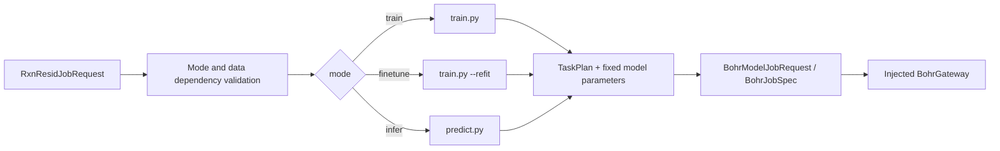

# tricycle-sar

`tricycle-sar` provides shared SAR model protocols and job infrastructure: model backends, validated environments and training/evaluation protocols, input preparation, executor planning, five-fold benchmarks, and result archiving. It currently includes 11 backends. RxnResid is one of them and also serves sampling experiments through this package.

Model profiles preserve scientific methods and environment differences while sharing protocol validation, environment initialization, job assembly, and result handling. [`tricycle-sampling`](../tricycle-sampling/README.md) owns sampling strategies and their literature baselines.

## Capabilities and entry points

| Entry point | Purpose |
| --- | --- |
| `list_backends()` / `get_backend(model)` | Query/select each model's current method |
| `ModelBackend.prepare()` / `python -m tricycle_sar prepare` | Prepare selected-model training/evaluation inputs, binding data, splits, code, and environment |
| `tricycle_sar.preparation` / `python -m tricycle_sar benchmark` | Organize multimodel benchmarks on shared data and splits |
| `tricycle_sar.submission` / `python -m tricycle_sar requests` | Assemble compact Bohr requests while retaining method bindings for internal-network executors |
| `python -m tricycle_sar results` | Verify results, prepare reruns with current backends, and index fixed assets |
| `get_backend("rxnresid")` / `tricycle_sar.sampling_runtime` | Reuse RxnResid training, refit, and inference for round-by-round sampling |

Current backends:

| Model family | Backend IDs |
| --- | --- |
| Fingerprint models | `fingerprint_rf`, `fingerprint_extra_trees`, `fingerprint_ridge` |
| Molecular models | `molclr`, `uam` |
| Reaction graph models | `chemprop_cgr`, `chemprop_multicomponent`, `rxnresid`, `rxngraphormer` |
| Sequence models | `t5chem`, `reactiont5` |

`SarPlugin` and `sar.train`, `sar.finetune`, and `sar.infer` remain RxnResid job interfaces. Cross-model jobs use the backend/benchmark entry points above. Each method defines its supported training, evaluation, or standalone inference operations.

## Validated model backends

Configuration owns version and integrity bindings; skills reference configuration entry points and validation procedures:

| Configuration/manifest | Bindings |
| --- | --- |
| [`assets/rxnresid-model.toml`](src/tricycle_sar/assets/rxnresid-model.toml) | RxnResid `model.repository`, `model.revision`, and native entry points |
| [`backends/catalog.json`](src/tricycle_sar/backends/catalog.json) | Current backend composition, executors, images, resources, and asset declarations |
| [`backends/environments/`](src/tricycle_sar/backends/environments/) | Model source revisions, dependencies, and initialization parameters |
| [`backends/SHA256SUMS`](src/tricycle_sar/backends/SHA256SUMS) | Packaged runtime-file checksums, referenced by catalog `integrity` |

Runtime reads expected values from these configurations/manifests, verifies them during preparation/submission, and records actual bindings. Binding-value changes do not require skill edits; configuration interface or workflow changes do. Concrete commits and hashes are not duplicated here.

RxnResid assets use `schema = "tricycle.rxnresid-model/v1"` and `[model]`, the only allowed top-level fields. The table accepts only `RxnResidModelAsset` fields; `revision_kind` must be `git-commit`. The catalog delivers the environment engine as `common/sar_model_envs/engine.py` for direct execution; workers, sampling, and local environment entry points share this implementation.

Environment initialization and training/inference scripts have passed smoke validation and are maintained as current package implementations. `backends/catalog.json` is the current entry point. All models initialize through `backends/environments/engine.py` and dispatch training kernels through `backends/execution.py`; `workers/unified.sh` enters that shared execution path. Profiles record image, source, dependency, device, and installation differences without duplicating common installation logic. `SHA256SUMS` binds SAR code and delivered core files; expanded worker file lists are derived only during preparation.

Metrics, atomic writes, TOML, file hashing, and independent source snapshots use `tricycle-core`. Remote jobs carry the same source files in a `sar_runtime` namespace without relying on the local checkout. `tricycle_sar.predictions` validates prediction rows and aggregates routes to substrate pairs: predicted means are averaged, variances summed, input coverage checked, and negative variances rejected. Constant labels do not produce undefined R² values.

Original MolCLR/UAM READMEs under `backends/assets/` are retained with third-party assets for provenance and citations. Their installation commands and paper experiments are not TriCycle execution instructions. Current package environment configurations govern initialization; do not execute upstream legacy dependency examples.

There is one catalog, registry, executor, and integrity index, with one current method per model. No historical catalogs, source snapshots, compatibility variants, or automatic fallback loaders are maintained. Intentional code edits update affected integrity bindings; unexpected drift remains an error.

```python
from pathlib import Path
from tricycle_sar import get_backend

backend = get_backend("rxnresid")
backend.prepare(
    Path("dataset.csv"),
    Path("splits.csv"),
    Path("worker-input"),
    fold=0,
)
```

RxnResid uses configured source and inherits the image environment. Both Chemprop models share an environment and training adapter; the three fingerprint models share a CPU runner. UAM/MolCLR share the molecular runner while preserving validated settings, including configured MolCLR pretrained weights. ReactionT5 inputs include configured local weights/tokenizer/config; missing or invalid assets fail preparation/submission rather than triggering HF downloads on training nodes. RXNGraphormer uses its configured internal-network executor.

Training kernels retain each model's scientific protocol while environment creation, interpreter selection, stage supervision, and output handling use shared entry points. Environment/source drift is rejected. Other models perform test-set inference through their original training/evaluation runners. RxnResid additionally exposes validated standalone `predict.py`; this package does not claim standalone checkpoint inference protocols for other models.

Data, splits, and model implementations are managed separately. CPU/molecular scientific parameters reside in reusable templates; data paths/hashes bind during preparation, without hardcoding dataset sizes or individual snapshot hashes as model constraints. All new jobs and reruns select current backends. Published method IDs record historical computation sources, not executable historical implementations.

Workers directly use `workers/unified.sh`. There are no thin shell wrappers by model, environment category, or under `tools/`. `workers/launch.sh` handles execution/result collection; `workers/base/sar_worker_common.sh` handles common runtime context.

The sole forward/backward smoke probe is `diagnostics/model_probe.py`, delivered with catalog and integrity bindings. `preparation.smoke` reads it from the installed package, without repository tools paths. `--group-config` must explicitly specify job-group configuration rather than read historical groups. Local assets must be complete; workers retain no online download scripts.

For a read-only image inventory, use `python -m tricycle_sar.diagnostics.inventory --out-dir <directory>`. Prepare Bohr inputs with `python -m tricycle_sar.preparation.inventory --config configs/example-sar-inventory.toml --out-dir <new-directory>`, then follow the normal batch workflow using generated `bohr-inventory.toml`. Inventory checks interpreters, modules, and GPUs; it does not establish successful model training/inference.

## Experiment records and archiving

Published `manifest.json` uses `backend.sha256` to record computation provenance. Missing fields or legacy hash fields are errors. Verification neither rewrites existing results nor requires their recorded backend hash to equal the current hash.

`prepare_modelling` uses current packaged backends and integrity bindings. One `run.toml` records common settings, method selection, and derived-input checks; shared asset references retain data and common splits. It creates no separate request/source/commands/scope/preflight/integrity summaries. Native snapshot/split/bundle files are derived only in execution preparation directories for current runners, not maintained as alternative model definitions or formal results.

`tricycle_sar.submission` uses `records.compact_tasks` to extract shared fields, including nested configurations and hash tables. Requests contain only `task_defaults` and per-fold/seed/round `task_specs`; Bohr staging derives full fold TOML. `tricycle_sar.preparation` assembles CPU, molecular, native, and additional models through package methods. Callers use package APIs directly; SAR Python forwarding scripts under `tools/` have been removed.

Copy [`example-sar-benchmark.toml`](../../configs/example-sar-benchmark.toml) and fill in models, data/split paths, and SHA-256 values. When relocating it, update `training_protocol.reference`. The template references no local reports; existing experiments must reuse original splits.

`dataset` and `split` reject unknown fields. Reusing a split requires both nonempty `split.path` and valid `split.sha256`. A missing file or hash mismatch stops preparation without generating a replacement. Only when both are absent may the selected protocol generate a split for a new experiment.

```bash
uv run --all-packages python -m tricycle_sar validate
uv run --all-packages python -m tricycle_sar benchmark prepare --config /path/to/filled-benchmark.toml --run-dir /path/to/new-run
uv run --all-packages python -m tricycle_sar requests --benchmark-run /path/to/new-run --out-dir /path/to/requests --job-group-name experiment --group-config /path/to/group.toml
```

These commands plan locally without installing environments, training, networking, or submitting. Images, environment initialization, training/prediction, and executors come directly from validated backends. Node errors do not authorize changing environments or installation recipes. Missing or invalid fixed assets fail before task output creation.

`requests` and `preparation.classical/molecular/native/additional/all_models/smoke/environment` require `--group-config`; Python APIs use `group_config=Path(...)`. Configuration supplies `project_id` and `job_group_id`. Copy and fill [`example-sar-bohr-group.toml`](../../configs/example-sar-bohr-group.toml). There are no implicit job-group defaults. `additional.prepare` and `write_bohr_request` may instead receive explicit `project_id` and a new group name. Supplying `--job-group-name` for a new group clears the old ID and sets `auto_job_group=true` for submission.

## Environment checks and reruns

Use preparation modules' `--include-smoke` for model smoke tests; RxnResid/ReactionT5 forward/backward probes use `python -m tricycle_sar.preparation.smoke`. Probes and environment checks deliver the shared execution entry point directly, recording its input hash under Bohr staging filename `__bohr_task_script.sh`. They do not invoke the training-result collector that requires complete prediction tables.

Environment checks first create input references and submission requests. Fixed assets are validated locally, materialized temporarily for upload, and executed through the same initialization engine:

```bash
uv run --all-packages python -m tricycle_sar.preparation.environment --model rxnresid --out-dir /path/to/environment-inputs --group-config /path/to/group.toml
uv run --all-packages python -m tricycle_sar results prepare --result-dir /path/to/published-results --model rxnresid --fold 0 --out-dir /path/to/rerun-inputs --retain-checkpoint
```

The second command preserves published data/splits and prepares rerun inputs with the current backend. Preparation neither installs/trains models nor submits jobs. Select models with `--model`; preparation entry points generate actual Bohr requests.

`tools/prepare_bohr_demo.py` delegates to RitS and SAR packages. Its RxnResid demo uses the sampling experiment's `path_id/rxn_smiles/ene_id/diene_id/prod_id/G_T_activate` format, preserving input identities and accepting conforming CSVs from any source. Cumulative-label training, refit, and demo training share `rxnresid.fit_all_revealed`. RitS preparation verifies current asset source revision/checkpoint hashes; source snapshots use files independent of the original directory.

## Compact job outputs

The package launcher calls the shared model worker and collects scientific outputs directly from training directories without copying complete model-runs trees.

| Output | Contents |
| --- | --- |
| `results/predictions.csv` | Predictions for completed tasks, identified by model/fold/reaction_id |
| `results/metrics.csv` | Fold metrics recomputed from the same prediction table |
| `results/status.csv` | Completion/failure, exit code, initialization retries, failure reason, and next action |
| `worker.log` | One platform-collected runtime log |

All models share environment-engine initialization. Transient pip installation, curl download, and git fetch errors allow at most three command attempts with 5- and 15-second delays. Each pip installation has a 450-second limit; initialization commands share a cumulative 1,800-second budget. Pip's own request retries remain subject to that deadline. If a mirror denies access, fails on networking, or returns an empty version list, initialization may switch to official PyPI. Missing required versions on official PyPI fail directly; explicitly configured installation sources are not replaced. Retries preserve installed dependencies and pip caches. After timeout, the command and descendants are cleaned up before retrying.

Dependency conflicts, hash errors, certificate errors, disk exhaustion, and code errors fail immediately. GPU environments inheriting image Torch run an actual CUDA preflight before installation. Whether successful or failed, `worker.log` records Python/Torch paths, CUDA runtime, host driver, driver API version, and loaded CUDA libraries. Failure records `failure_reason=cuda_preflight_failed` and `next_action=inspect_error`. Diagnose from image, interpreter, and dynamic-library evidence before attributing failure to a node or recommending another node based only on error text.

Exhausted network retries record `next_action=retry_job`; other failures record `inspect_error`. These guide outer recovery and never submit new Bohr jobs from workers. Training/inference are not automatically rerun wholesale; failures remain recorded when no reliable checkpoint recovery protocol exists.

`[init-attempt]` events in `worker.log` record attempts, elapsed time, budget, and retry reasons for each initialization command. Compact output adds `initialization_retries`, `failure_reason`, and `next_action` to existing `status.csv` without duplicate logs. The current shared implementation is maintained directly; intentional fixes update affected integrity bindings without creating historical implementation copies.

By default, downloads exclude checkpoints, installation directories, environment inventories, and stage logs. To continue training, use `retain_checkpoint=True` / `--retain-checkpoint` to preserve model files and necessary configuration. Sampling trajectories must explicitly retain checkpoints required by later refit/inference. Existing jobs retain original bindings. Reruns prepare inputs in new directories with current backends; preparation does not submit.

`collect`/`publish` read merged tables directly without reconstructing per-fold CSVs. Supply Bohr downloads through `--prediction-dir`:

```bash
uv run --all-packages python -m tricycle_sar benchmark publish --run-dir /path/to/completed-run --prediction-dir /path/to/downloads --out-dir /path/to/result-package
```

Experiment reports/result packages belong in Git-ignored `reports/` or `artifacts/`, outside source commits. Guides document interfaces and acceptance scope only.

Only `tricycle_sar.results.publish` exports formal results: frozen data/splits, one OOF table, metrics, grouped method bindings, and one scientific manifest. Backend definition paths and SHA values enter that manifest; no separate protocol-ref is generated. Do not recursively copy runs or include raw/provenance/inputs, task receipts, execution logs, or checkpoints. Folds sharing a model/method merge into one row. Large assets are externalized by fixed hash.

Formal results copy no verification, input-preparation, asset-indexing, or plotting scripts and no duplicate plotting environment. Use packaged reproduction entry points:

```bash
uv run --all-packages python -m tricycle_sar results verify --result-dir /path/to/result-package
uv run --all-packages python -m tricycle_sar results prepare --result-dir /path/to/result-package --model rxnresid --fold 0 --out-dir /path/to/inputs
uv run --all-packages python -m tricycle_sar results assets --result-dir /path/to/result-package --file /path/to/fixed-asset --out-dir /path/to/shared-assets
```

`results prepare` reuses the package's model, fold, data, and splits with current backends. `results assets` indexes fixed assets against current backends. `results verify` independently checks recorded data, splits, OOF, metrics, and file integrity without loading historical execution source; it returns `verification_scope=recorded-scientific-results`. These operations neither network nor train models, and writable directories must be outside the report. Verification needs no NumPy, Matplotlib, or model dependencies; input preparation requires NumPy.

Offline analysis and plotting share the root [`analysis/`](../../analysis/README.md) environment lock. Analysis calls `tricycle-sar` result validation/data-reading interfaces. From the repository root:

```bash
uv run --project analysis --locked python -m analysis.sar render --result-dir /path/to/result-package --out-dir /path/to/figures
```

GT distributions and substrate-group residuals use the same environment. `python -m analysis.sar distributions --result-dir /path/to/result-package --out-dir /path/to/distributions` generates a combined figure, three separate figures (PNG/PDF/SVG), and statistical JSON. `--style publication` selects publication layout and exports SVG/PDF/PNG/TIFF. Descriptive statistics live in `analysis/sar/distributions.py`.

Overall and within-group residual distributions weight routes equally. Within-group residuals subtract the `(ene_id, diene_id)` group mean from route activation free energy; singleton zero residuals are retained, with multiroute groups also shown separately. Group-mean residuals weight groups equally and center on the mean of all group means. All tails are retained; variance/standard deviation use ddof=0. These are not model prediction errors. Outputs must be outside the result package, and nonempty directories cannot be overwritten.

`--style publication` uses a 183 mm, three-panel scientific layout with primary histograms and supporting ECDFs. Exports include editable SVG, font-embedded PDF, 300 dpi PNG, and 600 dpi TIFF. Outputs contain captions, alt text, figure specifications, visual evidence/source hashes, and Matplotlib-measured text/panel layouts for scientific-figure skill audits. Root `analysis/` owns code and plotting dependencies; reports reference that implementation. The layout does not claim verified compliance with a specific journal.

Numerical result recomputation and retraining are verified separately. Inputs are regenerated from packaged backends and frozen data/splits; neither restoration of the original upload directory nor bitwise-identical retraining is promised.

## RxnResid job interface

The native plugin ID is `tricycle.sar`:

| Capability | Purpose |
| --- | --- |
| `sar.train` | Plan RxnResid training |
| `sar.finetune` | Refit/fine-tune from a checkpoint |
| `sar.infer` | Plan `predict.py` inference |
| `sar.bohr-submit` | Reuse the shared Bohr model submission boundary |

`SarPlugin` describes jobs with `RxnResidJobRequest`, reusing [`tricycle-bohr`](../tricycle-bohr/README.md)'s `BohrModelPlugin`.

## RxnResid model assets and fixed protocol

Default assets reside in [`src/tricycle_sar/assets/rxnresid-model.toml`](src/tricycle_sar/assets/rxnresid-model.toml). They record repository, commit, configuration paths, training/inference entry points, and current evidential uncertainty output fields. Asset loading is local and never automatically networks.

`SarPlugin.plan_job()` validates and records:

- `source_repository` and `source_revision`.
- The train/infer/finetune upstream entry point.
- `predict` inference and `refit` fine-tuning protocols.
- Default `config_path`, training entry point, and inference entry point.
- `uncertainty_method` and `uncertainty_fields`, including `epistemic_variance` for active learning.

Conflicting source versions/entry points are rejected. Generated Bohr plans can therefore be reviewed independently of implicit checkout versions on execution machines.

`sar.*` requests use shared command builders and match backend image/machine types. Planning checks local source and fixed archives and records input hashes. Dry-run without a local directory yields an incomplete plan to be filled. Submission requires complete inputs and rechecks input/backend bindings. `single_job.py` delivers the same environment, source, and API as `sampling_runtime`, then invokes native entry points. Requests still supply custom data/native configurations without requiring reaction-database fields. Preparation writes local runs without installation or submission. Local command assembly reads native YAML to identify cumulative-label training, so PyYAML is a base package dependency rather than an assumed GPU-image/model-environment dependency.

Current `predict.py` directly produces `aleatoric_variance`, `epistemic_variance`, `predictive_variance`, corresponding standard deviations, and 95% intervals. Prediction rows placed in candidate `payload` can feed [`tricycle-sampling`](../tricycle-sampling/README.md) uncertainty strategies directly.

## RxnResid command construction

`tricycle_sar.commands` builds arguments without launching subprocesses:

| Builder | Purpose |
| --- | --- |
| `build_training_command` | Build `train.py` commands with fold, split, epoch, device, and related arguments |
| `build_finetune_command` | Build `train.py --refit --checkpoint ...` with a new optimizer |
| `build_inference_command` | Build `predict.py --checkpoint --data --output` |

Training validates that from-scratch schemes and their stage-epoch settings do not conflict. Inference requires checkpoint, input data, and output paths, with optional batch, CPU/mixed-precision, and component-ID columns.

Sampling workers directly call `get_backend("rxnresid").training_command()`, `refit_command()`, and `inference_command()`. These reuse the builders and accept `source_directory` and `route_vocabulary`. [rxnresid.py](src/tricycle_sar/rxnresid.py) centralizes route-vocabulary adaptation, round data configuration, all-revealed-label splits, and checkpoint data updates; sampling callers use these APIs directly.

[sampling_runtime.py](src/tricycle_sar/sampling_runtime.py) locally delivers SAR, fixed source archives, and shared environment initialization files for sampling jobs. It reads source versions from current model assets without falling back to historical readiness records. `stage(root)` only prepares files; `verify(root)` checks bindings; workers invoke shared initialization at execution time. New jobs bind `backends/catalog.json` and `SHA256SUMS`; model profiles define image, source, and dependency versions.

Five-fold jobs retain their splits. Round jobs receive current revealed data and the same trajectory's checkpoint; common experiment configuration supplies epoch/batch/seed. Both reuse the model backend while keeping splits appropriate to their evaluation questions.

When cumulative-label splits are marked `active_learning_all_selected_train`, the backend automatically selects `--train-on-train-valid-from-scratch`. Main models, auxiliary models, and demos share this rule; ordinary five-fold training retains its validation-set protocol. Model selection uses concrete registry backend names, including separate `chemprop_cgr` and `chemprop_multicomponent`. Subset preparation generates only selected-model tasks/assets. Environment type determines CPU initialization supervision, which uses CPU checks and hides CUDA.

Current entry points resolve execution/installation paths while retaining validated environment recipes, model source, fixed weights, and dependencies. Fixes update shared implementations and affected bindings directly. Shared core files are located from installed modules, supporting both workspace and standard `site-packages` layouts.

Public packages deliver `py.typed`. Adjacent `.pyi` files declare static interfaces without executing or duplicating training implementations. Consistency tests check parameters, default positions, and dataclass fields. Mypy checks calling interfaces; Pyright scans actual source; method integrity and runtime regressions are checked separately. Interface declarations track current implementations.

Prediction validation checks per-route coverage against `path_id` and component identities; substrate-pair aggregation retains multiple routes. Substrate IDs are strings, so `001` and `1` differ. Scientific results are fully verified in a temporary directory before publication to the resolved destination.

## RxnResid workflow



The plugin plans and describes input/output artifacts. Actual source, checkpoints, data, and native YAML arrive through request artifacts/input directories. Workers reuse current shared initialization and image environments directly. Default dry-run neither accesses Bohr nor reads credentials.

## RxnResid request examples

The repository provides:

- [`configs/example-rxnresid-train-request.toml`](../../configs/example-rxnresid-train-request.toml).
- [`configs/example-rxnresid-infer-request.toml`](../../configs/example-rxnresid-infer-request.toml).
- [`configs/example-rxnresid-finetune-request.toml`](../../configs/example-rxnresid-finetune-request.toml).

Plan inference only:

```bash
uv run --package tricycle-agent tricycle-agent plan \
  sar.infer configs/example-rxnresid-infer-request.toml --run-id sar-infer-demo
```

Real submission requires explicit `--live` and an application-injected Bohr adapter. Post-job status, download, and recovery use core `run.toml` rather than conversational context.

## RxnResid data inputs and application adaptation

RxnResid is a general reaction-property regression model consuming native configuration, reaction data, and checkpoints. `sar.train`, `sar.finetune`, and `sar.infer` do not depend on the reaction database or require database projects, record identities, or export workflows. Users may supply CSVs and native configurations defining reaction, target, condition, component-ID, and route columns. Mappings must match model component roles.

Current five-fold and sampling experiments choose `rxn_smiles/G_T_activate/path_id/ene_id/diene_id/prod_id` as the application data convention. These column names, substrate-pair splitting/sampling, and variance aggregation belong to experiment adaptation. `write_round_config`, `write_all_train_manifest`, and `fit_all_revealed` are convenience entry points for cumulative-label training; general training uses user native configuration directly.

[`tricycle-reaction-db`](../tricycle-reaction-db/README.md) is an optional data source responsible for querying/exporting. Other data sources can also feed RxnResid. Database adapters own database filtering/identity mappings; model interfaces remain source-independent.

## Validation

```bash
uv run pytest packages/tricycle-sar/tests
make check
```

See [`.agents/skills/sar-infer/SKILL.md`](../../.agents/skills/sar-infer/SKILL.md) and the corresponding train/finetune skills for operational boundaries.

Sampling runtime delivers only the validated RxnResid method and required assets. Staging creates a single-model projection of the current catalog, preserving method ID, file hashes, source, environment, and training parameters, without other models' tokenizers, source archives, or weights. This is a worker delivery artifact, not another maintained backend definition. Core's asset store deduplicates across runs; sampling controllers record shared references and submission adapters materialize them only during upload.

All SAR benchmark workspaces, single-model preparation directories, and batch `common/` use the content-addressed `artifacts/task-assets` store. Identical data, source, tokenizers, and fixed weights share files across folds/runs. Preparation directories retain only `input-assets.json` and request records, without input-directory symlinks. `batch.toml.input_assets` records complete batch inputs; method, inputs, and shared assets are checked together before submission.

Benchmarks read datasets, splits, and workspaces through `tricycle_core.asset_store.resolve_input`. Analysis/result publication preserve original data/split hashes rather than reading run-local input paths directly. `results prepare` returns `run_dir` and `input_assets_manifest`; command paths are relative to the materialized execution directory.

Internal executors call `tricycle_sar.delivery.materialize` into caller-managed temporary directories. The Bohr adapter materializes independent writable inputs only for upload, then cleans them up. Internal-network/local executors call `tricycle_sar.delivery.materialize(prepared, disposable)` before transferring/executing temporary inputs, avoiding symlinks to local asset stores. After execution, retain results and remove temporary inputs. Bohr CLI still uploads required assets per job; this is not cross-job remote caching.

Worker `results/` collects only merged predictions, metrics, status, and diagnostics. `retain_checkpoint=true` selects newly saved models at runner-specific final paths: classical `model.joblib`; MolCLR/UAM/ReactionT5/RXNGraphormer `best.pt`; RxnResid `checkpoint.pt`; Chemprop `train/model_*/best.pt`; and T5Chem final model plus tokenizer/config. Collection does not recurse by extension. Uploaded weights, refit inputs, preprocessed data, optimizers, and intermediate checkpoints are excluded. Unrequested models/folds are not newly collected by the job.

Native `sar.train/finetune/infer` require relative `--output` paths separate from uploaded input/runtime-source directories. Computation first writes a temporary workspace, then publishes new checkpoints, predictions, and diagnostics to the declared output. Download selectors contain only that path and `worker.log`, never `job-inputs/` or runtime assets.

For completed jobs, `modelling_benchmark.collect` uses `check_data` to verify frozen data/splits/input hashes, then checks complete five-fold prediction coverage across models, row identities, targets, and finite metrics. Scientific evaluation does not require current backends to match historical execution versions. Preparation/execution `check` still enforces exact method/asset bindings; result verification cannot replace it.

## Scientific identity and recorded publication

`protocol_identity.py` partitions scientific dependencies from explicitly reviewed
post-result storage code. New benchmark `run.toml` records retain both scientific
and complete delivery fingerprints, per-component hashes, and selector identity.
Storage-only differences do not by themselves establish different scientific
methods. Exact-byte validation still governs prepared live execution.

`python -m tricycle_sar results publish-recorded` publishes completed observations
from original run/data/split/prediction records without loading a historical
backend. Original identities are retained and metrics independently recomputed.
See [reproducible results](../../docs/reproducible-results.md) for commands and limits.
